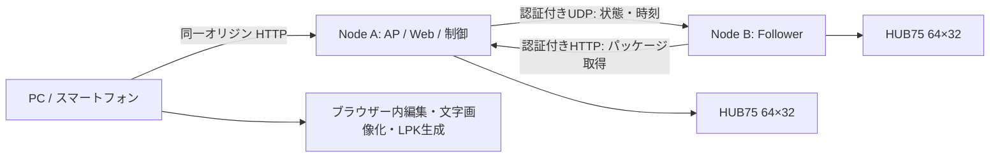

# 01. 要件・構成・決定事項

仕様バージョン: 1.1.0 / 対象: 増設可能な構成（初期試作は2ノード） / 2026-09-20

## 1. 目的と根拠の区別

本システムはライブ会場で演者名、ロゴ、曲名、短い告知をLEDパネルに表示する。スマートフォンまたはPCのWeb UIで作成し、対象ノード全台へ転送し、本番中に少ない操作で切り替える。

ユーザーの今回の依頼は「実装に先立つ詳細仕様とドキュメント」である。原PDF内の組み立て指示やソフトウェア候補は資料として参照する。今回、ファームウェアの書込み、既存機器の設定変更、アプリ公開は行わない。

原PDFから引き継いだ事実はH-01〜H-05。その他の選択は本仕様の設計決定であり、元資料に書かれている機能として扱わない。

| ID | ハードウェア前提 | 根拠 |
|---|---|---|
| H-01 | 1ノード = 64×32 HUB75パネル1枚 + Seengreat S3基板1台 | PDF p.1–4 |
| H-02 | Node AとB、各ノードの電源と信号線は独立 | PDF p.2–5 |
| H-03 | 縦64×64、横128×32、Bの原点のみ変更 | PDF p.2 |
| H-04 | 5V系。パネル電源はPower Type-C → VH-4P | PDF p.4–5 |
| H-05 | Wi-Fiで小さい制御情報を同期、常時フレーム転送をしない | PDF p.8 |

## 2. 初版の範囲

| ID | v1必須の能力 | 対応仕様 |
|---|---|---|
| R-01 | 同一ボード用ファームウェアを各ノードへUSB書込み、役割設定、初期化 | 03 |
| R-02 | インターネット不要のAP、認証付きWeb UI | 03–05 |
| R-03 | 日本語テキスト、PNG/JPEGロゴ、単色矩形、複数レイヤー | 02,05 |
| R-04 | 文字の静止/スクロール、位置/不透明度のキーフレーム、GIF取込 | 02,05 |
| R-05 | 縦横別のデザイン、画素単位プレビュー、ノード境界表示 | 02,05 |
| R-06 | 曲順キュー、手動GO/NEXT/PREV、任意キュー、任意シーン再生 | 04,05 |
| R-07 | ローカル保存/再編集、再生パッケージ書出し、対象ノード全台への配布 | 02,04 |
| R-08 | 同期再生、一時停止/再開、暗転/復帰、輝度変更 | 03,04 |
| R-09 | データ不一致・ノード消失・電源断に対する復旧 | 03,04,06 |
| R-10 | USB更新、認証付きOTA、ロールバック、診断取得 | 03,04 |

次はv1外である: 音反応、マイク録音、音楽再生、RTC時計、SDからの長編再生、動画ファイル/ストリーミング入力、SVG/PDF取込、任意スクリプト/シェーダー、DMX/MIDI/OSC、90度回転、DevKitC-1基板、インターネット遠隔操作、複数ユーザー同時編集。音反応用の追加方針は03に残す。

v1でもGIFは短いロゴアニメーションとして扱う。容量上限を越える動画代替用途を保証しない。高速点滅を自動生成するプリセットは含めない。

## 3. 構成と責務

Web UIの静的ファイルをMasterのファームウェアに埋め込む。ブラウザーで編集・画像変換・保存・コンパイルする。Masterには編集用フォント、編集プロジェクト、画像変換サーバーを置かない。

全対象ノードは同じLPKと同じ描画エンジンを保持し、仮想キャンバス内の担当64×32だけを表示する。ノード間にHUB75信号をチェーン接続しない。Masterは1台で自動選挙をしない。以下のA/B図は試作例であり、通常構成はMaster + N Follower。nodeIdと役割をハードコードしない。

## 4. レイアウトと座標

レイアウトはID、キャンバス寸法、1–16個の64×32配置枠（slot）から定義する。slotと実機の割当は機器設定に分離する。以下は2台用プリセット例であり、許可レイアウトの列挙ではない。列/行/grid/任意座標、非連続配置の詳細は08。

正面から見て左上が(0,0)、右が+x、下が+y。単位はLED画素。

| layoutId | キャンバス | Aの原点 | Bの原点 | パネル自体の向き |
|---|---|---|---|---|
| vertical | 64×64 | (0,0) | (0,32) | 両方とも64幅×32高 |
| horizontal | 128×32 | (0,0) | (64,0) | 両方とも64幅×32高 |

縦配置でパネルそのものを90度回転させない。任意のパネルを上下逆に設置したときのみ、デバイス校正の `rotation=180` で補正する。rotationはデザインに保存しない。90/270はv1で拒否する。

ローカル画素(u,v)の仮想座標は、rotation=0なら(originX+u,originY+v)、180なら(originX+63-u,originY+31-v)。色順や走査補正はこれより後のHALで行う。

縦横で同じ曲名でも文字組みを変えられるよう、シーンはレイアウトごとのvariantを持つ。自動で縦横に引き伸ばさない。選択レイアウト用variantがないシーンを本番キューに使うと配布前検証エラーにする。

## 5. 基本設定・性能目標

以下は製品仕様の上限または受け入れ目標であり、測定済み値ではない。

| 項目 | 決定値 |
|---|---|
| 対象台数 | 初期設計1–16ノード（Master含む）、実機試作2台。上限は能力値として公開 |
| 論理フレームレート | 30fps固定、時刻は整数tick |
| HUB75走査リフレッシュ | 200Hz以上を目標、実機測定必須 |
| 最大シーン / キュー | 64 / 128 |
| 1 variantのレイヤー | 16 |
| 再生パッケージ | 最大2,621,440 bytes（2.5MiB） |
| runtime manifest | 最大131,072 bytes |
| 資産数 / 資産画素合計 | 512 / 800,000 pixels |
| 1資産サイズ | 幅1–2048、高さ1–2048、画素数≤65,536 |
| キーフレーム | 1トラック64、1variant合計512 |
| シーン1周期 | 1–18,000 ticks（最大10分） |
| 1キュー滞在時間 | 自動:1–108,000 ticks（最大1時間）、手動:無期限 |
| Web API | 4セッションまで、ライブ操作クライアントは1つが所有 |
| 平常時の時計推定誤差 | p95 ≤5ms、RTT≤20msの試験環境 |
| 見た目のノード間差 | p95 ≤1論理フレーム、無線で走査位相一致は保証しない |
| 操作から通常切替 | p95 ≤700ms、200–500ms先を予約 |
| 暗転 | Aローカル≤100ms、通信正常時B≤200ms |
| 連続運転 | 2時間。30分の試験だけでは本番受け入れ未完了 |

解像度4096画素をRGB565で毎フレーム全保存すると8,192 bytes/frame、30fpsで245,760 bytes/sとなる。文字スクロールは文字列画像1枚と位置トラックで表現し、容量を消費する全画面動画化を避ける。

## 6. 重要な設計決定

- ADR-08: 2台は試作数。初版のノード台帳、配列、配置、通信、UIは可変台数で実装する。デザインのslotIdを実機nodeIdへ割り当て、増設でデータ形式を再設計しない。
- ADR-09: 内蔵APは1–4ノードの製品設計範囲、専用外部APでは1–16ノードを初期検証範囲とする。外部APでもクラウドやPCサーバーは不要。

- ADR-01: ESPHomeではなくESP-IDF/C++を採用する。共有描画コア、独自バイナリ、時刻同期、分割更新を一体で管理するため。PDF p.8のESPHome記載は選択肢であり必須条件ではない。
- ADR-02: 編集可能データと再生データを分離。フォント環境の差を保存済みラスタで吸収し、ESP32の文字処理をなくす。
- ADR-03: 初期設定はUSB。固定初期パスワード・無認証の自動AP・LAN上の秘密鍵配布を避ける。
- ADR-04: v1は専用AP内HTTP。スマートフォンで自己署名証明書の導入を必須にしない。WPA2とアプリ認証を使うが、AP参加者に対する通信秘匿は保証しない。インターネット公開用途は対象外。
- ADR-05: データ転送とOTAはメンテナンス状態のみ。Flash消去による走査/処理の停止を本番再生と競合させない。
- ADR-06: データ更新後は暗転で待機。電源投入後・Master再起動後も自動で本番再開しない。
- ADR-07: 演出拡張より先に文字の可読性、キュー操作、同期切れからの復帰を完成させる。
