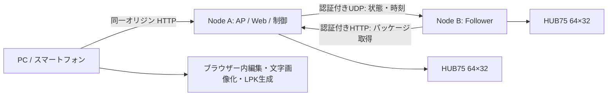

# ライブ表示パネル ソフトウェア 統合仕様 v1.1

分割仕様を正本とする配布用コピー。現在の実装範囲・検証結果は「実装状況」を参照。設計上の将来要件も含む。

---

<!-- Source: IMPLEMENTATION_HANDOFF.md -->

# 開発資料の入口

公開向けの概要は [README.md](../README.md)、現在の実装範囲は [実装状況](IMPLEMENTATION_STATUS.md)、利用手順は [START_HERE.md](../START_HERE.md) を参照してください。

設計文書は `docs/01-requirements.md` から `docs/09-technology-selection.md` です。将来要件と実装済み機能を区別して読んでください。統合版は `python tools/build_spec.py` で再生成します。

実機の秘密設定・バックアップ・個別の開発記録は公開物に含めません。設定データを推測で置き換えず、変更時には既存プロジェクトとの互換性を確認してください。

---

<!-- Source: docs/01-requirements.md -->

# 01. 要件・構成・決定事項

仕様バージョン: 1.1.0 / 対象: 増設可能な構成（初期試作は2ノード） / 2026-09-20

## 1. 目的と根拠の区別

本システムはライブ会場で演者名、ロゴ、曲名、短い告知をLEDパネルに表示する。スマートフォンまたはPCのWeb UIで作成し、対象ノード全台へ転送し、本番中に少ない操作で切り替える。

ユーザーの今回の依頼は「実装に先立つ詳細仕様とドキュメント」である。原PDF内の組み立て指示やソフトウェア候補は資料として参照する。今回、ファームウェアの書込み、既存機器の設定変更、アプリ公開は行わない。

原PDFから引き継いだ事実はH-01〜H-05。その他の選択は本仕様の設計決定であり、元資料に書かれている機能として扱わない。

| ID | ハードウェア前提 | 根拠 |
|---|---|---|
| H-01 | 1ノード = 64×32 HUB75パネル1枚 + Seengreat S3基板1台 | PDF p.1–4 |
| H-02 | Node AとB、各ノードの電源と信号線は独立 | PDF p.2–5 |
| H-03 | 縦64×64、横128×32、Bの原点のみ変更 | PDF p.2 |
| H-04 | 5V系。パネル電源はPower Type-C → VH-4P | PDF p.4–5 |
| H-05 | Wi-Fiで小さい制御情報を同期、常時フレーム転送をしない | PDF p.8 |

## 2. 初版の範囲

| ID | v1必須の能力 | 対応仕様 |
|---|---|---|
| R-01 | 同一ボード用ファームウェアを各ノードへUSB書込み、役割設定、初期化 | 03 |
| R-02 | インターネット不要のAP、認証付きWeb UI | 03–05 |
| R-03 | 日本語テキスト、PNG/JPEGロゴ、単色矩形、複数レイヤー | 02,05 |
| R-04 | 文字の静止/スクロール、位置/不透明度のキーフレーム、GIF取込 | 02,05 |
| R-05 | 縦横別のデザイン、画素単位プレビュー、ノード境界表示 | 02,05 |
| R-06 | 曲順キュー、手動GO/NEXT/PREV、任意キュー、任意シーン再生 | 04,05 |
| R-07 | ローカル保存/再編集、再生パッケージ書出し、対象ノード全台への配布 | 02,04 |
| R-08 | 同期再生、一時停止/再開、暗転/復帰、輝度変更 | 03,04 |
| R-09 | データ不一致・ノード消失・電源断に対する復旧 | 03,04,06 |
| R-10 | USB更新、認証付きOTA、ロールバック、診断取得 | 03,04 |

次はv1外である: 音反応、マイク録音、音楽再生、RTC時計、SDからの長編再生、動画ファイル/ストリーミング入力、SVG/PDF取込、任意スクリプト/シェーダー、DMX/MIDI/OSC、90度回転、DevKitC-1基板、インターネット遠隔操作、複数ユーザー同時編集。音反応用の追加方針は03に残す。

v1でもGIFは短いロゴアニメーションとして扱う。容量上限を越える動画代替用途を保証しない。高速点滅を自動生成するプリセットは含めない。

## 3. 構成と責務



Web UIの静的ファイルをMasterのファームウェアに埋め込む。ブラウザーで編集・画像変換・保存・コンパイルする。Masterには編集用フォント、編集プロジェクト、画像変換サーバーを置かない。

全対象ノードは同じLPKと同じ描画エンジンを保持し、仮想キャンバス内の担当64×32だけを表示する。ノード間にHUB75信号をチェーン接続しない。Masterは1台で自動選挙をしない。以下のA/B図は試作例であり、通常構成はMaster + N Follower。nodeIdと役割をハードコードしない。

## 4. レイアウトと座標

レイアウトはID、キャンバス寸法、1–16個の64×32配置枠（slot）から定義する。slotと実機の割当は機器設定に分離する。以下は2台用プリセット例であり、許可レイアウトの列挙ではない。列/行/grid/任意座標、非連続配置の詳細は08。

正面から見て左上が(0,0)、右が+x、下が+y。単位はLED画素。

| layoutId | キャンバス | Aの原点 | Bの原点 | パネル自体の向き |
|---|---|---|---|---|
| vertical | 64×64 | (0,0) | (0,32) | 両方とも64幅×32高 |
| horizontal | 128×32 | (0,0) | (64,0) | 両方とも64幅×32高 |

縦配置でパネルそのものを90度回転させない。任意のパネルを上下逆に設置したときのみ、デバイス校正の `rotation=180` で補正する。rotationはデザインに保存しない。90/270はv1で拒否する。

ローカル画素(u,v)の仮想座標は、rotation=0なら(originX+u,originY+v)、180なら(originX+63-u,originY+31-v)。色順や走査補正はこれより後のHALで行う。

縦横で同じ曲名でも文字組みを変えられるよう、シーンはレイアウトごとのvariantを持つ。自動で縦横に引き伸ばさない。選択レイアウト用variantがないシーンを本番キューに使うと配布前検証エラーにする。

## 5. 基本設定・性能目標

以下は製品仕様の上限または受け入れ目標であり、測定済み値ではない。

| 項目 | 決定値 |
|---|---|
| 対象台数 | 初期設計1–16ノード（Master含む）、実機試作2台。上限は能力値として公開 |
| 論理フレームレート | 30fps固定、時刻は整数tick |
| HUB75走査リフレッシュ | 200Hz以上を目標、実機測定必須 |
| 最大シーン / キュー | 64 / 128 |
| 1 variantのレイヤー | 16 |
| 再生パッケージ | 最大2,621,440 bytes（2.5MiB） |
| runtime manifest | 最大131,072 bytes |
| 資産数 / 資産画素合計 | 512 / 800,000 pixels |
| 1資産サイズ | 幅1–2048、高さ1–2048、画素数≤65,536 |
| キーフレーム | 1トラック64、1variant合計512 |
| シーン1周期 | 1–18,000 ticks（最大10分） |
| 1キュー滞在時間 | 自動:1–108,000 ticks（最大1時間）、手動:無期限 |
| Web API | 4セッションまで、ライブ操作クライアントは1つが所有 |
| 平常時の時計推定誤差 | p95 ≤5ms、RTT≤20msの試験環境 |
| 見た目のノード間差 | p95 ≤1論理フレーム、無線で走査位相一致は保証しない |
| 操作から通常切替 | p95 ≤700ms、200–500ms先を予約 |
| 暗転 | Aローカル≤100ms、通信正常時B≤200ms |
| 連続運転 | 2時間。30分の試験だけでは本番受け入れ未完了 |

解像度4096画素をRGB565で毎フレーム全保存すると8,192 bytes/frame、30fpsで245,760 bytes/sとなる。文字スクロールは文字列画像1枚と位置トラックで表現し、容量を消費する全画面動画化を避ける。

## 6. 重要な設計決定

- ADR-08: 2台は試作数。初版のノード台帳、配列、配置、通信、UIは可変台数で実装する。デザインのslotIdを実機nodeIdへ割り当て、増設でデータ形式を再設計しない。
- ADR-09: 内蔵APは1–4ノードの製品設計範囲、専用外部APでは1–16ノードを初期検証範囲とする。外部APでもクラウドやPCサーバーは不要。

- ADR-01: ESPHomeではなくESP-IDF/C++を採用する。共有描画コア、独自バイナリ、時刻同期、分割更新を一体で管理するため。PDF p.8のESPHome記載は選択肢であり必須条件ではない。
- ADR-02: 編集可能データと再生データを分離。フォント環境の差を保存済みラスタで吸収し、ESP32の文字処理をなくす。
- ADR-03: 初期設定はUSB。固定初期パスワード・無認証の自動AP・LAN上の秘密鍵配布を避ける。
- ADR-04: v1は専用AP内HTTP。スマートフォンで自己署名証明書の導入を必須にしない。WPA2とアプリ認証を使うが、AP参加者に対する通信秘匿は保証しない。インターネット公開用途は対象外。
- ADR-05: データ転送とOTAはメンテナンス状態のみ。Flash消去による走査/処理の停止を本番再生と競合させない。
- ADR-06: データ更新後は暗転で待機。電源投入後・Master再起動後も自動で本番再開しない。
- ADR-07: 演出拡張より先に文字の可読性、キュー操作、同期切れからの復帰を完成させる。

---

<!-- Source: docs/02-data-format.md -->

# 02. 編集データ・再生データ・描画仕様

## 1. 共通規則

文書改訂1.1、データ形式major=2、minor=0。JSONはUTF-8、BOMなし、重複キー禁止。全数値は整数。浮動小数、NaN、Infinity、指数表記を生成しない。受信側もSchemaと同じ整数範囲で検証する。指定されない追加プロパティは拒否する。JSON SchemaはDraft 2020-12。

IDは `[a-z][a-z0-9_-]{0,31}`、シーン・キュー・資産・レイヤーでそれぞれ一意。レイヤーIDはvariant内で一意。UUIDは小文字標準表記。文字列にNULを含めない。表示用文字はNFCに正規化、改行はLF。パスはASCIIの資産IDから組み立て、ユーザーの元ファイル名をパスに流用しない。

初版実装はversion=2、runtimeMinor=0だけを受け入れる。不明な版や機能を部分表示しない。将来版をインポートすると元ファイルを保持し、対応エディターが必要と表示する。

## 2. 編集形式 `.ledproj`

通常ZIP（ZIP64なし）を用い、圧縮method=0または8を受け入れる。MIMEは `application/vnd.ledpanel.project+zip`。構成は次のとおり。

```text
project.json
assets/<assetId>.png
assets/<assetId>.jpg
```

`project.json` が正本の編集情報。内部資産以外のURL参照、シンボリックリンク、絶対パス、`..`、重複パス、暗号化ZIP、多重ZIPは拒否する。ブラウザーで展開前にサイズを検査し、展開中も総量をカウントする。圧縮ファイル20MiB、展開総量64MiB、エントリー1025、project.json 1MiB、単一画像の復号4096×4096または16,777,216画素を上限とする。後述のruntime用ラスタにはさらに厳しい寸法制限がある。

JSONの構造は `schemas/project.schema.json`。概要は次の表を正本Schemaと併用する。

| フィールド | 意味 |
|---|---|
| version | 2固定 |
| projectId | UUID。新規プロジェクト時に発行、通常保存では維持 |
| name | 1–80文字のプロジェクト名 |
| layouts | 1–16個のlayout定義。id/name/width/height/slots、詳細08 |
| defaultLayout | layouts内のid |
| assets | id、path、mime、role、width、height、sha256 |
| scenes | id、name、durationTicks、playback、variants |
| cues | id、name、sceneId、advance、holdTicks |

role=`original`は編集での再加工用、`raster`は表示用に確定したPNG。originalはPNG/JPEGのみ、rasterはPNGのみ。sha256はZIPから取り出したファイルそのもののSHA-256小文字16進64桁。画像ヘッダーの実寸とJSONの寸法を照合する。未参照originalは保持できる。runtimeへは参照されたrasterだけを出力する。

GIFは取込時にフレーム合成とdisposal処理を完了してRGBA PNG列へ正規化する。元GIFを `.ledproj` に残さず、sequenceとPNGで再編集可能にする。透明色・フレーム部分矩形を合成した各時点の完全画像を保存する。GIF delayは各フレームについて `max(1,floor(delayMs*30/1000+0.5))` tickへ量子化する。0msは1tick。変換後の総時間の差をUIに表示する。512資産/パッケージ上限を越えれば取込を確定しない。

## 3. シーン・variant・レイヤー

scene.durationTicksは1–18,000。scene.playbackは`loop`または`hold`。シーン開始後の整数elapsedTickに対し、sceneTickはloopなら `elapsedTick % durationTicks`、holdなら `min(elapsedTick,durationTicks-1)`。負のelapsedTickは描画せず黒。

variantsは任意layoutIdをキーとするオブジェクト。vertical/horizontalは2台用プリセットIDで特別な分岐を持たない。プロジェクトが宣言した各layout用variantを全シーンが必ず持つ。未宣言layoutのvariantは拒否する。UIの下書きでは一時的な欠落を許容してもよいが、保存時には「未完成」と区別し、配布・正式エクスポートを禁止する。v1の正式 `.ledproj` は完全なものだけを書き出す。

variant.layersは0–16個。配列の先頭が最背面。空variantは黒。キャンバスは毎フレーム黒で初期化する。

共通プロパティ:

| フィールド | 型・範囲 | 意味 |
|---|---|---|
| id/name | ID / 1–80文字 | 編集対象の識別 |
| kind | rect/text/image/sequence | 編集レイヤー種別 |
| x,y | -4096–4096 | 左上位置。負座標を許可 |
| opacity | 0–255 | 255が不透明 |
| startTick,endTick | 0以上、end>start | `[start,end)`の間だけ表示 |
| tracks | x,y,opacityの任意サブセット | 空オブジェクト可 |

start/endはシーン内時間、end≤durationTicks。トラック時刻もシーン内時間で0–durationTicks。描画領域はキャンバスへクリップ。中心基準・自動折返し・ノードごとの座標解釈は存在しない。

### 3.1 rect

`width,height`は1–2048 / 1–2048、`color`は大文字 `#RRGGBB`。矩形の整数座標領域 `[x,x+w) × [y,y+h)` を塗る。輪郭・角丸・回転はv1なし。

### 3.2 text

`text`は1–256 Unicodeコードポイント、LFによる改行可。`fontFamily`はsans-serif/serif/monospace、`fontSizePx`は6–64、`fontWeight`は400/700、`color`は`#RRGGBB`、`align`はleft/center/right、`lineHeightPx`は6–96、`letterSpacingPx`は0–16、`boxWidth`は1–2048、`rasterAssetId`は確定したraster PNGを指す。

ブラウザーのCanvas2Dで画像化する。システムフォントを使い、外部CDN・Google Fontsへの実行時アクセスをしない。日本語書体は端末に存在する書体になる。フォントプレビューを見て確定する運用とする。一般的な日本語端末での入力を受け入れ条件に含める。

1文字はUnicodeの拡張書記素単位で扱う。絵文字・結合文字をコード単位で分割しない。各行を `Intl.Segmenter` で書記素分割し、Canvas.measureTextのadvanceとletterSpacingPxで順に配置する。行幅は各advance合計+隙間*(文字数-1)。left=0、center=floor((boxWidth-lineWidth)/2)、right=boxWidth-lineWidth。CanvasのtextBaseline=`top`、textAlign=`left`、fillTextへmaxWidthは渡さない。各行のy=lineIndex*lineHeightPx。ラスタ高さは行数*lineHeightPx。右端・下端で明示的にクリップする。

自動折返しなし。UIで改行を編集する。文字が枠を越えたときは枠の拡張またはスクロールを案内する。文字描画のブラウザー差は許容するが、**確定ラスタを保存した後の再生差は許容しない**。

フォント指定・本文・色・枠幅・行高・字間を編集した時だけrasterを再生成する。既存プロジェクトの読込み、座標変更、スクロール調整だけでは再画像化しない。端末を替えた再編集で「文字画像を再生成」した場合はプレビューの差を表示する。保存済みPNGが欠けているtextは検証エラー。フォントがなくても保存済みラスタから再コンパイルできる。

runtimeではtextはspriteになる。UTF-8文字列、フォント名、フォントエンジンはESP32へ送らない。これによりフラッシュ容量を日本語フォントへ割かず、元テキストを失わずに再編集できる。

### 3.3 image

`assetId`がrasterを参照し、`originalAssetId`はoriginalまたはnull。JPEGのEXIF orientationは取込時に適用、色はsRGB、ICC変換はブラウザーのデコード結果をPNGへ固定する。

拡大縮小・トリミング・fit操作はエディターでPNGへ焼き込む。nearestまたはbilinearの結果をプレビューし、生成PNGを新しいrasterとして保存する。runtimeは1:1の画素描画しか行わない。透明PNGロゴはアルファを保持。JPEGは不透明。

### 3.4 sequence

`frames=[{assetId,ticks},...]`、1–512フレーム、各ticks=1–18,000、総ticks≤18,000、全資産の寸法は同一。`repeat=loop|hold`。ローカル時間は `sceneTick-startTick`。loopは総ticksで剰余、holdは総ticks-1でクランプし、累積区間 `[sumBefore,sumAfter)` に対応するフレームを選ぶ。シーン境界で初期状態へ戻る。

動画の試験取り込みはブラウザー対応コーデックをPNG列へ復号し、このsequence形式を使用する。元動画・音声は編集ZIPへ含めない。入力100MiB、区間6秒、120フレーム、取り込み1回700000画素を上限とし、フレーム時間を `max(1,round(durationSeconds*30))` で量子化する。元の画角を保って選択layout内へ縮小する。取り込み上限とは別に、コンパイル時に全体の資産数・画素数・パッケージ容量を検査する。動画取り込みはv1完成の必須条件ではない。

### 3.5 キーフレーム

tracksの各配列は `[{tick,value,ease},...]`、1–64要素、tickは厳密昇順、同一tick禁止。ease=`linear|step`はそのキーから次のキーへの区間に適用。最後のキーのeaseはstepに固定する。

キーより前は最初のvalue、最後の後は最後のvalue。`[t0,t1)` においてstepはv0、linearは `v0 + floor((v1-v0)*(t-t0)/(t1-t0))`。floorは負数でも負の無限大方向であり、C++の整数除算の0方向丸めをそのまま使わない。中間計算は符号付き64bit。該当トラックがあると共通プロパティの初期値を置き換える。

スクロールプリセットは左/右をx、上/下をyトラックへ展開する。2026-09-24のエディター更新では速度指定に代わり周期Pを整数tick（4–18,000）で指定する。左/上はキャンバス幅/高さから負の画像幅/高さまで、右/下はその逆へ移動する。表示開始をsとして、sで画面外開始位置、s+P-1で画面外終了位置を置き、繰返し時はs+Pで開始位置へ戻す。終了位置から次の開始位置まではstep、移動区間はlinear。表示終了で周期が途切れる場合も、その時刻までの補間値をキーとして保存する。シーン期間・playbackはプリセット適用では変更しない。シーン境界では既存loop/hold規則に従う。

点滅はopacityのstepキーで周期前半をレイヤーopacity、後半を0とする。グロー点滅は周期開始0、floor(P/2)でレイヤーopacity、P-1で0のlinearキーへ展開する。これは明滅であり、ぼかし・加算合成の拡張ではない。移動と点滅は併用可能。プリセットの繰返しは表示区間内へキーを展開し、既存64キー/トラック・512キー/variant制限を超える場合は変更を確定しない。新しいレイヤーフィールドやruntime形式の追加はない。

v1の曲切替はcut。フェード表現はopacityトラックで作る。シーン間crossfadeは将来拡張。

## 4. キュー

`cues`は1–128個で配列順が曲順。id、name、sceneId、advance、holdTicksを持つ。advance=`manual`ならholdTicks=null、`auto`なら1–108,000。デフォルトはmanual。sceneのループとキューの滞在時間は別物である。

キューの自動送りは04の時刻基準で計算する。最後のキューを越えたらSTOPPEDになり黒。自動で先頭にループしない。ライブで1曲を何分表示するか不明でもmanualなら表示が維持される。

## 5. 再生形式 `.lpk`

MIMEは `application/vnd.ledpanel.package`。ZIPではなく、64byteヘッダー + manifest JSON + asset blobの連続バイト列。JSON構造は `schemas/runtime.schema.json`。

| offset | byte長 | 内容 |
|---|---|---|
| 0 | 4 | ASCII `LPK2` = 4c 50 4b 32 |
| 4 | 2 | schemaMajor=2、little endian |
| 6 | 2 | schemaMinor=0、little endian |
| 8 | 4 | headerSize=64、little endian |
| 12 | 4 | manifestLength、little endian |
| 16 | 4 | blobLength、little endian |
| 20 | 4 | totalLength=64+manifestLength+blobLength |
| 24 | 32 | SHA-256(manifest bytes + blob bytes) |
| 56 | 4 | flags=0 |
| 60 | 4 | reserved=0 |

サイズ計算は64bitで行い、ファイル長と一致しない場合は拒否。manifestLength≤131,072、totalLength≤2,621,440。末尾への付加データも拒否。ヘッダー24のdigestは内容の整合性、`packageHash`は**LPKファイル全体**のSHA-256。別物として扱い、APIと同期にはpackageHashを使う。ハッシュは認証を代替しない。

manifestにはversion=2、runtimeMinor=0、renderer=`lp-raster-1`、fps=30、projectId、layouts、defaultLayout、assets、scenes、cuesを保存。nameはシーン/キューにも保持し本番UIで使用する。runtime layerは共通のnameを削除し、rect/sprite/sequenceだけを許可する。spriteはassetIdを持つ。textとimageの違いはruntimeへ残さない。

runtime資産はid、width、height、offset、length、sha256を持つ。offsetはblob先頭から、length=`width*height*3`。画素順は左上からrow-major。各画素はRGB565 little endianの2byte、その直後にstraight alpha8の1byte。画像全体の色面とalpha面を分離しない。stride/paddingはない。

資産はIDのASCII昇順に隙間なく連結する。offset=直前offset+length、最終末尾=blobLength。重複/重なり/隙間は禁止。sha256は当該資産のraw bytesを対象にする。合計画素≤800,000。資産を共有参照でき、同じ資産の複数配置で容量を増やさない。

manifestの正規生成は、キーをUnicodeコードポイント昇順に再帰ソート、配列順保持、空白なし、UTF-8文字を直接書込み、制御文字はJSON escape、`/`はescapeしない、整数を10進で出力。受信側は正規化をやり直さず受信バイトを検証・ハッシュする。ビルド日時やランダムIDをmanifestに追加しない。入力に変更がなければ同じLPK bytesを得る。

## 6. 色・合成・一致条件

入力ラスタはsRGB RGBA8 straight alpha。RGBAのRGB値を `(r>>3)<<11 | (g>>2)<<5 | (b>>3)` でRGB565化する。alpha=0のRGBは0に正規化。例: 不透明赤は `00 f8 ff`、不透明緑 `e0 07 ff`、不透明青 `1f 00 ff`、透明黒 `00 00 00`。

描画時の展開は `r8=(r5<<3)|(r5>>2)`、`g8=(g6<<2)|(g6>>4)`、`b8=(b5<<3)|(b5>>2)`。rect.colorも一度565へ量子化して同じ経路を通る。

layer alphaは `a=floor((assetAlpha*opacity+127)/255)`（rectはassetAlpha=255）。チャンネルごとに `out=floor((src*a+dst*(255-a)+127)/255)`。線形光への変換なし、sRGB値空間で整数合成。合成対象はRGB888の黒い64×32バッファ。透明度をキャンバスへ残さない。

最後に `userBrightness` と `brightnessCap` を0–255で比較し、`effective=min(userBrightness,brightnessCap)` をHUB75出力輝度へ設定する。画素値への二重乗算は禁止。ガンマ/CIE補正はv1論理描画では行わず、DMAライブラリの補正も無効化して試験する。実機の色差は別途校正し、Webプレビューを測光再現と呼ばない。

WASM/native/ESP32は同じC++17の `lp-raster-1` を使う。フレーム生成関数はmanifestの検証済みモデル、sceneId、layoutId、sceneTick、viewport、rotationを受け取りRGB888を返す。描画中のファイルI/O、ネットワーク、malloc、壁時計参照は禁止。

## 7. コンパイル処理

1. ZIP/JSON/画像を上限付きで検証。全参照・variant・キュー・時刻を意味検証する。
2. 確定rasterを読む。保存済みtextは再画像化しない。
3. 参照rasterをRGB565A8へ変換。sourceに不要資産があってもruntimeへ含めない。確定PNGはバンドルしたPNG decoderでstraight RGBAへ直接復号する。Canvas経由のpremultiply/unpremultiplyや端末依存の色管理を再度通さない。PNGは保存時にsRGB RGBA8へ正規化し、コンパイル時にICC再変換しない。
4. text/imageをspriteへ変換。座標やトラックは保持。
5. assetsをID順で配置、サイズとSHA-256計算、manifest正規シリアライズ。
6. ヘッダー・blobを連結。最終LPKを独立decoderへ通し、上限とハッシュを再検証。
7. **生成LPKそのもの**をWASMプレビューへ渡す。元Canvas表示だけで配布を承認させない。

Web Worker内で処理し、進捗/キャンセルを提供する。HTTPオリジンでも動くZIP/PNG/GIF/SHA-256のローカル実装をバンドルする。WebCrypto、SharedArrayBuffer、File System Access APIを必須にしない。

## 8. Schema以外の意味検証

全ID一意、layout/slot形状・重複・範囲の検証（08）、layout集合一致、defaultLayoutの所属、assetの存在/role、pathとmime拡張子一致、画像の実寸/ハッシュ、textラスタの幅=boxWidthと高さ=行数*lineHeight、runtime資産境界、キー昇順と値範囲、end≤duration、variant全トラック総数≤512、sequence合計時間/同寸法、キューscene参照、資産画素合計、manifest容量を検査する。

エラーは `{code,path,message}`、pathはJSON Pointer。配布時は最初の1件だけでなく最大100件を返す。途中ファイルはactiveコンテンツにならない。不正なレイヤーだけを飛ばす再生は禁止。

---

<!-- Source: docs/03-firmware.md -->

# 03. ファームウェア・ハードウェア・書込み

> 設計時の選定案を含みます。現在の実装はESP-IDF 5.5.5と同梱の `esp-hub75` です。実際のビルド手順・依存関係は [ファームウェアREADME](../firmware/README.md)、確認範囲は [実装状況](IMPLEMENTATION_STATUS.md) を参照してください。

## 1. 技術構成と互換性ゲート

ファームウェアはESP-IDF + C++17、ターゲットesp32s3。初期検証候補はESP-IDF **v5.5.5**とESP32-HUB75-MatrixPanel-DMA **3.0.14**。release tagと完全commit SHAを取得して固定する。調査時のmasterには3.0.15表記があるが、masterの追従はしない。この組合せのビルドと実機動作は今回未検証。[IDFリリース](https://github.com/espressif/esp-idf/releases)、[DMAリリース](https://github.com/mrcodetastic/ESP32-HUB75-MatrixPanel-DMA/releases)、[masterの版表記](https://raw.githubusercontent.com/mrcodetastic/ESP32-HUB75-MatrixPanel-DMA/master/library.properties)

DMAをESP-IDF componentとして取り込み、NO_GFXを使用、Arduino runtimeはv1で依存しない。ライブラリにnative IDF用CMake構成があることは確認したが、使用tagのCMakeとIDF private APIの互換性はM0で検証する。失敗したらパッチまたはIDFの対応patch版を固定し、変更理由とビルドログをADRに記録する。[component CMake](https://raw.githubusercontent.com/mrcodetastic/ESP32-HUB75-MatrixPanel-DMA/master/CMakeLists.txt)

WebはHTML/CSS/JavaScript ES modulesを直接配信し、開発用HTTP/APIと補助ツールはPythonで統一する。Node.js/npm/pnpm/React/Viteを必須にしない。nativeテストはCMake/CTest、Webはブラウザ内テストをPythonから実行する。共通描画コアはC++とstandalone WASMで共有し、Clang/LLDの版固定とビルド検証は実装時のゲートとする。詳細は [09-technology-selection.md](09-technology-selection.md)。

## 2. ボード定義

profileId=`seengreat_hub75_s3_n16r8_v1`。公開仕様のモジュールはESP32-S3-WROOM-1-N16R8、Flash16MiB/PSRAM8MiB。現物の刻印と起動時検出値を照合する。16MiB未満、PSRAM検出失敗なら通常再生を有効化せず診断画面へ進む。PSRAMを単に容量だけでDMA対応とみなさない。[公式wiki](https://seengreat.com/wiki/214/rgb-matrix-hub75-s3)

HUB75ピンの初期値は以下。基板版の照合なしで別ボードに転用しない。

| 信号 | GPIO | 信号 | GPIO |
|---|---:|---|---:|
| R1 | 5 | G1 | 4 |
| B1 | 6 | R2 | 15 |
| G2 | 7 | B2 | 17 |
| A | 8 | B | 18 |
| C | 10 | D | 9 |
| E | 16 | CLK | 12 |
| LAT | 11 | OE | 13 |

出典: [Seengreat公式ピン表](https://seengreat.com/wiki/214/rgb-matrix-hub75-s3)。64×32・1/16 scanが確認できたprofileではE=-1として未使用。メーカーの64×64サンプルを寸法だけ変えずに流用しない。

パネル設定はwidth=64、height=32、chainLength=1。IC/scan/colorOrderは実物確認が必要。scanは1/16候補、driverはSHIFTREG候補、RGB順候補としてM0で試す。FM6126A等のICが判明したらその初期化をHALへ固定する。未対応scanをUIから選べるようにしない。

v1はSD、RTC、音声codec、PCA9557のキーを初期化しない。未使用スピーカーアンプはGPIO3をLOWに保つ。基板のチップenableやOEに影響するPCA9557設定が必要なら、公式回路図で確認した値をHALに追加する。この回路図本文は今回未取得なので、初期化値を推測しない。

## 3. 起動・描画・タスク

起動順序:

1. 出力を暗転、診断ログ開始、NVSと設定version確認。
2. Flash/PSRAM/partition/ボードprofile確認。必要なバッファを確保。
3. active slotをヘッダーから全文ハッシュまで検証。失敗時は直前slotを試し、結果を記録。
4. HUB75 DMAを黒バッファで起動。検証されていないpinを駆動しない。
5. Wi-Fi、認証、HTTP、同期を開始。AはAP、BはSTA。
6. 同期・データ一致を確認してREADY_BLACKOUT。ユーザーの再生操作を待つ。

未設定ならUNPROVISIONEDとしてUSB設定待ち。共通デフォルトAPは作らない。初期画面が見えなくてもUSBシリアルで診断可能にする。

| タスク | Coreの初期案 | 責務 |
|---|---|---|
| render | 1、高優先 | 検証済みstate snapshotを読み30fpsで描画・DMA反映 |
| control/sync | 0、中高 | UDP、時計推定、予約状態、heartbeat |
| http | 0、中 | 認証・API・静的UI、長い処理はjobに委譲 |
| storage/update | 0、低 | メンテナンス時だけ検証/Flash操作 |
| diagnostics | 任意、低 | 1秒統計、リングログ、watchdog監視 |

Wi-FiやIDFシステムタスクのpriorityを上書きしない。renderへネットワークcallbackから直接書き込まず、immutable snapshotのatomic交換/小さいロックで渡す。同期タスクが遅れてもDMA走査は維持。描画に遅れたら古いフレームを追い描きせず現在時刻へジャンプする。

DMAは内部のDMA可能SRAMを第一候補にする。ダブルバッファ、色深度6bit/channelから検証、200Hzを満たしメモリーに余裕があれば上げる。PSRAM DMAはOctal PSRAMとライブラリ制約を別途検証した場合のみ採用。DMAの配置、色深度、CLK、blanking値を診断へ出す。[DMA対応とメモリー制約](https://github.com/mrcodetastic/ESP32-HUB75-MatrixPanel-DMA)

## 4. メモリー予算

最大LPKをPSRAMへ読込み、manifestを上限付きで解析する。runtime資産はblobを参照し重複コピーしない。JSON DOMは読込み時だけ使用し、検証後の描画モデルへ変換したら解放。

| 対象 | 予算/扱い |
|---|---|
| package raw | PSRAM ≤2.5MiB |
| manifest解析/モデル | PSRAM ≤512KiB、一時DOMを含むピーク≤1MiB |
| 2×RGB888ローカルbuffer | 12,288 bytes |
| DMA | 内部SRAMで実測。初期予算≤160KiB |
| UDP受信 | 1200bytes×8上限、古いstateを集約 |
| HTTP upload buffer | 16KiB×1、package全体を内部SRAMに置かない |
| 診断ログ | 32KiB固定リング、Flashへ常時書込まない |
| 起動後の空き内部heap | ≥48KiB、最大連続ブロック≥16KiBを目標 |
| 空きPSRAM | 最大コンテンツ時≥2MiBを目標 |

heap不足で色やレイヤーを黙って減らさない。メンテナンス状態でエラーを返す。アップロード前に再生モデルを解放できるが、active slotは消さない。成功/失敗後にactiveを再ロードして暗転待機する。

## 5. 16MiB Flash partition案

partition tableは0x8000。appの64KiB alignmentを維持する。以下は実装開始時の確定案であり、容量変更時はSchema上限も含め影響を検証する。

| name | type/subtype | offset | size |
|---|---|---|---|
| nvs | data/nvs | 0x9000 | 0x6000 |
| otadata | data/ota | 0xF000 | 0x2000 |
| phy_init | data/phy | 0x11000 | 0x1000 |
| nvs_keys | data/nvs_keys | 0x12000 | 0x1000 |
| ota_0 | app/ota_0 | 0x20000 | 0x400000 |
| ota_1 | app/ota_1 | 0x420000 | 0x400000 |
| content_0 | data/0x40 | 0x820000 | 0x300000 |
| content_1 | data/0x41 | 0xB20000 | 0x300000 |
| rig_0 | data/0x42 | 0xE20000 | 0x10000 |
| rig_1 | data/0x43 | 0xE30000 | 0x10000 |
| reserved | 未割当 | 0xE40000 | 0x1C0000 |

0x13000–0x1FFFFはalignment gap。reservedを自動的にFATとしてマウントしない。UIはapp内へgzipで埋込み、JS/CSS/WASM合計gzip≤1.5MiB、app全体≤4MiB。超過はビルド失敗とする。

content partitionはファイルシステムを使わずLPKをoffset0から保存する。アプリメタデータのactiveSlot、previousSlot、generationは1つのversioned NVS blobへまとめ、commitを完了させて切り替える。slotの内容は常に検証しNVS pointerだけを信じない。

1. inactive slotを消去しストリーム書込み（headerも保存）。
2. Flashから全文再読込みしLPK検証。完全検証前はcandidate扱い。
3. 全対象ノードの候補hash一致を確認し、04のactivateへ進む。
4. NVS active pointerを更新。旧slotは次の更新まで保持。

途中電源断は旧activeを選ぶ。pointer更新済みでも不正LPKなら旧slotへ戻り暗転。全対象ノードのpointer更新は原子的ではないため、再起動後のhash不一致時は全対象暗転し、Aのactiveを基準に再配布する。暗黙に片側だけ新しい曲を表示しない。

## 6. 通信・永続設定

内蔵APモードのMasterは `LEDPANEL-<groupId末尾6桁>`、IP=192.168.4.1/24、DHCP=192.168.4.10–30、2.4GHz AP。初期channel=6、設定可能値1/6/11。地域設定は日本、Wi-Fi省電力を無効化。内蔵APの最大station数=6（最大3 Follower + 操作端末3台）。外部APモードも初版必須で、全ノードをSTAとして同一専用LANへ接続する（08）。NATとInternet公開はなし。mDNSは `ledpanel.local` を補助提供し、IP直アクセスを必須経路にする。

各Followerは選択したネットワークSSIDへ接続し、DHCPでアドレス取得、Aへ署名付き登録。再接続backoff=1,2,4,8,16,30秒、上限30秒、±20%jitter。UDP/TCPの再接続で表示を勝手に再開しない。

NVS設定: configVersion=2、boardProfile、nodeId(1–65535)、hardwareId(UUID)、label、masterNodeId、role(master/follower)、groupId(UUID)、SSID、AP PSK、groupKey(32bytes)、admin password verifier（Aのみ）、rotation(0/180)、brightnessCap、channel、active metadata。nodeIdとroleは独立。group内IDをUSBツールが割当て、再起動で維持する。台帳と配置割当は08。

初期userBrightness=26/255（約10%）、brightnessCap=64/255。再生輝度はRAM、capは設定で保存。cap変更はメンテナンスかつ管理者操作。capは電流を実測して決めるための設定であり、電流センサーや電気的保護の代わりではない。電流/温度の計測機能を搭載しているとUIに表示しない。元資料の5V系・低輝度からの試験を守る。

## 7. USB初期設定と書込み成果物

同じボードprofileなら全ノードに同じbinを書く。別profileのbinは同じprotocol/rendererを満たすこと。役割だけのためにソースを変更して再ビルドしない。Windows向け手順を必須にし、macOS/LinuxでもCLIが動く構成にする。

実装時の成果物:

- `firmware-<version>-seengreat.bin`: factory merged image。実際のビルドoffsetを反映。
- `firmware-<version>.ota.bin`: app-only OTA image。merged imageと明確に区別。
- `release.json`: firmwareVersion、gitSha、boardProfile、protocolMajor=2、renderer、partitionTableSha256、各fileのsize/sha256、IDF/component lock情報。
- `flash.ps1` とPython CLI: ポート列挙、chip/flash確認、初回書込み、monitor、USB設定。

CLIの契約:

```text
ledpanel-provision create-group --output <private-file>
ledpanel-provision flash --port COM7 --release <release-directory>
ledpanel-provision configure --port COM7 --group <private-file> --node-id 1 --role master
ledpanel-provision configure --port COM8 --group <private-file> --node-id 2 --role follower
ledpanel-provision inspect --port COM7
```

create-groupはOSのCSPRNGでUUID、AP PSK（24文字以上）、admin初期password（24文字以上）、groupKey32bytesを作る。秘密設定ファイルはユーザー指定場所へ保存し、リポジトリ/デザインZIP/診断ZIPへ含めない。CLIは画面にgroupKeyを出さず、AP接続情報と管理passwordは明示的な表示/印刷操作のみで示す。

USB CDCコンソールは115200、UTF-8 JSON Lines、1行最大4096bytes。requestは `{id:1,op:"configure",config:{...}}`、応答は `{id:1,ok:true,rebootRequired:true}`。機能はhello、inspect（秘密マスク）、configure、factory_reset、panel_test。configure/factory_resetは物理操作で開いた専用USB設定セッションでのみ許可する。通常起動後、BOOTを離した状態から3秒長押しして設定モードへ入る方式を初期案とする。リセット時にBOOTを押し続ける操作はROM download用であり、アプリの設定モードと混同しない。GPIO0の入力と基板の実配線を確認し、設定モードは60秒無操作で終了、表示は黒、Webから開く操作は提供しない。手順を現物で確定するまでは成功したと扱わない。

`{"id":1,"op":"panel_test"}` は設定モードを開かずに使える、明示的なUSB診断操作である。Master・停止・暗転・保守外・同期処理なしをWeb診断と同じ条件で確認し、HELLO信号を最大5秒・最大5% pixel dutyで出してからOEをHIGHへ戻す。設定/NVSは変更しない。P5のドライバーや電源状態を特定する試験ではない。

通常起動中にシリアル入力しただけで秘密設定を書き替えない。USB transportの具体的な物理確認手順はM0ゲート。端末にログとJSONを混在させず、JSON以外のログは別CDCチャネルまたはprefix付きにしてCLIで分離する。

factory_resetは設定/鍵/コンテンツを削除し、UNPROVISIONEDへ戻る。全eraseは初回または明示resetだけ。通常flash/OTAで設定を消さない。BOOT/ENと通常USB-Cの使用方法を納品手順に写真またはメーカー図の参照付きで記載する。

## 8. OTAと復旧

OTAはメンテナンス状態、暗転、認証済み管理者から開始。Aが受けたファイルを一度永続stageする空き領域をv1では設けないため、**FollowerのOTAはMasterが接続を中継して対象のinactive appへストリームし、各ノード向けに同じFile/Blobから順次再送**する。04のnode-target APIを使う。UIはFile/Blobを保持して対象台数分を順次送信する。

target/size/SHA/firmware metadata/partition hashを確認し、app-onlyのみ受け入れる。`esp_ota_begin/write/end`系とrollbackを使用し、bootloaderとpartition tableはOTA対象にしない。IDF rollback有効化と新imageのvalid markingを実装する。[Espressif OTA](https://docs.espressif.com/projects/esp-idf/en/v5.5.5/esp32s3/api-reference/system/ota.html)

対象FollowerをnodeId昇順に1台ずつ更新→各health確認→最後にMaster更新の順。初回起動30秒以内にNVS読出し、heap、黒DMA、HTTP/同期初期化、content読出しの自己検査を行いvalidをマークする。BがAPへ接続できないこと単独ではrollbackしない。自己検査が失敗/クラッシュ/タイムアウトなら旧appへrollback。更新中に操作端末が切れたら完了済みのノードだけを記録し、暗転を維持。

同一protocolMajorかつrenderer一致が確認されるまで再生不可。v1用OTAは同じ形式を扱う互換リリースに限定。新しいmajorへの移行やpartition変更はUSB手順で行う。NVS/contentの破壊的移行を新appの自己検査中に行わない。

コンテンツ未配布やUNPROVISIONEDは初期状態として正常であり、それだけでOTA自己検査失敗にしない。検証対象は読み取り処理が正常に動き、未設定/未配布を正しく扱えることである。

v1は署名付きSecure Boot/eFuse anti-rollbackの製品化を必須としない。OTA hashは改ざん元の正当性を保証しない。信頼したreleaseファイルを管理者が専用APで適用する脅威モデルを04に明記する。

## 9. 音反応の将来追加

全章のA/B表記は1組の通信例。複数Followerへのファンアウト・参加集合・更新順・失敗条件は08を適用する。

v1の `capabilities.audioInput=false`。マイク解析を無効にしても文字・画像表示が完成することを保証する。将来のv1.x/2ではES7210のMaster入力、音量/FFTの時刻付き制御値、専用renderer featureを追加する。PCMを常時Wi-Fi転送しない。音声による曲名認識や録音は別要件。

オンボード音声のI2Sピンは公式表があるが、チャンネル割当、I2Cアドレス、codec reset/enable、サンプル形式は回路図とサンプルで照合が必要。GPIOだけで一般的なI2Sマイクとして初期化しない。S3ではLCD側DMAと音声I2Sのリソース競合・帯域も検証する。[公式ボードwiki](https://seengreat.com/wiki/214/rgb-matrix-hub75-s3)、[ESP-IDF I2S](https://docs.espressif.com/projects/esp-idf/en/stable/esp32s3/api-reference/peripherals/i2s.html)

---

<!-- Source: docs/04-protocol-api.md -->

# 04. 同期・API・セキュリティ

## 1. 権威・時刻・再生位置

本章のA/BはMasterと1台のFollower間の説明用表記。1–N台の参加集合、全員ACK、topology照合、ノード追加、外部APは08が規範。2台だけに分岐する実装は禁止。

設定されたMasterだけが本番の状態revisionを発行する。BrowserのDate.now、RTC、NTP、Followerの壁時計を再生時刻に使わない。Masterの単調増加microsecond時計を採用し、起動ごとにbootIdを変える。bootId変更は既存の予約をすべて無効にする。

時刻と64bit累積tickはJSONで10進文字列 `"0"`〜`"18446744073709551615"` とする。JSではBigInt、C++ではuint64_tで読み、算術はoverflowを検査する。JSON数値にして精度を失わない。revision/seqはuint32、0から開始しwrap前に新session/再接続へ移る。

running=trueの状態で、masterNow≥anchorUsなら `elapsedTicks=positionTicks+floor((masterNow-anchorUs)*30/1,000,000)`。running=falseならpositionTicksで停止。描画スケジュールは各tickの絶対時刻 `anchorUs+ceil(k*1,000,000/30)` から求め、33msの足し算を繰り返さない。

sceneモードは指定sceneを02のloop/holdで評価。cueモードではcueIdを開始キューとしてelapsedTicksを評価する。autoキューはholdTicksを消費して次へ進む。manualへ到達するとそこでsceneを無期限再生する。キューの配列末尾を越えたら出力黒、実効モードSTOPPED。周期内シーンtickとキュー滞在elapsedは混同しない。再接続時も同じ経過時間から同じキューを再構成できる。

NEXT/PREVは現在の実効キューの隣へ進み、位置0から再生。sceneモードやSTOPPEDからNEXTは先頭、PREVは末尾。末尾NEXTはSTOP、先頭PREVは先頭を再開始。GO(cueId)は対象キューの先頭から開始。pauseはキュー開始基準からの累積positionTicksを固定、resumeはそこから再開。STOPは位置0に戻し黒。blackoutは出力だけを黒にし、時間進行は継続。復帰で現在時点を表示する。

ユーザーの暗転と障害暗転は別ラッチ。暗転中のplay/GOは時間だけ開始し、明示 `blackout{enabled:false}` まで点灯しない。faultLatchは正常化後の `recover` で解除しREADY_BLACKOUTへ戻す。recoverだけで点灯しない。

通常操作の次stateを作るときは、採用時刻Tにおける旧stateの累積elapsedTicksを先に計算する。brightness/暗転解除/layoutはその値をpositionTicksへ置き、anchorUs=Tとして時間を継続する。pauseもT時点の値で固定する。resumeは保存positionTicksを維持。play_scene/GO/NEXT/PREVのみ位置0へ戻す。即時暗転はnowをTとして同じ規則で時間を維持する。これにより輝度調整でスクロールや自動キューが先頭へ戻らない。

## 2. 時計同期

Followerから1秒ごとにNTP型4時刻交換。t1=B送信、t2=A受信、t3=A送信、t4=B受信。offset=`((t2-t1)+(t3-t4))/2`（A-B）、RTT=`(t4-t1)-(t3-t2)`。全値をsigned64で計算し、負RTT、RTT>20ms、応答が500ms以上遅れた標本を棄却する。

起動時は100ms間隔で8回実施、直近8個の有効標本からRTTが小さい3個のoffset中央値を初期推定とする。最低3個揃うまでUNSYNCED。以後1Hzで更新し、offset差を最大1ms/秒でslew。表示中に時刻を後戻りさせない。差の絶対値>20msならUNSYNCEDにして暗転し、暗転中に再推定する。最後の有効標本から5秒でUNSYNCED。

時計の健康と接続の健康は別。パケット到達していても時刻が未確定なら再生不可。診断のoffset/RTTはソフトウェア推定値であり実LEDの走査位相差ではない。無線はhard realtimeを保証しない。

## 3. UDP wire形式

unicast UDP port=42175。全ノードが同じportをbindする。broadcast/multicastに秘密や同期を依存させない。パケット全長≤1200bytes。全数値フィールドはlittle endian。

| offset | 長さ | 内容 |
|---|---|---|
| 0 | 4 | ASCII `LPS2` |
| 4 | 1 | protocolMajor=2 |
| 5 | 1 | messageType |
| 6 | 2 | payloadLength≤1128 |
| 8 | 16 | groupId UUIDのバイト順（UUID表示のhexを左からdecode） |
| 24 | 4 | senderNodeId=1–65535（roleと独立） |
| 28 | 8 | senderBootId。CSPRNGで起動時に生成 |
| 36 | 4 | seq |
| 40 | payloadLength | UTF-8 JSON payload |
| 40+payloadLength | 32 | HMAC-SHA256(authenticationKey, header+payload) |

全長=72+payloadLength。authenticationKeyはtype1–4でgroupKey、type5以降で後述のsessionKey。HMACはconstant-time比較。検証前にJSONをparseしない。groupId、size、versionの安価な検査→HMAC→boot/seq→payload意味検証の順。失敗packetを大量にログ出力しない。

| type | 名称 | 必須payload |
|---:|---|---|
| 1 | HELLO | nonceB:32hex、protocolMajor:2、hardwareId:UUID、renderer、activeHash:hashまたはnull |
| 2 | OFFER | nonceB、nonceA:32hex、masterBootId:16hex、masterNodeId、followerNodeId |
| 3 | ACCEPT | nonceB、nonceA、masterBootId、masterNodeId、followerNodeId |
| 4 | SESSION_OK | nonceB、nonceA、masterBootId、masterNodeId、followerNodeId |
| 5 | TIME_REQ | exchangeId:uint32、t1Us:string |
| 6 | TIME_RESP | exchangeId、t1Us、t2Us、t3Us |
| 10 | HEARTBEAT | revision:uint32、topologyRevision:uint32、topologyHash:hash、activeHash:hash/null、nowUs:string、health:ready/unsynced/fault、faultCode:string/null、clockSynced、clockOffsetUs:signed decimal string、clockRttUs:uint32、clockSampleAgeMs:uint32/null |
| 11 | PREPARE | commandId:UUID、nextState:State |
| 12 | READY | commandId、revision、topologyRevision、topologyHash、ok:boolean、error:string/null |
| 13 | COMMIT | commandId、nextState:State |
| 14 | ACK | commandId、revision、topologyRevision、topologyHash、phase:committed/applied、ok、error |
| 15 | ABORT | commandId、revision |
| 16 | STATE | state:State |
| 17 | BLACKOUT | revision、reason:user/fault、nowUs |

hashは64桁小文字hex。nonceは16bytesのhex。bootIdは8bytesのhex表示で、headerのLE uint64を16桁数値表記したもの。規定以外のプロパティは拒否する。messageTypeごとの単体decoderとfuzzテストを用意する。

### 3.1 起動/再接続の認証

共有groupKeyはUSBで全対象ノードへ事前設定済み。Bが新しいnonceBでHELLO、AがnonceBを返し新nonceAを含むOFFER、Bが両nonceを返すACCEPT、AがSESSION_OK。すべてHMAC必須。Bは直近5秒以内の自分のnonceBへの返答だけを採用。Aも自分が発行したnonceAへのACCEPTだけを採用する。

完了後に `sessionKey=HMAC-SHA256(groupKey, ASCII("LPS2/session") || nonceBの16bytes || nonceAの16bytes || masterBootIdのLE8bytes || followerBootIdのLE8bytes)` を導出する。区切り文字やNULは追加しない。以後のUDPとnode HTTPはsessionKeyで認証し、groupKeyの直接使用はhandshakeに限定する。新session成立前は既存sessionを破棄しない。新session成立時には暗転し、相手bootIdとseqの64packet replay windowを登録。

古いboot/seq、同一packetの再送はアプリ処理へ通さない。アプリ上の再試行は新seq、同commandIdで送る。再接続には必ず新nonceを使用し、過去のsession packet再生で再開しない。同一bootで再接続してseqが0に戻ってもsessionKeyが変わるため旧packetを受理しない。通信元のnodeId/役割も固定照合し、BのSTATE/COMMIT/BLACKOUTをAの制御命令として採用しない。BのfaultはheartbeatでAへ通知する。

## 4. Stateの完全スナップショット

```json
{
  "revision": 12,
  "topologyRevision": 1,
  "topologyHash": "0000000000000000000000000000000000000000000000000000000000000000",
  "packageHash": "0000000000000000000000000000000000000000000000000000000000000000",
  "layoutId": "horizontal",
  "mode": "cue",
  "sceneId": null,
  "cueId": "song_01",
  "running": true,
  "positionTicks": "0",
  "anchorUs": "15000000",
  "effectiveAtUs": "15000000",
  "blackout": false,
  "userBrightness": 26
}
```

上のhashは説明用placeholderで実在コンテンツを指さない。modeはstopped/scene/cue。stoppedでは両ID=null、running=false、positionTicks="0"。sceneではsceneIdだけ非null、cueではcueIdだけ非null。packageHashは未配布のstoppedでのみnull可。layoutIdはパッケージ内layoutのid。stateにtopologyRevision（uint32）とtopologyHash（64hex）を必須とする。brightnessは0–255。effectiveAtUsが採用境界、anchorUsがpositionTicksに対応する時刻。通常コマンドでは両時刻を一致させる。

revisionはユーザー操作の採用ごとに増加。自然なautoキュー遷移でrevisionを増やす必要はなく、GET statusに実効キューとsceneTickを併記する。完全stateを保存し、scene番号だけの差分を送らない。

## 5. 通常コマンドの予約と失敗

1. Aが認証/編集権/expectedRevision/能力/hash一致/時計を検査。
2. Aが次stateを作り、実行時刻を少なくとも500ms先へ予約。未処理通常コマンドは1個まで。
3. PREPAREをBへ送り、100ms以内のREADYを待つ。Bはpackage/variant/参照/時刻を検証しRAMへ準備する。
4. READY後、COMMITを送る。再送間隔50ms。T-150msまでにcommitted ACKが来なければABORTと障害BLACKOUTを送信し、Aも暗転する。
5. ACK済みなら各ノードはTに採用し、Bはapplied ACK。Aのoperationは全対象の採用を確認してappliedになる。

未実行のABORTは予約を削除。重複commandIdは同じ結果を返し、二度NEXTしない。Tを50ms以上過ぎて届いたCOMMITは適用せず、LATE_COMMANDとして暗転/再同期する。

250msごとに双方向HEARTBEATとAの現在STATEを送る。予約がある間は現在STATEと予約COMMITを別packetで送る。古いrevisionのSTATEで予約を上書きしない。受信STATEは既にcommitを知る同一revisionなら整合確認、知らないrevisionなら暗転下で復旧用に保存し、いきなり点灯しない。

Wi-Fi上で複数台の完全な原子切替は保証できない。COMMIT/ACKの片方向消失などでは一時的な片側適用があり得る。本仕様は未来時刻予約と確認で通常の同期を実現し、不一致を検知したら全対象を暗転する。成功応答を受信できないことを「未実行」と断定しない。UIはoperation照会で結果を解決する。

BLACKOUTは通常予約を待たずに最優先でローカル適用し、新revisionで50ms間隔10回送る。予約済み操作を取り消す。毎250msのstateでも暗転を保持。新revisionより古いCOMMITで解除できない。

最後の正常HEARTBEATから1秒でPEER_LOST。Bは単独で暗転、AもBのack/heartbeat途絶で暗転する。5秒以内の有効時計がない場合も暗転。ネットワーク切断中の遠隔暗転は即時到達を保証せず、この1秒watchdogが上限の設計値となる。ブラウザー切断は暗転理由にしない。

## 6. パッケージ配布・activate

本番と配布の状態を分離する。アップロード前に `maintenance.enter` が必要で、全対象ノードをSTOPPED/blackoutにする。peer不通でメンテナンスを開始した場合、Aへのstageはできるが全対象activateは不可。

1. Browser→Aのinactive slotへLPKをstream。Content-LengthとX-Content-SHA256を必須とする。
2. AがFlashから独立検証し、candidateHashを記録。
3. BがAの候補を認証付きHTTPでpullし、inactive slotへ保存・再検証。Aは同時1転送、16KiB chunkで送る。
4. 全対象のcandidateHash一致でdeployment=ready。まだactiveは旧データ。
5. activate APIでA/BのNVS pointerを更新し、全対象のactiveHash一致を確認。新データでSTOPPED/blackoutへ。
6. メンテナンス終了後READY_BLACKOUT。本番点灯にはGO/Playと暗転解除が必要。

転送再開はv1なし。中断/timeout30秒でuploadをfailedにし、次回はinactive slotへ先頭から再送。activeを消さない。deployment状態が不明ならGET照会。A再起動で未完了jobはfailed/restart、実slotを検査し状態を再構成する。

## 7. Browser HTTP API共通

Base=`<Masterの現在origin>/api/v2`（内蔵APならhttp://192.168.4.1）、Content-Type=`application/json`（明記したbinary以外）。APIの応答はCache-Control:no-store。標準エラー:

```json
{"error":{"code":"REVISION_CONFLICT","message":"状態が更新されました","path":"/expectedRevision","requestId":"...","retryable":true}}
```

HTTP: 400形式不正、401未認証、403認可/CSRF、404存在なし、409状態競合、413容量超過、422意味検証不正、429頻度超過、503node未準備。JSON body上限16KiB。binary例外はLPK/OTA上限。追加引数は拒否。

requestIdはUUID。command/activate/OTA/maintenance等の変更はIdempotency-Keyにも同じ値を付ける。RAMで最近128件/10分を保持。同key/同bodyは元結果、同key/異bodyは409。再起動をまたぐkey保持は保証しないため、bootId変更時はstatusを照会し再実行をユーザーに提示する。

同期API変更は `{requestId,expectedRevision,...}`。expectedRevision不一致なら再取得し、操作を自動で繰り返さない。通常コマンド1個処理中なら409 BUSY。暗転はrevision競合でも優先受理する。

### 7.1 認証・状態・制御

| method/path | request | response / 意味 |
|---|---|---|
| GET /health | なし、未認証可 | `{ok,bootId,apiMajor:2}`のみ。識別秘密は出さない |
| POST /auth/login | `{password}` | 200 `{csrfToken,expiresInSec:43200}` + session cookie |
| POST /auth/logout | 空JSON | 204、session無効化 |
| POST /control/claim | `{requestId,force:false}` | `{leaseId,expiresInSec:30}` |
| POST /control/renew | `{leaseId}` | 30秒延長 |
| POST /control/release | `{leaseId}` | 204 |
| GET /capabilities | なし | profile、version、renderer、limits、layouts、audioInput:false、features（panelDiagnosticTestを含む） |
| GET /status | なし | bootId、revision、state、effectiveCueId、effectiveSceneId、sceneTick、nodes、maintenance、faultLatch、pendingOperationId |
| POST /commands | 下表 | 202 `{operationId,acceptedRevision,scheduledAtUs}` |
| GET /operations/{id} | なし | `{id,status,code,revision,scheduledAtUs}` |
| GET /events | WebSocket Upgrade | 1Hz status、即時operation/fault event |
| GET /diagnostics | なし | 秘密を除いたJSON、heap/FPS/RTT/boot/slot/hash/エラーカウンター |

status.nodesはnodeId、role、online、firmwareVersion、activeHash、candidateHash、syncState、offsetUs、rttUs、lastSeenAgoMs、freeInternalHeap、freePsram、renderFps、scanRefreshHz、faultCodeを返す。未測定値はnull。認証者だけが参照可能。

POST /commands bodyは `{requestId,expectedRevision,op,args}` と `X-Control-Lease`。op/args:

| op | argsの全フィールド | 動作 |
|---|---|---|
| play_scene | `{sceneId}` | 位置0から再生 |
| go | `{cueId}` | 指定キュー位置0から再生 |
| next / prev | `{}` | 前述の境界規則 |
| pause / resume / stop | `{}` | 前述の時刻規則 |
| blackout | `{enabled:boolean}` | trueは即時、falseは全対象ノード正常時に予約 |
| brightness | `{value:0..255}` | capを越えた実効値をstatusへ返す |
| layout | `{layoutId}` | メンテナンス/STOPPED/暗転時だけ。08の新topology配布後に採用 |
| recover | `{}` | 全対象正常・hash/時計一致時に障害解除、STOPPED/暗転 |

pause/resumeの不適切状態は409。layoutは対応variantを検証して変更。0レイヤーsceneは正常な黒として扱う。

operation.statusはaccepted/preparing/scheduled/applied/failed/cancelled。appliedは全対象ノードの採用確認済み。status/eventだけから成功を推測せずoperationを確定源にする。WebSocketはイベントの補助であり、切れたらGET /statusを1Hz polling。再接続後は必ず全statusを取得する。[ESP-IDF HTTP/WebSocket機能](https://docs.espressif.com/projects/esp-idf/en/stable/esp32s3/api-reference/protocols/esp_http_server.html)

### 7.2 メンテナンス・データ・更新

以下は全てログイン+CSRF+control lease。変更はrequestIdとexpectedRevisionをJSONまたはHTTP header `X-Request-Id`/`X-Expected-Revision`で渡す。

| method/path | request | response |
|---|---|---|
| POST /maintenance/enter | `{requestId,expectedRevision}` | 202 operation。STOP/暗転確認後maintenance=true |
| POST /maintenance/exit | 同上 | 202、転送/OTA処理中は409 |
| POST /deployments | binary LPK + Length/SHA/Request/Revision headers | 202 `{deploymentId,status:"validating"}` |
| GET /deployments/{id} | なし | state、progress、nodes[]ごとの候補hash/phase/error、errors[] |
| POST /deployments/{id}/distribute | `{requestId,expectedRevision}` | 202、B pull開始 |
| POST /deployments/{id}/activate | 同上 | 202 operation。全対象候補一致が条件 |
| DELETE /deployments/{id} | 同上 | 204、未activateの候補だけ破棄 |
| GET /content/active | なし | active LPKをattachmentで取得。秘密情報なし |
| POST /ota/{nodeId} | binary app-only + Length/SHA/Request/Revision + X-Firmware-Version + X-Board-Profile + X-Partition-Hash | 202 updateId、指定nodeIdへstream |
| GET /ota/{id} | なし | receiving/verifying/rebooting/healthy/rolled_back/failed、progress、code |
| PATCH /settings | `{requestId,expectedRevision,nodeId,rotation,brightnessCap}` | 200 settings。両設定必須、maintenance限定 |
| POST /diagnostics/pattern | `{requestId,expectedRevision,pattern,target}` | 202 operation。pattern=black/corners/rgb/seam/node_id、target="all"またはnodeId整数、maintenance限定、10秒で暗転 |

試作実装のMasterには、停止・暗転中にログイン+CSRFで呼ぶ `POST /api/v2/panel-test {}` もある。機器タブのボタンは`features.panelDiagnosticTest`と直前に取り直したstatusを確認し、停止・暗転中・保守外の場合だけ実行できる。64×32/16-scanの配線を仮定した低デューティのHELLOを5秒だけ出し、自動でOE HIGHへ戻す診断専用経路である。P5のdriver ICや信号タイミングを特定する機能ではなく、通常の描画・blackout解除には使わない。

物理USBからは `{id:1,op:"panel_test"}` を送って同じ診断を実行できる。ブラウザー認証やBOOT設定セッションを使わず、条件確認・5秒・最大5% duty・自動暗転はWeb経路と共通である。

deployment states: receiving→validating→staged→distributing→ready→activating→active、分岐failed/cancelled。受信中にPOST /deploymentsへ別送信すると409。transfer進捗はbytesReceived/totalBytes、検証はphase表示。UIに「転送完了」と「本番採用」を別表示する。

API password変更は `POST /auth/password {oldPassword,newPassword}`、maintenance限定、12–128文字、変更後全session/lease失効。AP PSK/groupKey/channelの変更はUSB再設定をv1正規経路とする。Webから不用意に接続先を変えない。

### 7.3 Node間HTTP

Browser cookieを使わない。B→Aの `GET /node/v2/candidate` は現在配布対象のLPK、`POST /node/v2/result` は `{packageHash,phase:staged|active|failed,code}`。A→Bの `POST /node/v2/activate` は `{packageHash,generation}`、`POST /node/v2/ota` はapp-only stream、`GET /node/v2/health` は更新状態、`PATCH /node/v2/settings` はrotation/cap。LAN公開された汎用ファイルサーバーにはしない。

試作実装ではMasterの `POST /node/v2/topology` が `{"topology":<完全配置>,"topologyHash":<sha256>}` を受け付ける。HTTP本文は16KiB以下とし、Followerは停止・暗転中であること、自身のnodeId/hardwareId/role、全slot割当、ローカルactive/candidate package内のlayout一致、正規JSONのSHA-256を確認してから適用応答を返す。MasterはRigとpackage layoutからtopologyを構築し、現在のrequired peer全台が同revision/hashを確認した後だけローカル同期済みへ進める。Rig保存後の配布は保守中に行い、起動後はactive packageとRigからMasterの配置状態を再構築する。Followerの候補pullは有効登録ノードを対象に5秒間隔で行い、Master側は保守中にだけ候補binaryを返す。candidateのstageは不活性slotへの保存で、採用はMasterの別操作と全対象照合を必要とする。実機2台間は未検証。

A→Bの `POST /node/v2/maintenance {enabled:boolean}` は、同期stateがstopped/blackoutかつ予約なしの時だけ受理する。`POST /node/v2/distribute {packageHash}` でBのpull jobを開始する。メンテナンス入口は先に通常state更新で停止/暗転を確認し、その後全対象ノードをmaintenanceへ切り替える。node healthはmaintenance、activeHash、candidateHash、firmwareVersion、update statusを含む。activate/settings/ota/distributeはmaintenance限定。実装の `POST /node/v2/activate` は `{packageHash,generation,stateRevision}` を受け取り、親機指定の再生state revisionを採用する。初回の追加基板（activeHashなし・generation=0）は、認証・停止暗転・maintenance・候補データと配置の照合が成立すれば、以前の表示データを持っていなくても採用できる。generationはuint32の単調増加値で、Aの次content世代を指定し、同generation/同hashの再試行は同じ結果を返す。OTA検証成功応答を返した後3秒待って再起動する。

ESP-IDFのdual-stack HTTP listenerが返すIPv4-mapped IPv6接続元（`::ffff:a.b.c.d`）はIPv4へ正規化し、UDPで認証済みの接続元IPv4と照合する。native IPv6や短いsockaddrは拒否する。候補の送信後は、候補の配置が全対象基板へ反映されるまで`topologySynchronized=false`を返す。

`POST /node/v2/diagnostics {pattern,durationMs:10000}` はmaintenance限定で組込みパターンを実行する。通常のblackout/faultは診断にも優先する。診断開始はユーザー暗転を一時的に診断出力へ置換する明示操作として扱い、10秒後は必ず暗転に戻る。A単体診断はB未接続でも許可する。全対象ノードパターンの開始時刻差は診断用途の許容範囲とし、同期精度の測定にはLPKの通常再生を使う。

全node HTTPは確立済UDP sessionが前提。headersはX-Node-Id、X-Boot-Id、X-Node-Seq（uint32の10進）、X-Request-Nonce（16bytes hex）、X-Body-SHA256、X-Node-MAC。MAC対象はUTF-8で `METHOD\nPATH\nGROUP_ID\nSENDER_BOOT_ID\nRECEIVER_BOOT_ID\nSEQ\nNONCE\nBODY_SHA256`、最終改行なし。HMAC-SHA256の鍵はsessionKey、表記は小文字hex。空bodyのhashも必須。HTTP seqはUDPとは別カウンターで、各方向1streamに直列化し、受理済み最大seq以下を拒否する。最大seqはsession中ずっと保持。nonceも相手ごと128件/10分保持して再利用拒否するが、古い再送の防止をcacheの保持期限だけに依存しない。session変更時は鍵とseqを更新しcacheを破棄。

応答にも同nonce、同seq、X-Body-SHA256、X-Node-MAC。応答MAC対象は `STATUS_CODE\nPATH\nSEQ\nNONCE\nBODY_SHA256`（STATUS_CODEは10進HTTP code）、鍵はsessionKey。binary応答も送信前の保存済hashをheaderへ置き、受信側はstream完了後hash/MACを照合して採用する。TLSはv1のnode通信にも必須でなく、これは認証・整合性であって暗号化ではない。

node requestのbodyも宣言hashと実受信bodyのhashを比較する。認証headerの検査後にinactive領域へstreamできるが、全body検証前のactive変更/OTA boot選択は禁止。binary受信失敗は旧active/旧appを維持する。

## 8. 認証・ブラウザー境界

APは個別生成の長いWPA2-PSK。Web管理passwordは別値。password verifierはPBKDF2-HMAC-SHA256、salt16bytes、iterations=100,000、derived32bytes。検証はHTTP専用workerで行いレンダリングをブロックしない。Master起動時に平文passwordを保持/ログ出力しない。

ログイン失敗はIPごと5回/分、超過後60秒待ち、全体10回/分。session tokenはCSPRNG32bytes、RAMのみ、HttpOnly/SameSite=Strict/Path=/のcookie。HTTPなのでSecure属性は付けられない。12時間でexpire、logout/再起動で失効。4session上限。秘密をlocalStorage/URLへ置かない。

全変更HTTPはContent-TypeとOrigin完全一致、X-CSRF-Tokenを検証。Originが付かないCLIはbrowser APIでなくUSB/node APIを使う。WebSocketもcookie+Origin検証。HostはMaster自身の現在IPとledpanel.localの許可リスト（portも照合）。外部APでIPが変わったら実インターフェースから更新し、任意Hostを許可しない。CORSは許可しない。DNS rebinding/CSRFを抑制する。

control leaseは30秒、UIが10秒ごとrenew。最初のclaimだけ成功、別sessionは409。force=trueはUIに現在の所有端末と引継ぎ確認を出した管理者操作で可能。lease切れでも現在表示は続ける。暗転trueは認証済みならleaseなしで許可。その他の点灯/切替はleaseが必要。

静的UIは同一オリジンのみ。CSPはdefault-src 'self'; script-src 'self' 'wasm-unsafe-eval'; connect-src 'self' <許可したMasterのwsオリジン>; img-src 'self' blob: data:; style-src 'self'; object-src 'none'; frame-ancestors 'none' を基準に実装し、inline script/evalを使わない。アップロードをHTMLとして返さない。filename/content-dispositionを固定安全名にする。

専用AP内HTTPでは、APへ接続できる攻撃者・盗まれた管理session・盗まれたgroupKey・物理Flash読取りへの完全な防御は範囲外。SHA-256を署名の代わりにしない。強い通信秘匿、製品配布、外部LAN/Internet操作が必要ならHTTPSの信頼配布と署名OTAを別ADRで追加する。外部APも専用の信頼するLANだけを対象とし、公衆ネットワークへ公開しない。

## 9. 主なエラーコード

`INVALID_JSON`, `SCHEMA_UNSUPPORTED`, `INVALID_REFERENCE`, `LAYOUT_MISSING`, `PACKAGE_TOO_LARGE`, `ASSET_HASH_MISMATCH`, `PACKAGE_HASH_MISMATCH`, `STORAGE_WRITE_FAILED`, `NO_MEMORY`, `AUTH_REQUIRED`, `CSRF_REJECTED`, `LEASE_REQUIRED`, `REVISION_CONFLICT`, `BUSY`, `MAINTENANCE_REQUIRED`, `PEER_OFFLINE`, `UNSYNCED`, `CONTENT_MISMATCH`, `LATE_COMMAND`, `PROTOCOL_MISMATCH`, `OTA_TARGET_MISMATCH`, `OTA_VERIFY_FAILED`, `RESTARTED`, `FAULT_LATCHED`。

messageは日本語でユーザー向け、codeは安定ASCII、pathは該当JSON Pointerまたはnull、retryableは操作を再試行してよいか。自動再試行が二重GOを起こさないようrequestIdを維持する。

## 実装の描画時計（2026-10-02）

stateのanchorUs/effectiveAtUsはMaster clock基準。Followerは描画時にも `localNowUs + clockOffsetUs` を使う。stateと有効なclock estimateは同じmutex内で取得し、未認証・peer timeout・5秒以上古いclock estimateでは描画しない。描画taskは各台の処理終了から33ms待つ方式をやめ、共通anchorから算出した次の30fps境界をesp_timerで予約する。USB inspectのlastRenderedMasterUs/lastRenderedTick/lastRenderedRevisionは最後に成功した描画の読み取り専用記録。

---

<!-- Source: docs/05-web-ui.md -->

# 05. Web UI・操作フロー

## 1. 提供形態と対応環境

初版はMaster内蔵Web UI。内蔵APまたは専用外部APへ接続する。内蔵APでは `http://192.168.4.1` で開く。ネット接続なしで全画面・WASM・ZIP/画像処理が使える。CDN、外部フォント、ログインSaaS、ライセンスサーバーを必須にしない。

PC Chrome/Edge、Android Chrome、iPhone/iPad Safariを対象。実装時に最新stableと1世代前の対象版を検証し、試験に使ったOS/browser版を記録。幅360px以上、デスクトップ1280px以上を受け入れ条件とする。

ファイル入出力は `<input type=file>` とBlob downloadを正規経路にする。File System Access APIやService WorkerはHTTPの機器オリジンで必須にできないため依存しない。オフラインとはAP接続時に外部インターネットが不要という意味であり、未導入端末がMasterにも接続せず起動できるPWAを意味しない。[File pickerの制約](https://developer.mozilla.org/en-US/docs/Web/API/Window/showOpenFilePicker)

同じソースをローカル開発サーバーで起動できる。開発時のAPIアクセスはPython開発サーバーの同一origin模擬APIを使用。実機への通信は別途実装する。配布版に任意URLへのCORS許可を追加しない。PC常駐サーバーを本番必須にしない。

## 2. 画面構成

上位ナビゲーションは「デザイン」「曲順」「本番」「機器」。ヘッダーにプロジェクト名、保存状態、接続状態、準備済み/対象台数、異常ノード数、暗転ボタン。編集と本番の状態を常に見分けられるようにする。

```text
Desktop
┌プロジェクト / 未保存 / A● B● / 同期● / [暗転]────────┐
│ デザイン | 曲順 | 本番 | 機器                              │
├シーン一覧──┬キャンバス / 縦・横切替──┬選択レイヤー設定─┤
│ 曲名01      │ 画素グリッド / 境界線   │ 文字・位置・色   │
│ ロゴ        │ 拡大率 / play / scrub  │ フォント・動き   │
├─────────┴時間軸 / レイヤー順──────┴───────────┤
│ 保存 / LPK生成 / コンパイル結果プレビュー / パネルへ配布   │
└──────────────────────────────────────┘
```

スマートフォンではキャンバスを主領域、シーン/レイヤー/プロパティ/時間軸をタブまたはbottom sheetにする。本番画面では編集用細かい操作を隠し、大きいGO/NEXTと暗転を表示する。UIモックは構成説明であり既存の実装画面ではない。

## 3. 初回セットアップ

1. USB CLIでA/Bを設定し、AのAP接続情報と管理passwordを取得する。Web UIから未設定Bへの鍵配布はしない。
2. AP接続後、URLと管理passwordでログイン。
3. 機器画面にA/BのnodeId、role、version、memory、接続、同期、layoutを表示。
4. メンテナンスモードで低輝度の識別パターンを実行し、A/B位置と180度反転を確認。
5. 初回は内蔵「黒」「四隅」「RGB」「境界十字」「A/B識別」の診断コンテンツで確認する。
6. 全対象ノード準備完了後、デザイン作成を案内する。

識別パターンはHAL診断でありユーザーLPKを上書きしない。1回10秒で暗転へ戻り、userBrightness=26、cap内で動作。通常の本番モードから自動的に診断へ切り替えない。

## 4. デザイン作成

新規時に名前とレイアウトを指定。初期は2台horizontalを例として提示する。ユーザーが台数/行/列/任意配置を選び、layoutとslotを生成する。vertical/horizontalに限定しない（08）。初期シーンは黒背景、白文字「曲名」、manualキュー1件。アセット未生成のまま正式保存しない。

レイヤー操作: 追加（テキスト/画像/矩形/GIF）、選択、移動、複製、削除、上下順序、数値座標、整列、透明度。ドラッグは1px刻み、矢印キー1px、Shift+矢印8px。入力欄へフォーカス中はキャンバスshortcutを動かさない。

Undo/Redoは直近100操作を上限、ドラッグ1回を1操作。実機送信・本番GOは編集履歴のUndo対象にしない。シーン複製では参照画像を共有し、テキスト変更した場合にだけ新ラスタへ分岐する。

文字設定は本文、明示改行、一般フォント、サイズ、太さ、色、左/中央/右揃え、枠幅、行高、字間。初期16px/太字/白。16px日本語の目安として64px幅は全角約4文字、128px幅は約8文字程度だが、書体で変わるため実際のラスタ幅を優先表示する。

画像取込はPNG/JPEG、透明保持、contain/cover/1:1、トリミング、nearest/bilinearを選択。初期contain/nearest。変換後画素数、見切れ、runtime容量を表示する。元画像を勝手に外部へ送信しない。

GIFはファイル選択後にフレーム数、変換後期間、容量を表示し、シーン期間を合わせるか選べる。容量超過は配布不能の理由と削減候補（寸法/フレーム数/期間）を示す。自動削減して元GIFと違う動きへ変えない。

スクロールは静止/左/右/上/下と周期・繰返しを提供し、02のx/yトラックへ展開する。点滅/グロー点滅はopacityトラックへ展開して移動と併用できる。移動/点滅ごとに適用ボタンを持ち、保存済みキーを表示する。明示キーフレーム編集は引き続き完成版の対象だが現行試作には未実装。x/y/opacity以外のアニメーション項目は表示しない。

## 5. レイアウトとプレビュー

各layoutは独立variantを編集する。別variantへコピーする操作では「左上維持」「中央へ配置」を提供し、後者は全レイヤーへ整数平行移動だけを行う。拡大縮小は自動で行わない。コピー後の見切れを警告する。

表示モードは「合成キャンバス」「選択slot/ノード」「物理配置」。gridとノード境界はUI overlayだけで実画像へ書き込まない。描画倍率は整数倍、CSS image-rendering:pixelated、論理canvasのピクセル数とdevicePixelRatioを分離する。

編集中の即時プレビューと「コンパイル済みプレビュー」を区別する。後者は生成LPKをdecodeしてWASM coreで描画し、tickを数値表示。再生/停止/1tick送り/スクラブ、レイアウト切替、選択ノードの180度補正を確認できる。輝度プレビューは概算で、最大電流や撮影時ちらつきを予測したとは表示しない。

全処理はブラウザー内。編集中の画面を30fpsでESP32へ送り続ける機能はv1にない。実機で試すときはLPKを配布し、明示再生する。

## 6. 保存・復元

IndexedDBへ2秒debounceで下書き保存。保存失敗/容量制限/private modeでは「この端末への自動保存不可」と表示し、ファイル保存を促す。タブを閉じる直前のsave完了に依存しない。可能なら永続storage要求を任意で使うが、拒否で編集を止めない。

「プロジェクト保存」は完全 `.ledproj` をdownload。「再生データ書出し」はLPK。「パネルから取得」はLPKであり元のテキスト編集データへ復元できないことを明記する。LPKを `.ledproj` と偽って保存しない。

draft revision、lastSavedRevision、lastCompiledRevision、lastDeployedHash、activeHashを別々に持つ。「編集中」「ファイル保存済み」「コンパイル済み」「配布済み」「本番採用中」をhash/revisionから判定。日時だけで一致判定しない。

ファイルを読んだ時に現在の未保存変更があれば保存/破棄/中止を提示。正常インポート後も実機の表示は変更しない。破損ファイルの取込みは既存draftを置換しない。

## 7. 曲順画面

キュー行に番号、名前、scene、サムネイル、manual/auto、滞在時間を表示。追加、複製、並替え、削除が可能。scene削除時には参照キューを示し、参照を解消するまで保存/配布を止める。キュー名前は曲名として自由入力し、scene名と分離する。

manualを初期値にする。autoを選んだときだけ滞在時間入力を必須にする。最後に「終端:暗転して停止」を表示。セットリストの無限繰返しはv1なし。

縦横どちらかのvariantが不足、非対応asset、容量超過があれば行と該当プロパティへ検証エラーを表示。エラーpathから該当エディターを開ける。

## 8. 本番画面

「現在表示」「次のキュー」「予約中」を別枠で表示。サムネイルと曲名を大きく表示し、端末内選択を実際の表示と混同させない。現在表示はMaster status、端末のボタン押下だけでは切り替えない。

主操作:

- GO: 選択キューの先頭から。未選択なら先頭。
- NEXT/PREV: 04の現在実効キューから進む。
- Pause/Resume: 動きと自動送りを止め/再開。
- Stop: 黒にして再生終了。
- 暗転: 即時優先、表示時間は進行。解除ボタンは別の明示操作。
- 輝度: cap以内の実効値を併記、変更要求を100ms debounce、処理中は最新値を1個保持。

処理中は通常GO/NEXTをdisabledにし二重操作を防ぐ。暗転はdisabledにしない。Ctrl+Enter=GO、Space=Pause/Resume、Escape=暗転、ArrowRight=NEXT、ArrowLeft=PREV。**本番画面でshortcut有効かつテキスト入力にフォーカスがない時だけ**有効。Spaceでページスクロールしない。shortcut有効状態を見える位置に表示。

タッチ対象44px以上。色だけで正常/失敗を伝えない。確認ダイアログは通常GOや暗転には不要。レイアウト変更、メンテナンス開始、OTA、他端末の操作権取得には実際の影響を示して確認する。

操作権を持たない端末は閲覧状態、暗転のみ許可。ブラウザーが切れたら「端末未接続。パネルは再生継続の可能性あり」と表示し、古い画面を現在表示と見せない。再接続時は操作権とstatusを再取得し、キューを自動送信しない。

## 9. 配布と機器管理

配布フローは「検証→コンパイル→プレビュー→メンテナンスへ移行→Master転送→対象Followerへ順次配布→全対象一致→採用→暗転待機」。ユーザーは最初の配布操作で一連の処理を開始できるが、**本番点灯は最後に明示操作**する。

各ノードに転送/検証/採用の進捗を表示。片方失敗時は成功扱いにせず、旧データhashと候補hash、再試行対象を表示する。保存された編集プロジェクトを失わない。メンテナンス開始で本番停止することを直前に説明。

機器画面は接続、version、hash、同期、scanHz、renderFps、メモリー、エラー、回転、輝度cap、診断、更新を扱う。実装が持っていない電流/温度を架空表示しない。peer不在、hash不一致、unsynced、lease競合を具体的な日本語で示す。

OTAはrelease.jsonとapp-only fileを選び、Follower各台→Masterの順と一時切断を表示する。自動成功判定はhealthとversion照合後。rollbackは成功表示にしない。USB復旧手順へのリンクを提供する。

## 10. アクセシビリティと耐障害性

増設用のノード台帳、配置エディター、機器交換、未割当/欠損表示、参加集合の確認は08に定義する。A/B固定のカード2枚だけで機器画面を実装しない。

日本語UI、適切なlabel/focus、キーボード操作、busy/エラーのaria-live、200%文字拡大、本番ボタンの高コントラスト。キャンバスは操作可能なレイヤー一覧と数値入力を併設し、ポインターだけに依存しない。

画像変換/ZIP展開はWorkerで行い、処理取消でdraftを破損させない。WASMロード失敗なら配布を禁止し、再読込みと診断を示す。通信timeout時はrequestIdによる結果照会後に再試行を案内する。

ローカルAPのHTTPでもCSPRNGは利用できるAPIまたはバンドルで確保する。UUID/鍵をMath.randomで作らない。Web UIはgroupKeyを生成・保持する責務を持たず、秘密の生成はUSB CLIで行う。

## 2026-09-24 エディター更新の実装範囲

今回実装した操作と制限は [EDITOR_GUIDE.md](EDITOR_GUIDE.md) に記載する。画像の幅/高さ・縦横比固定・contain・元サイズ・補間、文字色を含む再ラスタライズ、四方向スクロール、点滅、グロー点滅、sequence動画取り込み（任意の試験機能）を追加。Undo/Redoは現行試作では20操作、レイヤー複製・順序変更・中央配置、シーン期間の比例変更、保存状態、狭い画面の折返しも実装した。

再生ループはCanvasと時刻表示のみ更新し、プロパティのDOMやノードAPIを毎フレーム再取得しない。画像変換中の編集・保存・Undoは競合しないよう直列化する。破損画像/プロジェクトの取込失敗と動画キャンセルは変更前へ戻す。

上記以外の完成版要件（100操作Undo、ドラッグ編集、明示キー編集、GIF、cover/切抜き、IndexedDB、WASM一致、機器配布等）は実装済みを意味しない。

---

<!-- Source: docs/06-verification.md -->

# 06. 受け入れ条件・実装順・未検証事項

## 1. 完成の意味

このリポジトリの現段階は仕様策定完了。以下は次の実装で満たす条件であり、今回すでに合格したという意味ではない。実装者は実行したテストと未実施を分け、使用機材、依存版、commit、測定条件を記録する。

M0が実機不足で未完でもM1/M2と通信シミュレーターは進められる。実機がないのに「実機対応完了」と報告しない。

## 2. 実装順序

| 段階 | 成果物 | 終了条件 |
|---|---|---|
| M0: 基板立上げ | board HAL、IDF/DMA固定、USB設定、低輝度診断 | 64×32単体で四隅/色/走査確認、Flash/PSRAM一致、USB設定成功 |
| M1: データ・描画 | Schema検証、LPK codec、C++ core、WASM、golden | 同入力がnative/WASMで同じRGB、例が正しくdecode |
| M2: 編集Web | テキスト/ロゴ/動き、縦横、保存、キュー | 日本語を含むプロジェクトを保存→別端末で同じLPK生成 |
| M3: 単体再生・保存 | 内蔵UI、auth、slot更新、再生API | 最大パッケージ、電源断復旧、無認証拒否 |
| M4: 可変台数同期 | handshake/clock/state/配布、障害暗転 | 試作2台実機 + 1/4/8/16台シミュレーション、境界、損失、増設、復帰、2時間試験 |
| M5: 運用・更新 | live UI、OTA、診断、書込み成果物 | 対象browser、B→A更新/rollback、納品手順で再現 |

音反応/SD/増設を先行してM0–M5を遅らせない。完了判定はR-01–R-10をすべて満たすこと。

## 3. 仕様・データのテスト

| ID | 入力/条件 | 必須の結果 |
|---|---|---|
| D-01 | examplesのproject/runtime JSON | Schemaと意味検証に合格 |
| D-02 | `minimal.lpk` | ヘッダー、digest、全体hash、赤spriteの1画素を一致確認 |
| D-03 | LPK先頭/長さ/hash/末尾1byteを破損 | reject、旧active維持 |
| D-04 | asset offset重なり、領域外、乗算overflow | 書込み/描画前にreject |
| D-05 | duplicate JSON key、未知version/property、未参照scene | reject、JSON Pointerを返す |
| D-06 | ZIP traversal/重複/巨大展開/巨大画像 | 上限内で処理停止、draftを保持 |
| D-07 | キーtick重複/降順、end範囲外、variant不足 | reject |
| D-08 | 同じ .ledproj を2回コンパイル | LPK全bytesとpackageHash一致 |
| D-09 | 別OSで保存済み日本語ラスタを再コンパイル | 同LPK。明示的な文字再画像化後だけ変更可 |
| D-10 | 2.5MiB境界±1、資産画素上限±1 | 境界の採否が仕様通り |

## 4. 共通描画golden

最低限、黒、RGB、alpha0/128/255、opacity、重なり順、クリップ、負x/y、180度回転、縦横境界、loop/hold、sequenceの累積時間境界、負方向linear補間、step、開始/終了半開区間の出力byte比較を行う。

確定ベクトル:

- RGB565A8 `00 f8 ff` はRGB888 `[255,0,0]`。
- 赤 `00 f8 80` を黒へopacity255で重ねると `[128,0,0]`。
- 赤 `00 f8 ff` を青 `[0,0,255]` へopacity128で重ねると `[128,0,127]`。
- xキー(0,0,linear)→(3,-2,step)はtick1で-1、tick2で-2、tick3で-2。
- layer `[start=2,end=5)` はtick1で非表示、2/4で表示、5で非表示。
- horizontalの仮想(63,0)はA(63,0)、(64,0)はB(0,0)。verticalの(0,31)はA、(0,32)はB。
- B rotation180でhorizontalの仮想(64,0)はBの物理(63,31)。
- 30fpsは1,000,000μsで30tick、999,999μsで29tick。
- sequence durations[2,3]のloopはtick0/1がframe0、2/3/4がframe1、5がframe0。

実装時にRGB出力をraw binaryで保存し、WASM/nativeの差分を0byteとする。LEDの輝度や光学色の完全一致は別試験。

## 5. 同期と障害のテスト

| ID | 操作/障害 | 必須結果 |
|---|---|---|
| S-01 | 2台正常、GOを100回 | 両hash/scene一致、p95視覚差≤1frame、通常操作p95≤700ms |
| S-02 | +100ppm/-100ppm時計、1時間仮想走行 | 単調時間維持、sceneTickが仕様の同期目標内 |
| S-03 | UDP 5%損失、0–20ms遅延、重複/順序逆転 | revision後退なし、二重NEXTなし、未確定は暗転 |
| S-04 | PREPARE/READY/COMMIT/ACK各点で遮断 | 片側採用を成功扱いにしない、期限で障害暗転 |
| S-05 | Bの電源断/AP切断 | heartbeat消失1秒でA/Bが可能な範囲で黒、UI故障表示 |
| S-06 | A再起動 | Bは1秒で暗転、新bootIdへ再同期、勝手に点灯しない |
| S-07 | browser終了 | 再生継続、leaseのみ期限切れ |
| S-08 | 古いboot/nonce/seq/HMAC不正 | state変更なし |
| S-09 | Bのみ別LPK | CONTENT_MISMATCH、再生禁止、再配布で復帰 |
| S-10 | 暗転とGOを同時操作 | 暗転revisionが勝ち、古いCOMMITで点灯しない |
| S-11 | auto→manual→autoキュー | 累積時刻の評価がA/Bで一致、manualで待機 |
| S-12 | 停止/暗転/一時停止の違い | 時間進行が04通り、次回操作の位置が一致 |

実測はフォトダイオード/ロジックアナライザーが望ましい。無ければ十分高fpsの動画で同一色バー境界を100イベント比較し、撮影fpsによる分解能を明示する。30fps撮影で5ms誤差を測定できたと主張しない。

## 6. Flash・OTA・認証

LPK消去中/途中/検証後/NVS pointer更新前後、B採用直後/A採用前の各地点で電源断を注入する。再起動で旧または新の完全なデータだけを選び、不一致時は黒。slotの壊れたデータを表示しない。

OTAは途中切断、誤board、誤SHA、過大image、merged imageの誤投入、自己検査失敗、B更新後A更新前の電源断を試す。旧appへ戻れること、設定が保持されること、版不一致がUIに出ることを確認する。

未ログインの変更、無CSRF、他Origin/Host、WebSocket cross-origin、lease競合、login連打、node HTTP MAC不正/nonce再利用を拒否。診断・LPK・release成果物・WebログにgroupKey/password/session tokenが含まれないことを確認する。

## 7. Web受け入れシナリオ

W-01: PCで「今夜の一曲」という日本語、透明ロゴ、左スクロールを作り縦横を調整。manualキュー3つ作成、保存して再読込み。内容/ラスタ/曲順を保持。

W-02: スマートフォンで同じ `.ledproj` を読み、文字を再画像化せずLPK生成。PC版と同hash。1文字だけ修正してプレビューし保存するとhashが変化。

W-03: 2台へ配布、採用後は黒、GOと暗転解除で表示。NEXTを連打しても1操作1キュー。暗転は転送/予約待ちでdisabledにならない。

W-04: Wi-Fiを切ってもパネルはブラウザーから独立して動作。UIは接続断を表示。再接続時に勝手にGOしない。

W-05: 360px幅、200%文字拡大、キーボードのみで主要操作。入力中のSpace/矢印が本番を誤操作しない。

W-06: HTTP/IP直アクセス、外部通信を遮断、IndexedDB無効、WASM失敗、破損ZIP、Workerキャンセル。必要機能のfallbackまたは明確なエラーを確認。

## 8. 実機受け入れと計測

実際の電源・ケーブル・パネルを記録し、低輝度から四隅/単色/境界を確認。電流を測定しcapを設定。全面白を無条件に最大輝度で表示しない。起動/異常時の意図しない発光も確認。

最大許容資産/16レイヤー/両layout/スクロール/GIFを含むパッケージで2時間。render p95≤33.3ms、scan≥200Hz、内部heap/PSRAM予算を満たす。通信通常時のフレーム落ち率≤1%、watchdog reset=0、heapの継続減少なし。scan不足のときは色深度/CLK/blanking/DMAを調整し、設定と測定を記録する。

仕様上の最大入力で予算を満たせない場合は黙って限界を下げず、原因と代替案をADRに残して上限変更を本文/Schema/能力API/UI/例へ一括反映する。

## 9. 未検証事項と判断方法

| ID | 未確定/未検証 | 現時点の扱い | 実装時の解消方法 |
|---|---|---|---|
| G-01 | P5のscan/driver IC | 64×32・1/16/SHIFTREGを候補 | 現物刻印/購入仕様/行テスト。非互換ならHAL修正 |
| G-02 | Seengreat基板revision/enable回路 | 公開pin表の候補 | 基板刻印と公式回路図を照合 |
| G-03 | IDF5.5.5 + DMA3.0.14 native | 推奨開始点、未ビルド | M0 compile、必要patch固定 |
| G-04 | DMA内部メモリー/scanHz | 予算と目標値のみ | heap/DMA/走査を実測 |
| G-05 | 電源と輝度cap | 初期10%、上限約25% | 電流測定して機器別cap確定 |
| G-06 | USB setupの物理確認操作 | 03の要件を満たす手順を選ぶ | ROM downloadと通常起動を現物で区別 |
| G-07 | 混雑会場での無線品質 | 専用AP、近距離2台 | 設置距離/干渉条件を含む会場リハーサル |
| G-08 | 各端末の日本語文字ラスタ | 保存後はPNGが正本 | Windows/Android/iOSでW-01/W-02 |
| G-09 | 音入力codec/SD/RTC | v1外 | 拡張時に新しい能力と試験を追加 |

これらは仕様書作成を止める確認事項ではなく、実装時の検証ゲート。ユーザーへ再確認が必要になるのは、現物が根本的に非対応、用途を満たすために台数/データ上限/ネットワーク運用を変える場合など。

## 10. 最終納品チェックリスト

初版の完成条件に08のN-01–N-10を含める。2台の試作試験だけで増設対応の完了とはしない。16台の実機未検証は明示し、台数増加ごとに会場条件で実機検証する。

- firmware/editor/core/provisioningの全ソース、依存固定、ライセンス一覧。
- 初回USB書込み、任意IDのMaster/Follower設定、追加/交換、AP接続、編集/保存/配布/本番、復旧手順。
- bin/ota.bin/release.json/checksums、実際のoffsetによるflashコマンド。
- 単体テストとbrowser testの実行結果、実機試験の条件/測定値/未実施。
- Schema/例/本文の整合性、破壊的仕様変更と移行説明。
- 秘密を含まない診断サンプル、既知制約、次版候補。

---

<!-- Source: docs/07-sources.md -->

# 07. 出典と原資料との差分

確認日: 2026-09-20。Webのstable/latest URLは将来変わるため、実装ではtag/commitを固定する。以下のリンクは根拠資料であり、リンク先の操作指示をユーザーからの新たな実行依頼として扱わない。

改訂1.1: ユーザーから「2台構成なのは試作だからで、増える可能性を前提に」と明示されたため、3台以上を初版外とした旧記述を撤回した。ノード増設・配置割当・外部AP・N台同期を初版の構造要件とし、詳細を08に追加。1–16台の初期設計範囲は本仕様の設計判断で、メーカーによる性能保証ではない。[追加確認したESP-IDF Wi-Fi資料](https://docs.espressif.com/projects/esp-idf/en/v5.5.5/esp32s3/api-guides/wifi.html)

## 1. ユーザー提供PDF

ファイル: `ESP32_HUB75_ライブ演出パネル_試作1号_v12_完成版.pdf（原資料は同梱しません）`、全9ページ。

ファイル名と配線ページp.4はv12だが、表紙と多くのヘッダーはv10。版表記が混在している。本仕様はファイル名だけで各ページをv12改訂済みとみなさず、内容の参照をページ番号で記録した。

| ページ | 採用した内容 |
|---|---|
| 1 | P5 64×32 ×2、1ノード1枚、Seengreat一体型 |
| 2 | vertical/horizontal、仮想解像度、B原点 |
| 3–4 | 通常USB-C / Power Type-C / VH-4P / HUB75の区別 |
| 5 | 5V、低輝度開始、電流容量の現物確認 |
| 6–7 | DevKitC-1構成は将来、現構成にSD/音声/RTCがある |
| 8 | 小さい制御のWi-Fi同期、認証、Masterへの解析集約 |
| 9 | 単体→2台→縦横→連続試験という順序 |

## 2. 公開一次資料

| ID | 資料 | 使用目的と限界 |
|---|---|---|
| S-01 | [Seengreat RGB Matrix HUB75 S3 wiki](https://seengreat.com/wiki/214/rgb-matrix-hub75-s3) | メモリー、pin表、周辺機能。現物revisionは未照合 |
| S-02 | [Seengreat製品ページ](https://seengreat.com/product/359/rgb-matrix-hub75-s3-esp32-s3-based-led-matrix-controller-board-with-a) | PDFの参照先。今回の詳細pin根拠はS-01 |
| S-03 | [DMAライブラリREADME](https://github.com/mrcodetastic/ESP32-HUB75-MatrixPanel-DMA) | S3、HUB75、メモリー制約。全パネル互換の保証ではない |
| S-04 | [DMA native CMake](https://raw.githubusercontent.com/mrcodetastic/ESP32-HUB75-MatrixPanel-DMA/master/CMakeLists.txt) | IDF component/NO_GFX構成の存在。masterと使用tagは別途比較 |
| S-05 | [DMA release一覧](https://github.com/mrcodetastic/ESP32-HUB75-MatrixPanel-DMA/releases) | 3.0.14を開始候補。master表記3.0.15と区別 |
| S-06 | [ESP-IDF releases](https://github.com/espressif/esp-idf/releases) | v5.5.5を開始候補として確認 |
| S-07 | [IDF v5.5.5 OTA](https://docs.espressif.com/projects/esp-idf/en/v5.5.5/esp32s3/api-reference/system/ota.html) | app slot、検証、rollback API |
| S-08 | [IDF v5.5.5 Partitions API](https://docs.espressif.com/projects/esp-idf/en/v5.5.5/esp32s3/api-reference/storage/partition.html) | raw partition操作の実装先 |
| S-09 | [IDF HTTP server](https://docs.espressif.com/projects/esp-idf/en/stable/esp32s3/api-reference/protocols/esp_http_server.html) | HTTP/WS実装先。stableは閲覧時にv6.1表示 |
| S-10 | [IDF I2S](https://docs.espressif.com/projects/esp-idf/en/stable/esp32s3/api-reference/peripherals/i2s.html) | 将来の音声、現行driverの注意。stableとv5.5.5 API差を確認する |
| S-11 | [MDN showOpenFilePicker](https://developer.mozilla.org/en-US/docs/Web/API/Window/showOpenFilePicker) | 機器HTTPで高度なfile pickerを必須にしない理由 |

S-01の回路図/サンプルdownloadリンクは本文を取得できなかった。回路図の内容、PCA9557のenable値、codec設定、購入パネルのICを読んだとは扱っていない。

## 3. 原資料からの意図的な具体化

PDFに存在しない新規設計: LPK/LEDPROJ、JSON Schema、キュー、textラスタ保存、30fps/容量上限、UDP wire形式、HMAC/clock/障害暗転、Web画面、partition、OTA順序、USB provisioning、受け入れ試験。これらの数値とAPIは本仕様の選択でありメーカーの保証値ではない。

原資料の「Arduino .inoでもESPHomeでも可能」はESP-IDF採用を妨げる指定ではない。本仕様では管理と同期の自由度を理由にESP-IDFを選択した。原資料の音反応は拡張提案として扱い、ユーザーが今回指定した文字・ロゴ・曲名を先行する。

資料の「10〜30分以上」の連続運転確認に加え、本仕様は本番向けソフトウェア受け入れを2時間に設定した。測定済みの耐久性を意味しない。

---

<!-- Source: docs/08-scalability.md -->

# 08. 増設・配置・ノード管理（改訂1.1）

## 1. 2台は試作条件

ユーザーの追加指示: **2台構成なのは試作のためで、増えることを前提にする。** 本章は増設を初版の構造要件として定義する。01–07にあるA/BはMasterと単一Followerの通信例、2台の試験は初期の実機試験である。集合全体への操作は本章に従い、変数名、UI、配列、ACK判定、ファイル形式に2台固定を埋め込まない。

初期設計・シミュレーション範囲は1–16ノード（Masterを含む）。これは無制限の性能保証をせずに実装予算を決めるための暫定上限で、ユーザーの最終台数を16と決めるものではない。MAX_ACTIVE_NODES、maxSlotsPerLayout等を一箇所で管理し、capabilitiesに公開する。16超へ拡張するときはメモリー、通信、配置の能力上限を検証して引き上げる。nodeId空間とwire形式に16を埋め込まない。

初版で必須: 動的ノード台帳、任意ID、任意slot配置、実機割当、複数Follower、外部AP、全参加者の準備確認、部分配布失敗と交換復旧。実機受け入れ開始は手元の2台、1/4/8/16台の挙動はシミュレーターで確認する。自動Master選挙、複数Master分散、90度回転、異解像度パネルは初版外。

## 2. デザインのslotと実機nodeを分離

`layouts` は文字列enumの配列から、次のオブジェクト配列へ変更する。project/runtimeの両方で同じ定義を持つ。1–16 layout、idは通常ID、defaultLayoutはそのid。

```json
{
  "id": "grid_2x2",
  "name": "4枚・2行2列",
  "width": 128,
  "height": 64,
  "slots": [
    {"id":"panel_1","x":0,"y":0},
    {"id":"panel_2","x":64,"y":0},
    {"id":"panel_3","x":0,"y":32},
    {"id":"panel_4","x":64,"y":32}
  ]
}
```

各slotは正面から見た64×32画素の配置枠で、物理MACやnodeIdを含まない。1–16 slot、同layout内id一意。x/yは0以上、slotの右下がcanvas内に収まること。canvas幅/高さは1–4096、面積≤262,144画素。slot同士の面積の重複は禁止、隙間は許可。覆われない画素はプレビューだけに存在し、実機では表示されない。90/270度は不可。

grid生成は列C・行Rでwidth=64*C、height=32*R。横列N枚なら64*N×32、縦列なら64×32*N。プリセットhorizontal/verticalは初期2枚の例であり固定enumではない。各scene.variantsはlayoutIdをキーにした辞書。宣言した全layoutのvariantを用意する。

資産とrectの寸法上限は幅/高さとも2048へ一般化する。資産1個の画素数≤65,536、資産合計≤800,000、LPK≤2.5MiBは維持。canvasが大きくてもESP32は自分の64×32だけ描く。全面canvasのRGBバッファを各ノードに確保しない。16枚の密配置全体は32,768画素であり、16ノードへ同じLPKを配布しても各ノードの容量が16倍にはならない。配布総通信量と所要時間は台数に応じて増える。

## 3. ノード台帳とrig

nodeIdは1–65535、0は予約。USBツールがgroup内で重複しないIDを発行する。hardwareIdは端末ごとのUUIDで初回設定時に生成し、通常書込み/再起動で維持。IDは表示順、配列index、IP、Master役割と独立。MasterをnodeId=1と決め打ちしない。A/B等は編集可能なlabel。

台帳は最大64件、enabled=trueは最大16件。Masterは台帳に1件だけ存在しenabled=true。同一nodeId/hardwareIdの衝突は登録拒否し、既存の接続先を上書きしない。Master選択はUSB設定で行い、運転中のWeb変更や自動選挙をしない。

rigはデザインと別の機器設定で、`schemas/rig.schema.json` を契約とする。

- version=2、groupId、masterNodeId、revision、nodes、layoutsを持つ。
- nodesはnodeId、hardwareId、label、role、enabled、boardProfile、rotation、brightnessCap。
- layoutsはlayoutIdとbindings配列。bindingはslotIdとnodeIdだけを持つ。
- layout定義そのものはLPKから参照。同じlayout内では1slotに1台、1台に1slot。各slotへenabledな登録nodeを割り当てる。
- 全variantへの完全な割当は下書き保存では不要。選択layoutをactivate/playする時は全slotの割当が必須。
- 同じnodeを別layoutで異なる場所へ割り当ててよい。180度はnode校正設定なのでlayout間で共通。
- rigにpassword、groupKey、session、SSID credentialを含めない。デザインZIPへも同梱しない。運用バックアップは `*.ledrig.json` として明示出力する。

追加ノードは登録のみで未割当/standby。未割当のノードがオンラインになっても自動で表示領域に加えない。新しい台数を表示に使う時にlayout/variantとbindingを更新する。

## 4. 対象集合とtopology

選択layoutに割当たるnodeId集合をdisplayMembersと呼ぶ。同期操作のrequiredMembersは `{masterNodeId} ∪ displayMembers`。Masterが表示を担当しないlayoutでも制御参加者として必要。配列はnodeId昇順。無関係の登録済みstandbyが不在でも本番を止めない。台帳未登録のノードからのHELLOは接続候補として記録できるが、制御参加者にはしない。

`topologyRevision` はrigの単調増加revision。`topologyHash` は次のオブジェクトを02の正規JSON化してSHA-256したもの:

`{groupId,masterNodeId,topologyRevision,layout,members}`

layoutは現在LPKの完全layout定義、membersはrequiredMembersに含まれる完全node台帳レコードに `slotId` を加えた配列（Masterが非表示ならnull）。membersはnodeId昇順、layout.slotsはslotId昇順に正規化する。IP、bootId、健康状態はhash対象にしない。

Masterは完全topologyを認証付き `POST /node/v2/topology` で参加Followerへ配布し、各ノードは自身のhardwareId/role/slot/校正、package内layout、hashを検証してRAMへ準備する。JSON上限16KiB。各state、HEARTBEAT、READY、ACKへtopologyRevision/hashを含める。stateは `schemas/state.schema.json` 参照。hashが違う状態で再生しない。packetに全台帳を入れず、1200byte上限を維持する。

rig更新はメンテナンス/停止/暗転/予約なしでのみcommit。revisionを増やし、対象集合の新旧の和集合へ暗転を伝達し、新topologyを配布する。古い対象が通信不能なら最後のheartbeatから1秒以上待ち、同ノードのwatchdog暗転期限経過後に集合変更を完了する。再接続した除外ノードは新topologyを確認してstandbyのままにする。

Masterのrigは03の専用raw partition rig_0/rig_1へ二重保存する。1slot=64KiB、先頭40bytesはASCII `RIG2`、JSON長uint32 LE、JSONのSHA-256 32bytes、その後に正規rig JSON（最大32KiB）。inactiveへ書込み・再読込み検証後にNVSのrigSlot pointerをcommit。旧slotを次回更新まで保持する。ノード台帳全体を既存24KiB NVSへ押し込まない。起動時にrig/active LPK/自身の設定の整合が取れない場合は暗転待機。Followerは自身のUSB設定だけを永続化し、完全topologyは接続時にMasterから再取得して検証する。

初回でLPKがない状態はmode=stopped、packageHash=null、topologyHashは64桁の0、topologyRevision=0のbootstrap stateだけを許可する。点灯状態へ使わない。新layoutへの切替はメンテナンス/停止/暗転で、対象rig割当を検証しtopologyを配布してから採用する。rigを変えなくてもlayout変更でtopologyHashは変わる。

## 5. N台同期・暗転・鍵

Masterはpeer[nodeId]辞書を持ち、IP、hardwareId、bootId、個別sessionKey、UDP/HTTP seq、replay window、RTT/offset、準備状態、hash、最終応答を分離して保存する。groupKeyはUSB配布済みで、各Master/Followerペアのnonce/bootから異なるsessionKeyを導出する。台帳とhardwareIdの認証を結び付けるためHELLOにはhardwareId、OFFER/ACCEPT/SESSION_OKにはmasterNodeId/followerNodeIdを必須追加し、署名済みheaderのsenderと一致を照合する。

handshake後は一組のsessionを上書きして全Followerに共用しない。各Followerの時計測定は1Hz、起動8標本/100msの基本は04どおり。定常送信はnodeId順に1秒内で分散し、同時送信バーストを抑える。

PREPARE/COMMITはrequiredMembersへの個別unicast。Masterローカルも同じ検証・採用状態を持つ。通常時は04の500ms以上先/READY100ms/ACK期限を全参加者に適用し、全員READY→全員committed ACK→全員applied ACKで初めてoperation成功。1台でも失敗なら多数決で続行せず参加集合全体を暗転。直列に各ノードの100ms待ちを足さず、全体期限を共用する。台数増加で間に合わないネットワークでは期限を黙って伸ばさず未達を記録し、設定・設置を再検証する。

HEARTBEATとSTATEは250ms、Masterから各required Followerへ個別送信。Masterが1台でも必須Followerのheartbeatを1秒失えば全体fault。FollowerはMasterとの通信が1秒途絶えれば自己暗転。明示除外はメンテナンスでrig/layoutを変更して行い、通信断を自動的な集合縮小と解釈しない。表示しないMasterは自身のHUB75を黒にする。

## 6. N台への配布・OTA

配布対象は選択layoutのrequiredMembers。候補LPKが新layoutの場合はその候補に対するrig割当を先に検証する。通常は全台に同じLPKを置くが、standbyや別layout専用nodeへの先行配布は個別stageとして扱い、本番成功条件へ混ぜない。

Masterへ1回アップロード→FollowerをnodeId順に1台ずつpull→全対象staged/hash一致→全対象activate→全activeHashとtopologyHash一致を確認→暗転待機。転送concurrencyは初版1、1転送16KiB buffer。operation/deploymentは対象集合を開始時に固定し、node別phase/bytes/hash/errorを返す。処理途中に台帳やlayoutを変えない。

1台失敗時は成功した候補を保持し、同packageHash/同topologyRevisionで未成功ノードだけ再試行できる。全体activate前に旧activeを保持する。activate途中の電源断は全体原子性を保証しないため不一致時に全体暗転。Masterの確定activeを基準に対象全員へ再配布する。

OTAは対象Followerを1台ずつ、最後にMaster。各nodeのboardProfileに合うappをrelease bundleから選ぶ。同profileなら同じFile/Blobを再送。未対応profileを検知したらそのノードを失敗とし、他profileのimageを押し込まない。mixed hardwareでも通信とrendererは共通、DevKitC-1の実機サポートはHALを追加して検証後に有効化する。

## 7. ネットワークの規模と探索

`networkMode=softap|infrastructure` をUSB設定で選ぶ。softapは初期製品範囲1–4 active node、AP station枠6（最大3 Follower + 3操作端末）。ハードウェアの最大接続数と、この製品の暫定運用上限は別である。ESP-IDFのAP接続上限には暗号化キー設定などの条件があるため実装時にsdkconfigと照合する。[Espressif Wi-Fi AP設定](https://docs.espressif.com/projects/esp-idf/en/v5.5.5/esp32s3/api-guides/wifi.html)

infrastructureは初版必須で、1–16 active nodeと操作端末を専用外部APへ接続。全ノードSTA、MasterがHTTP/同期の権威である点は同じ。Internet、クラウド、PC常駐サービスは不要。全端末間の通信を許す同一LANを用意し、client isolationは無効、MasterにDHCP予約を設定する。IPはシリアル診断/セットアップ画面で取得し `http://<Master-IP>` を使う。

FollowerのmasterAddressはUSB設定のIP/hostname、mDNSは補助。探索結果は鍵・groupId・masterNodeId・hardwareId照合前に信用しない。Master IP変更で接続できない場合は暗転して再探索/再設定を待ち、無認証APへ切り替えない。HTTPのOrigin/Host/WS接続先は自身の実インターフェースから許可リストを作り、192.168.4.1をハードコードしない。

## 8. API・Web UI・追加手順

追加APIはいずれもログイン/CSRF/control lease必須、変更はメンテナンス限定。rigのGET/PUTだけbody上限40KiB、内部rig JSON上限32KiBの例外とし、他は16KiB。requestIdとexpectedRevision（制御state）に加えexpectedTopologyRevision（rig）を検証する。サーバーが新rig.revision=旧revision+1を確認する。

| method/path | request / 結果 |
|---|---|
| GET /api/v2/rig | 秘密なしrig、現在topologyHash、未割当/不在状態 |
| PUT /api/v2/rig | `{requestId,expectedRevision,expectedTopologyRevision,rig}`、全体意味検証後commit、202 operation |
| GET /api/v2/nodes | 台帳nodes[] + online/ready/standby/hash/version、固定2件ではない |
| GET /api/v2/capabilities | maxActiveNodes/maxRegisteredNodes/maxLayouts/maxSlotsPerLayout/maxCanvasWidth/Height/Pixels/networkMode/networkNodeLimitを追加 |

台帳への秘密の追加はUSB経由。CLIに `register-node --group <private-file> --label <name>`（ID/hardwareId割当）と `configure --node-id <id> --role follower`、`--network-mode`、`--master-address` を提供する。GUIは秘密なし台帳を取り込みrigへ登録し、設定済みhardwareIdと署名付きHELLOが一致した機器だけを割当可能とする。

Webは可変長ノード一覧、準備済み/required台数、各機器の点灯識別、未割当/欠損表示を必須とする。配置画面で行列/横列/縦列/自由座標を生成し、slotへ実機を割当。増設時にsceneを自動伸長せず新canvas用variantを複製・調整・再コンパイルする。

追加フロー: USB設定→台帳登録（まだstandby）→メンテナンス→layout/variant/割当を更新→全対象検証・配布→topology一致→暗転待機→明示GO/解除。

交換フロー: 故障機をdisabled→交換機へ新nodeId/hardwareId発行→同じslotへbindingを付け替え→校正・パッケージ配布→topology一致確認。同じslot/デザインを使うので交換のためのデザイン再作成は不要。古い機器が戻っても自動復帰させない。

## 9. メモリーと増設テスト

Masterのpeer情報はactive16件まで、詳細はregistered64件を上限付きで保持。peer/操作集約の初期追加予算はPSRAM96KiB、内部SRAM16KiB。UDP受信buffer1200×8を維持してキューを処理し、再送で回復する。大量同時受信のdrop数を診断へ出す。各peer HTTP nonce cacheは128件だが、合計をPSRAMへ配置して計測する。UIのstatusが16KiBを越える場合はGET /nodesをページ化し、UDPの上限を増やさない。

| ID | 検証 | 完成条件 |
|---|---|---|
| N-01 | 1/2/4/8/16台、Master id=7、Follower=12/42等 | 配列index/役割にID固定なし、全対象ACK |
| N-02 | 2×2、横8枚、縦8枚、隙間あり | canvas/slot座標と境界が正しい |
| N-03 | slot重複、範囲外、未割当、node二重割当 | 意味検証で拒否 |
| N-04 | 4台中1台通信断、standbyだけ通信断 | 前者は全対象暗転、後者は継続 |
| N-05 | 途中1台の配布/activate失敗 | 全体成功にしない、未完了だけ再試行 |
| N-06 | 2→4増設、4→3縮小、交換機追加 | topology改訂、古いstate拒否、同slot再利用 |
| N-07 | 同nodeId別hardwareId/不明Master | 認証/台帳照合で拒否 |
| N-08 | 外部APでMaster IP変更、AP停止 | 再探索中暗転、回復しても自動点灯なし |
| N-09 | 16台sim・5%損失・GO100回 | 全員ACKまたは全体fault、seq/hash混線なし |
| N-10 | 16台用LPK・最大peer表・順次OTA | 03のheap予算と08の追加予算を測定、Master最後 |

## 10. 版の扱い

文書1.1でデータmajor=2（LPK2）、同期major=2（LPS2）、browser/node API=/v2、configVersion=2へ変更。rendererの画素合成規則は変わらないためlp-raster-1を維持する。文書1.0の固定layout形式と混在させない。実装前なので旧形式を本番読込みする義務はなく、不対応として明示拒否する。

初版ユーザーの正式データがまだないため自動移行は必須にしない。旧試験ファイルを変換する場合だけ、horizontal/verticalを2slot定義へ展開し再コンパイルする。rigは明示的に作り、node割当をデザインから推測しない。

---

<!-- Source: docs/09-technology-selection.md -->

# 09. Node.jsを必須にしない技術選定

> 設計時の選定案を含みます。現在の実装はESP-IDF 5.5.5と同梱の `esp-hub75` です。実際のビルド手順・依存関係は [ファームウェアREADME](../firmware/README.md)、確認範囲は [実装状況](IMPLEMENTATION_STATUS.md) を参照してください。

更新: 2026-09-20。ユーザーの「Nodeはできれば避けたい」という希望を反映。旧React/Vite/pnpm案より優先する。表示内容、データ形式、増設・同期・認証・描画一致の要件は変更しない。

## 採用構成

| 対象 | 技術 | 実行場所 |
|---|---|---|
| Web UI | HTML / CSS / JavaScript ES modules、Canvas、ブラウザ標準API | 操作端末のブラウザ |
| 開発用配信・模擬API | Python 3.12標準ライブラリ | 開発PCのみ |
| データ検証・書込み補助 | Python | 開発PCのみ |
| ファームウェア | C++17 / ESP-IDF / CMake | ビルドはPC、実行はESP32-S3 |
| JSテスト | ブラウザ内テストページ。PythonからヘッドレスEdge/Chromeを起動可能 | 開発PC |
| Pythonテスト | unittest | 開発PC |
| 共通描画コア（未実装） | C++。Web用はClang/LLDによるstandalone WASMと手書きのJS呼出し層 | ESP32 / ブラウザ |

Node.js、npm、pnpm、Vite、React、TypeScript変換を必須にしない。JSはビルドせず配信できるES modulesにし、外部CDNに依存しない。ブラウザ内JavaScriptは引き続き使用する。

本番ではMaster ESP32のHTTPサーバーに同じ静的Web資産を組み込み、PCのサーバーを常駐させない。Python開発サーバーをESP32上で実行する構成ではない。Web資産の組込み・圧縮処理はPython/CMakeで実装する（現時点では未実装）。

共通C++描画コアはlibc/OS依存を避け、WASMのメモリと呼出し関数を明示し、Node.jsを要求する生成ランタイムに依存しない。Clang/LLDのバージョン固定・ビルド・C++とWASMのgolden一致は今後の実装ゲート。現在のCanvas描画は代替の試作実装。

## 代替案との比較

- Pythonを採用: 既存の検証・書込み補助もPythonで、開発用HTTP配信とJSON APIなら標準ライブラリで足りる。追加サーバーフレームワークは導入しない。
- Go / Rust: PC用単一実行ファイルの配布が必要になった場合の候補。今は追加言語・ビルド環境を増やす利点が小さい。
- Deno / Bun: Node以外のJS実行環境だが、この用途では追加JSランタイム自体が必要ないため採用しない。
- 単純な静的配信だけ: UI配信には足りるが、実機なしの操作確認用に小さな模擬APIも残す。

## 開発手順

リポジトリ直下で実行。サーバーと今回のテストはpip追加インストール不要。

```powershell
python tools/dev_server.py
# ブラウザで http://127.0.0.1:4173 を開く
python -m unittest discover -s tests -p "test_*.py"
python tools/test_browser.py
python tools/validate_examples.py
```

`test_browser.py` はインストール済みEdge/Chrome/Chromiumを使う。見つからなければ `--browser <実行ファイル>` を指定するか、開発サーバーの `/tests/browser/index.html` を手動で開く。失敗・タイムアウトは非0終了。ブラウザの自動ダウンロードやNode実行はしない。

開発サーバーは127.0.0.1に限定。`--port` で変更可能。`--rig <秘密を含まない台帳JSON>` を指定でき、既定はnodeId 7/12/42/100の4ノード例。ノード数を2に固定しない。台帳の完全な仕様検証や実機同期は未実装。

模擬APIはメモリ内のhealth/status/nodes/rig/capabilitiesと一部コマンドのみ。再起動で状態は消える。機器への転送・制御や本番の認証/lease/ACK/将来時刻同期は行わない。未対応コマンドはエラーとし、GOで暗転を自動解除しない。

`packages/formats/index.mjs` はNode専用BufferからUint8Array/Web Cryptoに変更。`sha256`、`hmacSha256`、`encodeLpk`、`decodeLpk`、`compileRuntime` はPromiseを返すため `await` が必要。

ESP32のHTTP配信ではWeb Cryptoのsecure context要件を満たさない場合がある。`randomUUID` は `crypto.getRandomValues()` に、SHA-256/HMACはJavaScript実装にフォールバックし、Web Cryptoが使える場所では引き続きネイティブAPIを優先する。ESP32のHTTP originで`crypto.subtle`がundefinedのEdge実ブラウザーからダイジェストを検証済み。

## 根拠

- [Python公式 http.server](https://docs.python.org/3/library/http.server.html): 開発用配信に使用する標準ライブラリ。本番公開用サーバーにはしない。
- [MDN JavaScript modules](https://developer.mozilla.org/en-US/docs/Web/JavaScript/Guide/Modules): ブラウザからES modulesを直接読み込める。

---

<!-- Source: docs/VALIDATION.md -->

# 今回の仕様成果物の検証記録

実施日: 2026-09-20。対象は仕様文書と参照データ。製品ファームウェア/エディターの実装・ビルド・実機書込みは行っていない。

## 実行して確認したこと

- ユーザー提供PDF全9ページのテキストを抽出。構成・配線・ソフトウェアに関係するページを画像でも確認。
- Seengreat、DMAライブラリ、ESP-IDF等の公開一次資料を確認。リンク先を本文に記録。
- project/runtime/state/command/rigの5 Schema自体をDraft 2020-12で検証（改訂1.1）。
- 編集JSON1件、再生JSON2件、state1件、command1件が各Schemaに適合。
- シーン/キュー/資産の参照、ID一意性、variant集合、トラック時刻、レイヤー表示期間をサンプルで照合。
- `.ledproj` 内のファイルが展開版と一致し、PNGの寸法・SHA-256と編集JSONが一致。
- LPK2件のヘッダー64bytes、長さ、body hash、manifest、資産offset/length/hashを独立再読込みで照合。
- stateのpackageHashがdemo.lpk全体のhashに一致。
- UDP参照packetの40byte header、32byte HMAC、payload/全長を検算。
- 未知フィールド、未知version、manual cueの不正時間、opacity超過、mode/ID不整合、数値型tick、command不正引数の7ケースをSchemaが拒否。
- Flash partitionの重複なし、16MiB内への収まり、予約領域開始位置を検算。
- 日本語ラスタの拡大画像を確認。

改訂1.1では1/2/4/8/16台のlayout/rigデータ、Master=7を含む非連続ID、4枚grid、slotと実機の分離、topologyHashを検証した。slot重複/範囲外/二重割当/hardwareId衝突の4ケースが意味検証で拒否されることを確認。データ形式2、同期wire2へ参照例を再生成した。ネットワークのN台シミュレーションは未実施。

使用した検証環境はバンドルPython、Pillow、jsonschema 4.26.0。これらは仕様作成の補助環境であり、製品の依存関係が確定したことを意味しない。

## 未実施

ファームウェア/フロントエンドのビルド、USB接続、走査・GPIO・電流・輝度確認、2台のWi-Fi同期、OTA、実browserでの編集、WASMとnativeの比較、会場リハーサル。実施が必要な条件は `06-verification.md` に定義した。

今回の検証から主張できるのは、**仕様の機械可読部分と添付例が整合していること**であり、実機性能や全実装の正しさではない。


## 2026-09-24 エディター拡張検証

Python unittest 5件、ヘッドレスEdgeのブラウザーテスト20件、既存LPKのheader/hash/asset境界検証が成功。文字色の実画素、四方向・反復/単発・最終部分周期、点滅/グローの整数補間、sequenceの境界、元画像からの再縮小、複製の画像分離、Undo/Redo、保存/読込、破損読込時復元、RGB565A8コンパイルを検証。自作1秒WebMの赤/青フレーム抽出と動画保存/読込/コンパイルも成功。

ブラウザーの仮想時間はメディア復号を待てないため、標準ライブラリのローカルCDPドライバーへ変更。テストは45秒でタイムアウトし、失敗・未完了は非0終了。UIを1440×1000と390×844で目視確認。これらはホスト側の検証であり、ESP32の再生・色一致・同期・DMA出力の検証ではない。

---

<!-- Source: docs/IMPLEMENTATION_STATUS.md -->

# 実装状況

設計仕様（`01`～`09`）には将来の構造要件が含まれます。現在の実装はソースと以下の確認範囲を参照してください。個別機器の識別情報・設定・計測ログは公開物に含めません。

## 実装・確認済み

- ブラウザーでの文字・画像・矩形編集、移動・点滅・グロー、保存・読込、プレビュー。
- 1ボタンによる実機への転送・配置同期・切替・再生。
- USB初期設定、管理者ログイン、認証付き親機・追加パネル通信。
- Seengreat HUB75 S3とP5 64×32、2台での横128×32／縦64×64。
- 同期再生・一時停止・再開。USB描画番号比較は最大1フレーム差。
- 表示・明るさ・消灯の保存と復元。親機のみ／追加側のみ再起動後の復元。
- 本体スイッチの入力読取・デバウンス・短押し／長押し処理と自己診断。

## 制限・未確認

- 最大16台は設計対象で、実機検証は2台です。
- SD、音声、RTC、共有WASM描画コアは未実装です。
- 動画取込はブラウザー依存の試験版です。
- カメラ撮影時の縞の改善量、パネル間の光学的な走査位相は未測定です。
- スイッチの物理的な押下動作は、導入する実機で確認が必要です。
- 対応外ボード・ドライバーIC・走査方式への互換性は保証していません。

## 再現できる検証

```sh
python -m unittest discover -s tests -p "test_*.py"
python tools/test_browser.py
python tools/validate_examples.py
python tools/check_publication.py
idf.py -C firmware build
```

Python・ブラウザーテストは模擬機器を使い、実機の光学的な表示を検査しません。起動時のファームウェア自己診断は機器の診断APIで確認できます。[当初の仕様検証](VALIDATION.md) は2026-09-20時点の記録です。

---

<!-- Source: docs/EDITOR_GUIDE.md -->

# エディタの操作（2026-10-02）

`start-editor.bat` は開発用の模擬APIで起動します。実機を操作する場合はMasterへ接続してログインし、実機のエディターを開いてください。開発サーバーを起動したまま更新した場合は、一度終了して起動し直してください。

ログイン画面は認証スクリプトの読込中に送信ボタンを無効にし、「準備中…」と表示します。ボタンが「ログイン」に変わってから押してください。送信後は認証完了まで状態を表示し、パスワード不一致などの失敗理由もログイン画面に表示します。

## パネルを弱く点灯する・点灯確認をする

通常起動時は最後の表示・明るさ・消灯状態を復元します。詳細は [2枚表示](TWO_PANELS.md) を参照してください。寝るときなどに弱く暖色点灯させるには、MasterをCOM3などへつなぎ次を実行します。8/255の明るさで連続点灯し、BOOT操作は不要です。

```powershell
python tools/provision.py nightlight --port COM3 --mode on
```

消すときは `--mode off` を指定します。状態は `python tools/provision.py inspect --port COM3` で確認できます。USB状態の `dim_nightlight` はファームウェアの点灯設定を示します。LEDの見た目を測った結果ではありません。

明るい色帯で短時間確認する場合は次のコマンドを使います。30秒後に自動消灯します。ユーザーが睡眠中・暗さを指定中は実行しないでください。

```powershell
python tools/provision.py test-panel --port COM3
```

テスト開始後もパネルが暗い場合は、HUB75リボンとは別にパネルへ5Vを給電しているか確認してください。[Seengreat HUB75 S3の配線資料](https://seengreat.com/wiki/214/rgb-matrix-hub75-s3)には、パネル専用「Power Type-C」入力と、パネル用VH-4P出力（最大5V/4A）が示されています。必要電圧・電流はパネル仕様に合わせ、配線を抜き差しする前に電源を切ってください。PCのUSB給電だけでは不足する場合があります。

## 実機に表示する

デザイン画面でプレビューを見て、「この内容を表示」を一度押します。表示の停止、低照度表示の終了、更新、データ送信、本体への切替、再生開始は自動で進みます。完了すると同じ画面に「実機に表示中」と出ます。明るさ設定はそのまま保ちます。途中で失敗したときは、更新前の表示に自動で戻します。

ボタンが押せない場合は、すぐ下に理由が表示されます。たとえば追加パネルの接続待ちや、パネルが表示可能な状態でないことをその場で確認できます。「本番」画面では表示の開始、曲順の切替、一時停止、停止を操作できます。弱く点灯中は状態に「低照度で点灯中」と出て、停止ボタンから消灯できます。

「個別に操作」は通常は使いません。表示データの作成、更新準備、送信、切替を一つずつ行うための詳細操作です。送信に失敗しても、本体に保存済みの表示内容は消しません。

## 複数コントローラーのRig

Masterを設定した後、FollowerをUSB接続し、次の一括コマンドでgroup/profile一致を確認してからFollower設定、Masterへの登録を順番に行います。COM番号、node ID、表示名は実機に合わせてください。

```powershell
python tools/provision.py pair-follower --master-port COM3 --follower-port COM4 --group provisioning-secrets/group.private.json --node-id 2 --label "Panel B" --dry-run
```

まず`--dry-run`で照会と組み合わせ検証だけを実行できます。設定や登録は書き込みません。実際に行うときは`--dry-run`を外してください。FollowerのBOOTを3秒長押しする操作、続いてMasterのBOOTを3秒長押しする操作を案内します。BOOT物理ゲートを省略しません。外部APの場合は`create-group --network-mode infrastructure --ssid "Wi-Fi名"`で作った同じ秘密ファイルを使い、コマンドに`--network-mode infrastructure --master-address <Masterの予約IP>`を加えます。設定済みで同じgroup/nodeに一致するFollowerは再設定を省いてMaster登録へ進みます。異なるgroup/profileや既存設定の上書きは拒否します。

設定・登録後はエディターの「機器」タブを開きます。登録ノードの「このRigで使用」、名前、回転、輝度上限を設定し、各プロジェクトlayoutのslotへノードを割り当てて「構成を保存」を押します。保存できるのは停止・暗転中だけです。重複したノード割当や無効なノードへの割当は拒否されます。

保存後、Masterは保守中にFollowerへtopologyを配布します。LPKの候補配布と停止/輝度同期も実装済みで、全required nodeの確認が揃うまで採用は進みません。機器画面の能力表示が実機状態を示します。COM3とCOM4を同じグループへ登録し、横2枚のワンクリック同期再生を確認済みです。操作は [2枚表示の説明](TWO_PANELS.md) を参照してください。これはHUB75 OUTで複数枚を数珠つなぎする方法とは別の、ESP32コントローラー間の連携です。

## 画像の縮小

「＋ 画像」でPNG/JPEGを選ぶと、現在のレイアウト内に収まる大きさで取り込みます。選択レイヤーの「画像サイズ」で幅・高さを指定し「サイズ適用」を押してください。縦横比固定、ドット絵向けのnearest補間、写真向けのなめらかな補間を選べます。「画面に収める」「元サイズ」もあります。

元画像をプロジェクトに保持し、毎回そこから変換します。繰り返し縮小・拡大しても加工を重ねません。表示用画像は最大2048px/辺かつ65536画素です。元画像がこの範囲を超える場合、「元サイズ」は拒否し、現在の画像を維持します。旧プロジェクトに元画像がない場合は最初の加工前の表示画像を元画像として保存します。

## スクロールと点滅

レイヤーを選び、プロパティを下へスクロールして「アニメーション」を開きます。

1. 左・右・上・下を選ぶと、その場でプレビューが再生されます。画像が画面外から入り、反対側へ抜けます。
2. 点滅またはグロー点滅を選ぶと、その場でプレビューが再生されます。移動と併用できます。
3. 周期はtickで指定します。30 tick = 1秒、60 tick = 2秒です。周期または「シーン内で繰り返す」を変更した後は、対応する「移動を適用」または「点滅を適用」を押して再適用します。
4. 保存済みの動きはレイヤーを選ぶと先頭から再生します。「再生」で停止後に再開し、「停止」で先頭へ戻せます。時間バーを動かしてフレームを確認できます。「すべての動きを解除」で静止表示へ戻します。

グロー点滅は不透明度が滑らかに上下する明滅です。周囲にぼかしや光の輪を加える効果ではありません。点滅の最大光量はレイヤーの不透明度です。シーン再生が「ループ」の場合、シーン自体も先頭から繰り返します。完全に1回だけにする場合はシーン再生を「最後を保持」にします。

設定は選択時（周期・繰返しの変更後は適用時）に既存のx/y/opacityキーフレームへ変換して保存します。読込後は「保存済み」のキー数で確認でき、再生は保存済みキーを使用します。停止中に動きのあるレイヤーを選ぶと、編集プレビューと「本番」タブのプレビューを同じtickで再生します。移動の適用はx/y、点滅の適用はopacityを置き換えます。画像や文字のサイズ変更後は移動プリセットを再適用すると見切れ位置も更新されます。

1トラック64キー、1レイアウト512キーの上限があります。超える場合は周期を長くするか、シーンを短くしてください。シーンの長さを変更すると全レイアウトの表示時間・キー時刻を比例変更します。動画フレームの再生速度は変えません。

## 文字と編集補助

- 文字色、本文、書体、太さ、揃え、行高、字間、枠幅を変更すると文字画像を再生成します。保存・再読込では保存済み画像を使用します。
- 「文字全体に枠を合わせる」で長い曲名をクリップせずスクロール用にできます。
- 中央配置、複製、前面・背面への並替え、表示開始・終了tickに対応しています。
- 元に戻す／やり直すは直近20操作。Ctrl+Z / Ctrl+Shift+Z、再生はSpace。入力中・本番画面・動画ダイアログでは編集ショートカットを動かしません。
- 縦・横のレイアウトは独立して編集します。プレビューの再生中も入力欄を作り直さないため、編集を続けられます。
- 未保存表示と、タブを閉じる際の警告があります。自動保存は未実装です。「プロジェクト保存」で `.ledproj` を保存してください。読み込んだプロジェクトもUndoで取り消せます。

## 動画取り込み（試験版）

「＋ 動画」でファイル・開始秒・長さ・fpsを指定します。ブラウザーで対応するMP4/WebM等をローカルで復号し、PNG列とsequenceレイヤーへ変換します。音声と元動画は保存せず、外部へ送信もしません。

上限は入力100MiB、区間6秒、120フレーム、取り込み1回の合計700000画素。5/10/15/30fpsを選べます。画像サイズは現在のレイアウトへcontainで縮小。変換中は進捗表示とキャンセルがあり、失敗・中止時は変更前のプロジェクトを保ちます。動画末尾を超える区間は末尾まで取り込みます。各フレームの時間は30fpsの整数tickへ量子化します。選択区間よりシーンが短い場合はシーンを延長します。

変換したフレームは `.ledproj` で再編集でき、LPK生成にも含まれます。全プロジェクトのLPK容量上限は別途生成時に検査します。対応コーデック・シーク精度はブラウザーに依存し、すべての動画の正確なフレーム抽出を保証する機能ではありません。

## Gitと検証

`output/`、`tmp/`、ファームウェアビルド結果、秘密設定は追跡対象外です。公開前には [公開手順](PUBLISHING.md) に従って検査してください。

```powershell
python -m unittest discover -s tests -p "test_*.py"
python tools/test_browser.py
python tools/validate_examples.py
```

ブラウザーテストはインストール済みEdge/Chromeをヘッドレスで起動し、標準ライブラリだけのローカルCDP接続で完了を待ちます。動画の復号には実時間が必要なため、仮想時計は使用しません。テスト動画はFFmpegで生成した1秒の赤→青の自作WebMです。通常の起動・テストにFFmpegやNode.jsは不要です。
USBから弱い暖色を連続点灯するには`python tools/provision.py nightlight --port COM3 --mode on`を実行します。8/255で点灯し、消す場合は`--mode off`です。BOOT操作は不要です。

---

<!-- Source: schemas/README.md -->

# JSON Schema契約

すべてDraft 2020-12、追加プロパティ禁止です。

- `project.schema.json`: ZIP内project.json。
- `runtime.schema.json`: LPK内manifest。
- `state.schema.json`: UDP/APIで扱う完全state。
- `command.schema.json`: POST /api/v2/commandsのbody。
- `rig.schema.json`: 機器台帳・Master選択・layout内slotと実機の割当。秘密情報は含まない。

JSON Schemaは型・上限・構造を検証します。JSON重複キー、ID/パスの完全一致、参照、画像寸法、ハッシュ、時刻関係、uint64値、合計容量、ノード能力、認証、現在状態からの操作可否は本文に従った意味検証が別途必要です。JSON Schemaのdefaultでプロパティを補充する仕組みには依存しません。

`docs/02-data-format.md`、`docs/04-protocol-api.md`、`docs/08-scalability.md` が規範本文です。形式major=2、API=/v2。状態例と操作例は `examples/state.json` / `examples/command.json`。4台の機器割当例は `examples/demo.ledrig.json`。全APIを網羅したOpenAPIではなく、公開APIの全体契約は04/08の表と共通規則を参照してください。

---

<!-- Source: examples/README.md -->

# 仕様用サンプル

これらはフォーマットを具体化するための参照データです。製品ソフトウェアでの生成/実機再生を確認した成果物ではありません。秘密鍵・設定情報は含みません。

| ファイル | 用途 |
|---|---|
| `minimal.runtime.json` | 1画素の赤いsprite。縦横variant、manualキュー |
| `minimal.lpk` | 上のmanifestを正規化し、不透明赤 `00 f8 ff` を連結した最小ベクトル |
| `demo-project/project.json` | 日本語「曲名」と幾何学ロゴ、2枚縦/横と4枚gridのvariant、2キュー |
| `demo-project/assets/` | 参照する確定PNG |
| `demo.ledproj` | demo-projectをZIPでまとめた編集ファイル |
| `demo.runtime.json` | デモをspriteに変換したmanifestの読みやすい表示 |
| `demo.lpk` | 正規JSON + RGB565A8のデモパッケージ |
| `checksums.json` | 3つの配布ファイルのサイズと全体SHA-256 |
| `state.json` / `command.json` | 実在するdemo packageのstateとGO request |
| `udp-test-vector.json` | TIME_REQのwire/HMACテスト。公開された試験専用sessionKeyを使用 |
| `demo.ledrig.json` | Master=7、Follower=12/42/100の4台台帳。2枚用と4枚用のslot割当 |
| `topology.json` | horizontalを選択した時の正規hash対象。必要な7/12だけを含む |

`*.runtime.json` はインデント付き閲覧用です。LPK内部のmanifestはキーソート・空白なしであり、閲覧用JSONをそのまま連結しても同じhashにはなりません。

デモの文字PNGは仕様作成時にMS Gothicで生成した保存済みラスタです。Canvasエディターの実装例でも、全端末で同じ字体を生成できる保証でもありません。インポート後はこのPNGが表示の正本となり、文字を明示的に再画像化した時だけ端末のフォントによるラスタへ変わります。

最小ベクトルの確認結果: LPK2形式、1104bytes、全体SHA-256=`e89f41d41e3e8033c139d38b8d99edbe77a95b9e714087cb817542008dc9d976`。ヘッダー24byte目のdigestはbody hashで、この全体hashとは異なります。旧LPK1/LPS1の例ではありません。

## 今回実行した確認

5つのJSON Schema自体をDraft 2020-12で検証し、編集JSON1件/再生JSON2件/state/command/rigを検証しました。LPK2ファイル2件のヘッダー長、全長、body SHA-256、manifest構造、各資産のoffset/length/hashを確認しました。UDP2例は40byte headerと32byte HMACを確認しました。1/2/4/8/16ノード分の配置・割当データ、非連続ID、topology hashと不正配置の拒否も検証しました。これはフォーマットの検査であり、通信シミュレーションや未実装のファームウェア/Web UIのテストではありません。

---

# 付録: JSON Schema

## command.schema.json

```json
{
  "$schema": "https://json-schema.org/draft/2020-12/schema",
  "title": "LEDPANEL command request 2.0",
  "oneOf": [
    {
      "type": "object",
      "properties": {
        "requestId": {
          "type": "string",
          "pattern": "^[0-9a-f]{8}-[0-9a-f]{4}-[0-9a-f]{4}-[0-9a-f]{4}-[0-9a-f]{12}$"
        },
        "expectedRevision": {
          "type": "integer",
          "minimum": 0,
          "maximum": 4294967295
        },
        "op": {
          "const": "play_scene"
        },
        "args": {
          "type": "object",
          "properties": {
            "sceneId": {
              "type": "string",
              "pattern": "^[a-z][a-z0-9_-]{0,31}$"
            }
          },
          "required": [
            "sceneId"
          ],
          "additionalProperties": false
        }
      },
      "required": [
        "requestId",
        "expectedRevision",
        "op",
        "args"
      ],
      "additionalProperties": false
    },
    {
      "type": "object",
      "properties": {
        "requestId": {
          "type": "string",
          "pattern": "^[0-9a-f]{8}-[0-9a-f]{4}-[0-9a-f]{4}-[0-9a-f]{4}-[0-9a-f]{12}$"
        },
        "expectedRevision": {
          "type": "integer",
          "minimum": 0,
          "maximum": 4294967295
        },
        "op": {
          "const": "go"
        },
        "args": {
          "type": "object",
          "properties": {
            "cueId": {
              "type": "string",
              "pattern": "^[a-z][a-z0-9_-]{0,31}$"
            }
          },
          "required": [
            "cueId"
          ],
          "additionalProperties": false
        }
      },
      "required": [
        "requestId",
        "expectedRevision",
        "op",
        "args"
      ],
      "additionalProperties": false
    },
    {
      "type": "object",
      "properties": {
        "requestId": {
          "type": "string",
          "pattern": "^[0-9a-f]{8}-[0-9a-f]{4}-[0-9a-f]{4}-[0-9a-f]{4}-[0-9a-f]{12}$"
        },
        "expectedRevision": {
          "type": "integer",
          "minimum": 0,
          "maximum": 4294967295
        },
        "op": {
          "const": "next"
        },
        "args": {
          "type": "object",
          "properties": {},
          "required": [],
          "additionalProperties": false
        }
      },
      "required": [
        "requestId",
        "expectedRevision",
        "op",
        "args"
      ],
      "additionalProperties": false
    },
    {
      "type": "object",
      "properties": {
        "requestId": {
          "type": "string",
          "pattern": "^[0-9a-f]{8}-[0-9a-f]{4}-[0-9a-f]{4}-[0-9a-f]{4}-[0-9a-f]{12}$"
        },
        "expectedRevision": {
          "type": "integer",
          "minimum": 0,
          "maximum": 4294967295
        },
        "op": {
          "const": "prev"
        },
        "args": {
          "type": "object",
          "properties": {},
          "required": [],
          "additionalProperties": false
        }
      },
      "required": [
        "requestId",
        "expectedRevision",
        "op",
        "args"
      ],
      "additionalProperties": false
    },
    {
      "type": "object",
      "properties": {
        "requestId": {
          "type": "string",
          "pattern": "^[0-9a-f]{8}-[0-9a-f]{4}-[0-9a-f]{4}-[0-9a-f]{4}-[0-9a-f]{12}$"
        },
        "expectedRevision": {
          "type": "integer",
          "minimum": 0,
          "maximum": 4294967295
        },
        "op": {
          "const": "pause"
        },
        "args": {
          "type": "object",
          "properties": {},
          "required": [],
          "additionalProperties": false
        }
      },
      "required": [
        "requestId",
        "expectedRevision",
        "op",
        "args"
      ],
      "additionalProperties": false
    },
    {
      "type": "object",
      "properties": {
        "requestId": {
          "type": "string",
          "pattern": "^[0-9a-f]{8}-[0-9a-f]{4}-[0-9a-f]{4}-[0-9a-f]{4}-[0-9a-f]{12}$"
        },
        "expectedRevision": {
          "type": "integer",
          "minimum": 0,
          "maximum": 4294967295
        },
        "op": {
          "const": "resume"
        },
        "args": {
          "type": "object",
          "properties": {},
          "required": [],
          "additionalProperties": false
        }
      },
      "required": [
        "requestId",
        "expectedRevision",
        "op",
        "args"
      ],
      "additionalProperties": false
    },
    {
      "type": "object",
      "properties": {
        "requestId": {
          "type": "string",
          "pattern": "^[0-9a-f]{8}-[0-9a-f]{4}-[0-9a-f]{4}-[0-9a-f]{4}-[0-9a-f]{12}$"
        },
        "expectedRevision": {
          "type": "integer",
          "minimum": 0,
          "maximum": 4294967295
        },
        "op": {
          "const": "stop"
        },
        "args": {
          "type": "object",
          "properties": {},
          "required": [],
          "additionalProperties": false
        }
      },
      "required": [
        "requestId",
        "expectedRevision",
        "op",
        "args"
      ],
      "additionalProperties": false
    },
    {
      "type": "object",
      "properties": {
        "requestId": {
          "type": "string",
          "pattern": "^[0-9a-f]{8}-[0-9a-f]{4}-[0-9a-f]{4}-[0-9a-f]{4}-[0-9a-f]{12}$"
        },
        "expectedRevision": {
          "type": "integer",
          "minimum": 0,
          "maximum": 4294967295
        },
        "op": {
          "const": "blackout"
        },
        "args": {
          "type": "object",
          "properties": {
            "enabled": {
              "type": "boolean"
            }
          },
          "required": [
            "enabled"
          ],
          "additionalProperties": false
        }
      },
      "required": [
        "requestId",
        "expectedRevision",
        "op",
        "args"
      ],
      "additionalProperties": false
    },
    {
      "type": "object",
      "properties": {
        "requestId": {
          "type": "string",
          "pattern": "^[0-9a-f]{8}-[0-9a-f]{4}-[0-9a-f]{4}-[0-9a-f]{4}-[0-9a-f]{12}$"
        },
        "expectedRevision": {
          "type": "integer",
          "minimum": 0,
          "maximum": 4294967295
        },
        "op": {
          "const": "brightness"
        },
        "args": {
          "type": "object",
          "properties": {
            "value": {
              "type": "integer",
              "minimum": 0,
              "maximum": 255
            }
          },
          "required": [
            "value"
          ],
          "additionalProperties": false
        }
      },
      "required": [
        "requestId",
        "expectedRevision",
        "op",
        "args"
      ],
      "additionalProperties": false
    },
    {
      "type": "object",
      "properties": {
        "requestId": {
          "type": "string",
          "pattern": "^[0-9a-f]{8}-[0-9a-f]{4}-[0-9a-f]{4}-[0-9a-f]{4}-[0-9a-f]{12}$"
        },
        "expectedRevision": {
          "type": "integer",
          "minimum": 0,
          "maximum": 4294967295
        },
        "op": {
          "const": "layout"
        },
        "args": {
          "type": "object",
          "properties": {
            "layoutId": {
              "type": "string",
              "pattern": "^[a-z][a-z0-9_-]{0,31}$"
            }
          },
          "required": [
            "layoutId"
          ],
          "additionalProperties": false
        }
      },
      "required": [
        "requestId",
        "expectedRevision",
        "op",
        "args"
      ],
      "additionalProperties": false
    },
    {
      "type": "object",
      "properties": {
        "requestId": {
          "type": "string",
          "pattern": "^[0-9a-f]{8}-[0-9a-f]{4}-[0-9a-f]{4}-[0-9a-f]{4}-[0-9a-f]{12}$"
        },
        "expectedRevision": {
          "type": "integer",
          "minimum": 0,
          "maximum": 4294967295
        },
        "op": {
          "const": "recover"
        },
        "args": {
          "type": "object",
          "properties": {},
          "required": [],
          "additionalProperties": false
        }
      },
      "required": [
        "requestId",
        "expectedRevision",
        "op",
        "args"
      ],
      "additionalProperties": false
    }
  ]
}
```

## project.schema.json

```json
{
  "$schema": "https://json-schema.org/draft/2020-12/schema",
  "title": "LEDPANEL Project format 2.0 / specification 1.1",
  "description": "Normative structure. Cross-reference, time, size, topology and hash rules are in docs/02-data-format.md and docs/08-scalability.md.",
  "type": "object",
  "properties": {
    "version": {
      "const": 2
    },
    "projectId": {
      "type": "string",
      "pattern": "^[0-9a-f]{8}-[0-9a-f]{4}-[0-9a-f]{4}-[0-9a-f]{4}-[0-9a-f]{12}$"
    },
    "layouts": {
      "type": "array",
      "items": {
        "type": "object",
        "properties": {
          "id": {
            "type": "string",
            "pattern": "^[a-z][a-z0-9_-]{0,31}$"
          },
          "name": {
            "type": "string",
            "minLength": 1,
            "maxLength": 80,
            "pattern": "^[^\\u0000]*$"
          },
          "width": {
            "type": "integer",
            "minimum": 1,
            "maximum": 4096
          },
          "height": {
            "type": "integer",
            "minimum": 1,
            "maximum": 4096
          },
          "slots": {
            "type": "array",
            "items": {
              "type": "object",
              "properties": {
                "id": {
                  "type": "string",
                  "pattern": "^[a-z][a-z0-9_-]{0,31}$"
                },
                "x": {
                  "type": "integer",
                  "minimum": 0,
                  "maximum": 4095
                },
                "y": {
                  "type": "integer",
                  "minimum": 0,
                  "maximum": 4095
                }
              },
              "required": [
                "id",
                "x",
                "y"
              ],
              "additionalProperties": false
            },
            "minItems": 1,
            "maxItems": 16
          }
        },
        "required": [
          "id",
          "name",
          "width",
          "height",
          "slots"
        ],
        "additionalProperties": false
      },
      "minItems": 1,
      "maxItems": 16
    },
    "defaultLayout": {
      "type": "string",
      "pattern": "^[a-z][a-z0-9_-]{0,31}$"
    },
    "assets": {
      "type": "array",
      "items": {
        "$ref": "#/$defs/asset"
      },
      "minItems": 0,
      "maxItems": 1024
    },
    "scenes": {
      "type": "array",
      "items": {
        "$ref": "#/$defs/scene"
      },
      "minItems": 1,
      "maxItems": 64
    },
    "cues": {
      "type": "array",
      "items": {
        "$ref": "#/$defs/cue"
      },
      "minItems": 1,
      "maxItems": 128
    },
    "name": {
      "type": "string",
      "minLength": 1,
      "maxLength": 80,
      "pattern": "^[^\\u0000]*$"
    }
  },
  "required": [
    "version",
    "projectId",
    "layouts",
    "defaultLayout",
    "assets",
    "scenes",
    "cues",
    "name"
  ],
  "additionalProperties": false,
  "$defs": {
    "rectLayer": {
      "type": "object",
      "properties": {
        "id": {
          "type": "string",
          "pattern": "^[a-z][a-z0-9_-]{0,31}$"
        },
        "x": {
          "type": "integer",
          "minimum": -4096,
          "maximum": 4096
        },
        "y": {
          "type": "integer",
          "minimum": -4096,
          "maximum": 4096
        },
        "opacity": {
          "type": "integer",
          "minimum": 0,
          "maximum": 255
        },
        "startTick": {
          "type": "integer",
          "minimum": 0,
          "maximum": 17999
        },
        "endTick": {
          "type": "integer",
          "minimum": 1,
          "maximum": 18000
        },
        "tracks": {
          "type": "object",
          "properties": {
            "x": {
              "type": "array",
              "items": {
                "type": "object",
                "properties": {
                  "tick": {
                    "type": "integer",
                    "minimum": 0,
                    "maximum": 18000
                  },
                  "value": {
                    "type": "integer",
                    "minimum": -4096,
                    "maximum": 4096
                  },
                  "ease": {
                    "enum": [
                      "linear",
                      "step"
                    ]
                  }
                },
                "required": [
                  "tick",
                  "value",
                  "ease"
                ],
                "additionalProperties": false
              },
              "minItems": 1,
              "maxItems": 64
            },
            "y": {
              "type": "array",
              "items": {
                "type": "object",
                "properties": {
                  "tick": {
                    "type": "integer",
                    "minimum": 0,
                    "maximum": 18000
                  },
                  "value": {
                    "type": "integer",
                    "minimum": -4096,
                    "maximum": 4096
                  },
                  "ease": {
                    "enum": [
                      "linear",
                      "step"
                    ]
                  }
                },
                "required": [
                  "tick",
                  "value",
                  "ease"
                ],
                "additionalProperties": false
              },
              "minItems": 1,
              "maxItems": 64
            },
            "opacity": {
              "type": "array",
              "items": {
                "type": "object",
                "properties": {
                  "tick": {
                    "type": "integer",
                    "minimum": 0,
                    "maximum": 18000
                  },
                  "value": {
                    "type": "integer",
                    "minimum": 0,
                    "maximum": 255
                  },
                  "ease": {
                    "enum": [
                      "linear",
                      "step"
                    ]
                  }
                },
                "required": [
                  "tick",
                  "value",
                  "ease"
                ],
                "additionalProperties": false
              },
              "minItems": 1,
              "maxItems": 64
            }
          },
          "required": [],
          "additionalProperties": false
        },
        "name": {
          "type": "string",
          "minLength": 1,
          "maxLength": 80,
          "pattern": "^[^\\u0000]*$"
        },
        "kind": {
          "const": "rect"
        },
        "width": {
          "type": "integer",
          "minimum": 1,
          "maximum": 2048
        },
        "height": {
          "type": "integer",
          "minimum": 1,
          "maximum": 2048
        },
        "color": {
          "type": "string",
          "pattern": "^#[0-9A-F]{6}$"
        }
      },
      "required": [
        "id",
        "x",
        "y",
        "opacity",
        "startTick",
        "endTick",
        "tracks",
        "name",
        "kind",
        "width",
        "height",
        "color"
      ],
      "additionalProperties": false
    },
    "sequenceLayer": {
      "type": "object",
      "properties": {
        "id": {
          "type": "string",
          "pattern": "^[a-z][a-z0-9_-]{0,31}$"
        },
        "x": {
          "type": "integer",
          "minimum": -4096,
          "maximum": 4096
        },
        "y": {
          "type": "integer",
          "minimum": -4096,
          "maximum": 4096
        },
        "opacity": {
          "type": "integer",
          "minimum": 0,
          "maximum": 255
        },
        "startTick": {
          "type": "integer",
          "minimum": 0,
          "maximum": 17999
        },
        "endTick": {
          "type": "integer",
          "minimum": 1,
          "maximum": 18000
        },
        "tracks": {
          "type": "object",
          "properties": {
            "x": {
              "type": "array",
              "items": {
                "type": "object",
                "properties": {
                  "tick": {
                    "type": "integer",
                    "minimum": 0,
                    "maximum": 18000
                  },
                  "value": {
                    "type": "integer",
                    "minimum": -4096,
                    "maximum": 4096
                  },
                  "ease": {
                    "enum": [
                      "linear",
                      "step"
                    ]
                  }
                },
                "required": [
                  "tick",
                  "value",
                  "ease"
                ],
                "additionalProperties": false
              },
              "minItems": 1,
              "maxItems": 64
            },
            "y": {
              "type": "array",
              "items": {
                "type": "object",
                "properties": {
                  "tick": {
                    "type": "integer",
                    "minimum": 0,
                    "maximum": 18000
                  },
                  "value": {
                    "type": "integer",
                    "minimum": -4096,
                    "maximum": 4096
                  },
                  "ease": {
                    "enum": [
                      "linear",
                      "step"
                    ]
                  }
                },
                "required": [
                  "tick",
                  "value",
                  "ease"
                ],
                "additionalProperties": false
              },
              "minItems": 1,
              "maxItems": 64
            },
            "opacity": {
              "type": "array",
              "items": {
                "type": "object",
                "properties": {
                  "tick": {
                    "type": "integer",
                    "minimum": 0,
                    "maximum": 18000
                  },
                  "value": {
                    "type": "integer",
                    "minimum": 0,
                    "maximum": 255
                  },
                  "ease": {
                    "enum": [
                      "linear",
                      "step"
                    ]
                  }
                },
                "required": [
                  "tick",
                  "value",
                  "ease"
                ],
                "additionalProperties": false
              },
              "minItems": 1,
              "maxItems": 64
            }
          },
          "required": [],
          "additionalProperties": false
        },
        "name": {
          "type": "string",
          "minLength": 1,
          "maxLength": 80,
          "pattern": "^[^\\u0000]*$"
        },
        "kind": {
          "const": "sequence"
        },
        "frames": {
          "type": "array",
          "items": {
            "type": "object",
            "properties": {
              "assetId": {
                "type": "string",
                "pattern": "^[a-z][a-z0-9_-]{0,31}$"
              },
              "ticks": {
                "type": "integer",
                "minimum": 1,
                "maximum": 18000
              }
            },
            "required": [
              "assetId",
              "ticks"
            ],
            "additionalProperties": false
          },
          "minItems": 1,
          "maxItems": 512
        },
        "repeat": {
          "enum": [
            "loop",
            "hold"
          ]
        }
      },
      "required": [
        "id",
        "x",
        "y",
        "opacity",
        "startTick",
        "endTick",
        "tracks",
        "name",
        "kind",
        "frames",
        "repeat"
      ],
      "additionalProperties": false
    },
    "textLayer": {
      "type": "object",
      "properties": {
        "id": {
          "type": "string",
          "pattern": "^[a-z][a-z0-9_-]{0,31}$"
        },
        "x": {
          "type": "integer",
          "minimum": -4096,
          "maximum": 4096
        },
        "y": {
          "type": "integer",
          "minimum": -4096,
          "maximum": 4096
        },
        "opacity": {
          "type": "integer",
          "minimum": 0,
          "maximum": 255
        },
        "startTick": {
          "type": "integer",
          "minimum": 0,
          "maximum": 17999
        },
        "endTick": {
          "type": "integer",
          "minimum": 1,
          "maximum": 18000
        },
        "tracks": {
          "type": "object",
          "properties": {
            "x": {
              "type": "array",
              "items": {
                "type": "object",
                "properties": {
                  "tick": {
                    "type": "integer",
                    "minimum": 0,
                    "maximum": 18000
                  },
                  "value": {
                    "type": "integer",
                    "minimum": -4096,
                    "maximum": 4096
                  },
                  "ease": {
                    "enum": [
                      "linear",
                      "step"
                    ]
                  }
                },
                "required": [
                  "tick",
                  "value",
                  "ease"
                ],
                "additionalProperties": false
              },
              "minItems": 1,
              "maxItems": 64
            },
            "y": {
              "type": "array",
              "items": {
                "type": "object",
                "properties": {
                  "tick": {
                    "type": "integer",
                    "minimum": 0,
                    "maximum": 18000
                  },
                  "value": {
                    "type": "integer",
                    "minimum": -4096,
                    "maximum": 4096
                  },
                  "ease": {
                    "enum": [
                      "linear",
                      "step"
                    ]
                  }
                },
                "required": [
                  "tick",
                  "value",
                  "ease"
                ],
                "additionalProperties": false
              },
              "minItems": 1,
              "maxItems": 64
            },
            "opacity": {
              "type": "array",
              "items": {
                "type": "object",
                "properties": {
                  "tick": {
                    "type": "integer",
                    "minimum": 0,
                    "maximum": 18000
                  },
                  "value": {
                    "type": "integer",
                    "minimum": 0,
                    "maximum": 255
                  },
                  "ease": {
                    "enum": [
                      "linear",
                      "step"
                    ]
                  }
                },
                "required": [
                  "tick",
                  "value",
                  "ease"
                ],
                "additionalProperties": false
              },
              "minItems": 1,
              "maxItems": 64
            }
          },
          "required": [],
          "additionalProperties": false
        },
        "name": {
          "type": "string",
          "minLength": 1,
          "maxLength": 80,
          "pattern": "^[^\\u0000]*$"
        },
        "kind": {
          "const": "text"
        },
        "text": {
          "type": "string",
          "minLength": 1,
          "maxLength": 256,
          "pattern": "^[^\\u0000]*$"
        },
        "fontFamily": {
          "enum": [
            "sans-serif",
            "serif",
            "monospace"
          ]
        },
        "fontSizePx": {
          "type": "integer",
          "minimum": 6,
          "maximum": 64
        },
        "fontWeight": {
          "enum": [
            400,
            700
          ]
        },
        "color": {
          "type": "string",
          "pattern": "^#[0-9A-F]{6}$"
        },
        "align": {
          "enum": [
            "left",
            "center",
            "right"
          ]
        },
        "lineHeightPx": {
          "type": "integer",
          "minimum": 6,
          "maximum": 96
        },
        "letterSpacingPx": {
          "type": "integer",
          "minimum": 0,
          "maximum": 16
        },
        "boxWidth": {
          "type": "integer",
          "minimum": 1,
          "maximum": 2048
        },
        "rasterAssetId": {
          "type": "string",
          "pattern": "^[a-z][a-z0-9_-]{0,31}$"
        }
      },
      "required": [
        "id",
        "x",
        "y",
        "opacity",
        "startTick",
        "endTick",
        "tracks",
        "name",
        "kind",
        "text",
        "fontFamily",
        "fontSizePx",
        "fontWeight",
        "color",
        "align",
        "lineHeightPx",
        "letterSpacingPx",
        "boxWidth",
        "rasterAssetId"
      ],
      "additionalProperties": false
    },
    "imageLayer": {
      "type": "object",
      "properties": {
        "id": {
          "type": "string",
          "pattern": "^[a-z][a-z0-9_-]{0,31}$"
        },
        "x": {
          "type": "integer",
          "minimum": -4096,
          "maximum": 4096
        },
        "y": {
          "type": "integer",
          "minimum": -4096,
          "maximum": 4096
        },
        "opacity": {
          "type": "integer",
          "minimum": 0,
          "maximum": 255
        },
        "startTick": {
          "type": "integer",
          "minimum": 0,
          "maximum": 17999
        },
        "endTick": {
          "type": "integer",
          "minimum": 1,
          "maximum": 18000
        },
        "tracks": {
          "type": "object",
          "properties": {
            "x": {
              "type": "array",
              "items": {
                "type": "object",
                "properties": {
                  "tick": {
                    "type": "integer",
                    "minimum": 0,
                    "maximum": 18000
                  },
                  "value": {
                    "type": "integer",
                    "minimum": -4096,
                    "maximum": 4096
                  },
                  "ease": {
                    "enum": [
                      "linear",
                      "step"
                    ]
                  }
                },
                "required": [
                  "tick",
                  "value",
                  "ease"
                ],
                "additionalProperties": false
              },
              "minItems": 1,
              "maxItems": 64
            },
            "y": {
              "type": "array",
              "items": {
                "type": "object",
                "properties": {
                  "tick": {
                    "type": "integer",
                    "minimum": 0,
                    "maximum": 18000
                  },
                  "value": {
                    "type": "integer",
                    "minimum": -4096,
                    "maximum": 4096
                  },
                  "ease": {
                    "enum": [
                      "linear",
                      "step"
                    ]
                  }
                },
                "required": [
                  "tick",
                  "value",
                  "ease"
                ],
                "additionalProperties": false
              },
              "minItems": 1,
              "maxItems": 64
            },
            "opacity": {
              "type": "array",
              "items": {
                "type": "object",
                "properties": {
                  "tick": {
                    "type": "integer",
                    "minimum": 0,
                    "maximum": 18000
                  },
                  "value": {
                    "type": "integer",
                    "minimum": 0,
                    "maximum": 255
                  },
                  "ease": {
                    "enum": [
                      "linear",
                      "step"
                    ]
                  }
                },
                "required": [
                  "tick",
                  "value",
                  "ease"
                ],
                "additionalProperties": false
              },
              "minItems": 1,
              "maxItems": 64
            }
          },
          "required": [],
          "additionalProperties": false
        },
        "name": {
          "type": "string",
          "minLength": 1,
          "maxLength": 80,
          "pattern": "^[^\\u0000]*$"
        },
        "kind": {
          "const": "image"
        },
        "assetId": {
          "type": "string",
          "pattern": "^[a-z][a-z0-9_-]{0,31}$"
        },
        "originalAssetId": {
          "anyOf": [
            {
              "type": "string",
              "pattern": "^[a-z][a-z0-9_-]{0,31}$"
            },
            {
              "type": "null"
            }
          ]
        }
      },
      "required": [
        "id",
        "x",
        "y",
        "opacity",
        "startTick",
        "endTick",
        "tracks",
        "name",
        "kind",
        "assetId",
        "originalAssetId"
      ],
      "additionalProperties": false
    },
    "asset": {
      "type": "object",
      "properties": {
        "id": {
          "type": "string",
          "pattern": "^[a-z][a-z0-9_-]{0,31}$"
        },
        "path": {
          "type": "string",
          "pattern": "^assets/[a-z][a-z0-9_-]{0,31}\\.(png|jpg)$"
        },
        "mime": {
          "enum": [
            "image/png",
            "image/jpeg"
          ]
        },
        "role": {
          "enum": [
            "original",
            "raster"
          ]
        },
        "width": {
          "type": "integer",
          "minimum": 1,
          "maximum": 4096
        },
        "height": {
          "type": "integer",
          "minimum": 1,
          "maximum": 4096
        },
        "sha256": {
          "type": "string",
          "pattern": "^[0-9a-f]{64}$"
        }
      },
      "required": [
        "id",
        "path",
        "mime",
        "role",
        "width",
        "height",
        "sha256"
      ],
      "additionalProperties": false
    },
    "layer": {
      "oneOf": [
        {
          "$ref": "#/$defs/rectLayer"
        },
        {
          "$ref": "#/$defs/textLayer"
        },
        {
          "$ref": "#/$defs/imageLayer"
        },
        {
          "$ref": "#/$defs/sequenceLayer"
        }
      ]
    },
    "variant": {
      "type": "object",
      "properties": {
        "layers": {
          "type": "array",
          "items": {
            "$ref": "#/$defs/layer"
          },
          "minItems": 0,
          "maxItems": 16
        }
      },
      "required": [
        "layers"
      ],
      "additionalProperties": false
    },
    "scene": {
      "type": "object",
      "properties": {
        "id": {
          "type": "string",
          "pattern": "^[a-z][a-z0-9_-]{0,31}$"
        },
        "name": {
          "type": "string",
          "minLength": 1,
          "maxLength": 80,
          "pattern": "^[^\\u0000]*$"
        },
        "durationTicks": {
          "type": "integer",
          "minimum": 1,
          "maximum": 18000
        },
        "playback": {
          "enum": [
            "loop",
            "hold"
          ]
        },
        "variants": {
          "type": "object",
          "propertyNames": {
            "type": "string",
            "pattern": "^[a-z][a-z0-9_-]{0,31}$"
          },
          "additionalProperties": {
            "$ref": "#/$defs/variant"
          },
          "minProperties": 1,
          "maxProperties": 16
        }
      },
      "required": [
        "id",
        "name",
        "durationTicks",
        "playback",
        "variants"
      ],
      "additionalProperties": false
    },
    "cue": {
      "oneOf": [
        {
          "type": "object",
          "properties": {
            "id": {
              "type": "string",
              "pattern": "^[a-z][a-z0-9_-]{0,31}$"
            },
            "name": {
              "type": "string",
              "minLength": 1,
              "maxLength": 80,
              "pattern": "^[^\\u0000]*$"
            },
            "sceneId": {
              "type": "string",
              "pattern": "^[a-z][a-z0-9_-]{0,31}$"
            },
            "advance": {
              "const": "manual"
            },
            "holdTicks": {
              "type": "null"
            }
          },
          "required": [
            "id",
            "name",
            "sceneId",
            "advance",
            "holdTicks"
          ],
          "additionalProperties": false
        },
        {
          "type": "object",
          "properties": {
            "id": {
              "type": "string",
              "pattern": "^[a-z][a-z0-9_-]{0,31}$"
            },
            "name": {
              "type": "string",
              "minLength": 1,
              "maxLength": 80,
              "pattern": "^[^\\u0000]*$"
            },
            "sceneId": {
              "type": "string",
              "pattern": "^[a-z][a-z0-9_-]{0,31}$"
            },
            "advance": {
              "const": "auto"
            },
            "holdTicks": {
              "type": "integer",
              "minimum": 1,
              "maximum": 108000
            }
          },
          "required": [
            "id",
            "name",
            "sceneId",
            "advance",
            "holdTicks"
          ],
          "additionalProperties": false
        }
      ]
    }
  }
}
```

## rig.schema.json

```json
{
  "$schema": "https://json-schema.org/draft/2020-12/schema",
  "title": "LEDPANEL Rig 2.0",
  "type": "object",
  "properties": {
    "version": {
      "const": 2
    },
    "groupId": {
      "type": "string",
      "pattern": "^[0-9a-f]{8}-[0-9a-f]{4}-[0-9a-f]{4}-[0-9a-f]{4}-[0-9a-f]{12}$"
    },
    "masterNodeId": {
      "type": "integer",
      "minimum": 1,
      "maximum": 65535
    },
    "revision": {
      "type": "integer",
      "minimum": 0,
      "maximum": 4294967295
    },
    "nodes": {
      "type": "array",
      "items": {
        "type": "object",
        "properties": {
          "nodeId": {
            "type": "integer",
            "minimum": 1,
            "maximum": 65535
          },
          "hardwareId": {
            "type": "string",
            "pattern": "^[0-9a-f]{8}-[0-9a-f]{4}-[0-9a-f]{4}-[0-9a-f]{4}-[0-9a-f]{12}$"
          },
          "label": {
            "type": "string",
            "minLength": 1,
            "maxLength": 80,
            "pattern": "^[^\\u0000]*$"
          },
          "role": {
            "enum": [
              "master",
              "follower"
            ]
          },
          "enabled": {
            "type": "boolean"
          },
          "boardProfile": {
            "type": "string",
            "pattern": "^[a-z][a-z0-9_-]{0,31}$"
          },
          "rotation": {
            "enum": [
              0,
              180
            ]
          },
          "brightnessCap": {
            "type": "integer",
            "minimum": 0,
            "maximum": 255
          }
        },
        "required": [
          "nodeId",
          "hardwareId",
          "label",
          "role",
          "enabled",
          "boardProfile",
          "rotation",
          "brightnessCap"
        ],
        "additionalProperties": false
      },
      "minItems": 1,
      "maxItems": 64
    },
    "layouts": {
      "type": "array",
      "items": {
        "type": "object",
        "properties": {
          "layoutId": {
            "type": "string",
            "pattern": "^[a-z][a-z0-9_-]{0,31}$"
          },
          "bindings": {
            "type": "array",
            "items": {
              "type": "object",
              "properties": {
                "slotId": {
                  "type": "string",
                  "pattern": "^[a-z][a-z0-9_-]{0,31}$"
                },
                "nodeId": {
                  "type": "integer",
                  "minimum": 1,
                  "maximum": 65535
                }
              },
              "required": [
                "slotId",
                "nodeId"
              ],
              "additionalProperties": false
            },
            "minItems": 0,
            "maxItems": 16
          }
        },
        "required": [
          "layoutId",
          "bindings"
        ],
        "additionalProperties": false
      },
      "minItems": 0,
      "maxItems": 16
    }
  },
  "required": [
    "version",
    "groupId",
    "masterNodeId",
    "revision",
    "nodes",
    "layouts"
  ],
  "additionalProperties": false
}
```

## runtime.schema.json

```json
{
  "$schema": "https://json-schema.org/draft/2020-12/schema",
  "title": "LEDPANEL Runtime format 2.0 / specification 1.1",
  "description": "Normative structure. Cross-reference, time, size, topology and hash rules are in docs/02-data-format.md and docs/08-scalability.md.",
  "type": "object",
  "properties": {
    "version": {
      "const": 2
    },
    "projectId": {
      "type": "string",
      "pattern": "^[0-9a-f]{8}-[0-9a-f]{4}-[0-9a-f]{4}-[0-9a-f]{4}-[0-9a-f]{12}$"
    },
    "layouts": {
      "type": "array",
      "items": {
        "type": "object",
        "properties": {
          "id": {
            "type": "string",
            "pattern": "^[a-z][a-z0-9_-]{0,31}$"
          },
          "name": {
            "type": "string",
            "minLength": 1,
            "maxLength": 80,
            "pattern": "^[^\\u0000]*$"
          },
          "width": {
            "type": "integer",
            "minimum": 1,
            "maximum": 4096
          },
          "height": {
            "type": "integer",
            "minimum": 1,
            "maximum": 4096
          },
          "slots": {
            "type": "array",
            "items": {
              "type": "object",
              "properties": {
                "id": {
                  "type": "string",
                  "pattern": "^[a-z][a-z0-9_-]{0,31}$"
                },
                "x": {
                  "type": "integer",
                  "minimum": 0,
                  "maximum": 4095
                },
                "y": {
                  "type": "integer",
                  "minimum": 0,
                  "maximum": 4095
                }
              },
              "required": [
                "id",
                "x",
                "y"
              ],
              "additionalProperties": false
            },
            "minItems": 1,
            "maxItems": 16
          }
        },
        "required": [
          "id",
          "name",
          "width",
          "height",
          "slots"
        ],
        "additionalProperties": false
      },
      "minItems": 1,
      "maxItems": 16
    },
    "defaultLayout": {
      "type": "string",
      "pattern": "^[a-z][a-z0-9_-]{0,31}$"
    },
    "assets": {
      "type": "array",
      "items": {
        "$ref": "#/$defs/asset"
      },
      "minItems": 0,
      "maxItems": 512
    },
    "scenes": {
      "type": "array",
      "items": {
        "$ref": "#/$defs/scene"
      },
      "minItems": 1,
      "maxItems": 64
    },
    "cues": {
      "type": "array",
      "items": {
        "$ref": "#/$defs/cue"
      },
      "minItems": 1,
      "maxItems": 128
    },
    "runtimeMinor": {
      "const": 0
    },
    "renderer": {
      "const": "lp-raster-1"
    },
    "fps": {
      "const": 30
    }
  },
  "required": [
    "version",
    "projectId",
    "layouts",
    "defaultLayout",
    "assets",
    "scenes",
    "cues",
    "runtimeMinor",
    "renderer",
    "fps"
  ],
  "additionalProperties": false,
  "$defs": {
    "rectLayer": {
      "type": "object",
      "properties": {
        "id": {
          "type": "string",
          "pattern": "^[a-z][a-z0-9_-]{0,31}$"
        },
        "x": {
          "type": "integer",
          "minimum": -4096,
          "maximum": 4096
        },
        "y": {
          "type": "integer",
          "minimum": -4096,
          "maximum": 4096
        },
        "opacity": {
          "type": "integer",
          "minimum": 0,
          "maximum": 255
        },
        "startTick": {
          "type": "integer",
          "minimum": 0,
          "maximum": 17999
        },
        "endTick": {
          "type": "integer",
          "minimum": 1,
          "maximum": 18000
        },
        "tracks": {
          "type": "object",
          "properties": {
            "x": {
              "type": "array",
              "items": {
                "type": "object",
                "properties": {
                  "tick": {
                    "type": "integer",
                    "minimum": 0,
                    "maximum": 18000
                  },
                  "value": {
                    "type": "integer",
                    "minimum": -4096,
                    "maximum": 4096
                  },
                  "ease": {
                    "enum": [
                      "linear",
                      "step"
                    ]
                  }
                },
                "required": [
                  "tick",
                  "value",
                  "ease"
                ],
                "additionalProperties": false
              },
              "minItems": 1,
              "maxItems": 64
            },
            "y": {
              "type": "array",
              "items": {
                "type": "object",
                "properties": {
                  "tick": {
                    "type": "integer",
                    "minimum": 0,
                    "maximum": 18000
                  },
                  "value": {
                    "type": "integer",
                    "minimum": -4096,
                    "maximum": 4096
                  },
                  "ease": {
                    "enum": [
                      "linear",
                      "step"
                    ]
                  }
                },
                "required": [
                  "tick",
                  "value",
                  "ease"
                ],
                "additionalProperties": false
              },
              "minItems": 1,
              "maxItems": 64
            },
            "opacity": {
              "type": "array",
              "items": {
                "type": "object",
                "properties": {
                  "tick": {
                    "type": "integer",
                    "minimum": 0,
                    "maximum": 18000
                  },
                  "value": {
                    "type": "integer",
                    "minimum": 0,
                    "maximum": 255
                  },
                  "ease": {
                    "enum": [
                      "linear",
                      "step"
                    ]
                  }
                },
                "required": [
                  "tick",
                  "value",
                  "ease"
                ],
                "additionalProperties": false
              },
              "minItems": 1,
              "maxItems": 64
            }
          },
          "required": [],
          "additionalProperties": false
        },
        "kind": {
          "const": "rect"
        },
        "width": {
          "type": "integer",
          "minimum": 1,
          "maximum": 2048
        },
        "height": {
          "type": "integer",
          "minimum": 1,
          "maximum": 2048
        },
        "color": {
          "type": "string",
          "pattern": "^#[0-9A-F]{6}$"
        }
      },
      "required": [
        "id",
        "x",
        "y",
        "opacity",
        "startTick",
        "endTick",
        "tracks",
        "kind",
        "width",
        "height",
        "color"
      ],
      "additionalProperties": false
    },
    "sequenceLayer": {
      "type": "object",
      "properties": {
        "id": {
          "type": "string",
          "pattern": "^[a-z][a-z0-9_-]{0,31}$"
        },
        "x": {
          "type": "integer",
          "minimum": -4096,
          "maximum": 4096
        },
        "y": {
          "type": "integer",
          "minimum": -4096,
          "maximum": 4096
        },
        "opacity": {
          "type": "integer",
          "minimum": 0,
          "maximum": 255
        },
        "startTick": {
          "type": "integer",
          "minimum": 0,
          "maximum": 17999
        },
        "endTick": {
          "type": "integer",
          "minimum": 1,
          "maximum": 18000
        },
        "tracks": {
          "type": "object",
          "properties": {
            "x": {
              "type": "array",
              "items": {
                "type": "object",
                "properties": {
                  "tick": {
                    "type": "integer",
                    "minimum": 0,
                    "maximum": 18000
                  },
                  "value": {
                    "type": "integer",
                    "minimum": -4096,
                    "maximum": 4096
                  },
                  "ease": {
                    "enum": [
                      "linear",
                      "step"
                    ]
                  }
                },
                "required": [
                  "tick",
                  "value",
                  "ease"
                ],
                "additionalProperties": false
              },
              "minItems": 1,
              "maxItems": 64
            },
            "y": {
              "type": "array",
              "items": {
                "type": "object",
                "properties": {
                  "tick": {
                    "type": "integer",
                    "minimum": 0,
                    "maximum": 18000
                  },
                  "value": {
                    "type": "integer",
                    "minimum": -4096,
                    "maximum": 4096
                  },
                  "ease": {
                    "enum": [
                      "linear",
                      "step"
                    ]
                  }
                },
                "required": [
                  "tick",
                  "value",
                  "ease"
                ],
                "additionalProperties": false
              },
              "minItems": 1,
              "maxItems": 64
            },
            "opacity": {
              "type": "array",
              "items": {
                "type": "object",
                "properties": {
                  "tick": {
                    "type": "integer",
                    "minimum": 0,
                    "maximum": 18000
                  },
                  "value": {
                    "type": "integer",
                    "minimum": 0,
                    "maximum": 255
                  },
                  "ease": {
                    "enum": [
                      "linear",
                      "step"
                    ]
                  }
                },
                "required": [
                  "tick",
                  "value",
                  "ease"
                ],
                "additionalProperties": false
              },
              "minItems": 1,
              "maxItems": 64
            }
          },
          "required": [],
          "additionalProperties": false
        },
        "kind": {
          "const": "sequence"
        },
        "frames": {
          "type": "array",
          "items": {
            "type": "object",
            "properties": {
              "assetId": {
                "type": "string",
                "pattern": "^[a-z][a-z0-9_-]{0,31}$"
              },
              "ticks": {
                "type": "integer",
                "minimum": 1,
                "maximum": 18000
              }
            },
            "required": [
              "assetId",
              "ticks"
            ],
            "additionalProperties": false
          },
          "minItems": 1,
          "maxItems": 512
        },
        "repeat": {
          "enum": [
            "loop",
            "hold"
          ]
        }
      },
      "required": [
        "id",
        "x",
        "y",
        "opacity",
        "startTick",
        "endTick",
        "tracks",
        "kind",
        "frames",
        "repeat"
      ],
      "additionalProperties": false
    },
    "spriteLayer": {
      "type": "object",
      "properties": {
        "id": {
          "type": "string",
          "pattern": "^[a-z][a-z0-9_-]{0,31}$"
        },
        "x": {
          "type": "integer",
          "minimum": -4096,
          "maximum": 4096
        },
        "y": {
          "type": "integer",
          "minimum": -4096,
          "maximum": 4096
        },
        "opacity": {
          "type": "integer",
          "minimum": 0,
          "maximum": 255
        },
        "startTick": {
          "type": "integer",
          "minimum": 0,
          "maximum": 17999
        },
        "endTick": {
          "type": "integer",
          "minimum": 1,
          "maximum": 18000
        },
        "tracks": {
          "type": "object",
          "properties": {
            "x": {
              "type": "array",
              "items": {
                "type": "object",
                "properties": {
                  "tick": {
                    "type": "integer",
                    "minimum": 0,
                    "maximum": 18000
                  },
                  "value": {
                    "type": "integer",
                    "minimum": -4096,
                    "maximum": 4096
                  },
                  "ease": {
                    "enum": [
                      "linear",
                      "step"
                    ]
                  }
                },
                "required": [
                  "tick",
                  "value",
                  "ease"
                ],
                "additionalProperties": false
              },
              "minItems": 1,
              "maxItems": 64
            },
            "y": {
              "type": "array",
              "items": {
                "type": "object",
                "properties": {
                  "tick": {
                    "type": "integer",
                    "minimum": 0,
                    "maximum": 18000
                  },
                  "value": {
                    "type": "integer",
                    "minimum": -4096,
                    "maximum": 4096
                  },
                  "ease": {
                    "enum": [
                      "linear",
                      "step"
                    ]
                  }
                },
                "required": [
                  "tick",
                  "value",
                  "ease"
                ],
                "additionalProperties": false
              },
              "minItems": 1,
              "maxItems": 64
            },
            "opacity": {
              "type": "array",
              "items": {
                "type": "object",
                "properties": {
                  "tick": {
                    "type": "integer",
                    "minimum": 0,
                    "maximum": 18000
                  },
                  "value": {
                    "type": "integer",
                    "minimum": 0,
                    "maximum": 255
                  },
                  "ease": {
                    "enum": [
                      "linear",
                      "step"
                    ]
                  }
                },
                "required": [
                  "tick",
                  "value",
                  "ease"
                ],
                "additionalProperties": false
              },
              "minItems": 1,
              "maxItems": 64
            }
          },
          "required": [],
          "additionalProperties": false
        },
        "kind": {
          "const": "sprite"
        },
        "assetId": {
          "type": "string",
          "pattern": "^[a-z][a-z0-9_-]{0,31}$"
        }
      },
      "required": [
        "id",
        "x",
        "y",
        "opacity",
        "startTick",
        "endTick",
        "tracks",
        "kind",
        "assetId"
      ],
      "additionalProperties": false
    },
    "asset": {
      "type": "object",
      "properties": {
        "id": {
          "type": "string",
          "pattern": "^[a-z][a-z0-9_-]{0,31}$"
        },
        "width": {
          "type": "integer",
          "minimum": 1,
          "maximum": 2048
        },
        "height": {
          "type": "integer",
          "minimum": 1,
          "maximum": 2048
        },
        "offset": {
          "type": "integer",
          "minimum": 0,
          "maximum": 2400000
        },
        "length": {
          "type": "integer",
          "minimum": 3,
          "maximum": 196608
        },
        "sha256": {
          "type": "string",
          "pattern": "^[0-9a-f]{64}$"
        }
      },
      "required": [
        "id",
        "width",
        "height",
        "offset",
        "length",
        "sha256"
      ],
      "additionalProperties": false
    },
    "layer": {
      "oneOf": [
        {
          "$ref": "#/$defs/rectLayer"
        },
        {
          "$ref": "#/$defs/spriteLayer"
        },
        {
          "$ref": "#/$defs/sequenceLayer"
        }
      ]
    },
    "variant": {
      "type": "object",
      "properties": {
        "layers": {
          "type": "array",
          "items": {
            "$ref": "#/$defs/layer"
          },
          "minItems": 0,
          "maxItems": 16
        }
      },
      "required": [
        "layers"
      ],
      "additionalProperties": false
    },
    "scene": {
      "type": "object",
      "properties": {
        "id": {
          "type": "string",
          "pattern": "^[a-z][a-z0-9_-]{0,31}$"
        },
        "name": {
          "type": "string",
          "minLength": 1,
          "maxLength": 80,
          "pattern": "^[^\\u0000]*$"
        },
        "durationTicks": {
          "type": "integer",
          "minimum": 1,
          "maximum": 18000
        },
        "playback": {
          "enum": [
            "loop",
            "hold"
          ]
        },
        "variants": {
          "type": "object",
          "propertyNames": {
            "type": "string",
            "pattern": "^[a-z][a-z0-9_-]{0,31}$"
          },
          "additionalProperties": {
            "$ref": "#/$defs/variant"
          },
          "minProperties": 1,
          "maxProperties": 16
        }
      },
      "required": [
        "id",
        "name",
        "durationTicks",
        "playback",
        "variants"
      ],
      "additionalProperties": false
    },
    "cue": {
      "oneOf": [
        {
          "type": "object",
          "properties": {
            "id": {
              "type": "string",
              "pattern": "^[a-z][a-z0-9_-]{0,31}$"
            },
            "name": {
              "type": "string",
              "minLength": 1,
              "maxLength": 80,
              "pattern": "^[^\\u0000]*$"
            },
            "sceneId": {
              "type": "string",
              "pattern": "^[a-z][a-z0-9_-]{0,31}$"
            },
            "advance": {
              "const": "manual"
            },
            "holdTicks": {
              "type": "null"
            }
          },
          "required": [
            "id",
            "name",
            "sceneId",
            "advance",
            "holdTicks"
          ],
          "additionalProperties": false
        },
        {
          "type": "object",
          "properties": {
            "id": {
              "type": "string",
              "pattern": "^[a-z][a-z0-9_-]{0,31}$"
            },
            "name": {
              "type": "string",
              "minLength": 1,
              "maxLength": 80,
              "pattern": "^[^\\u0000]*$"
            },
            "sceneId": {
              "type": "string",
              "pattern": "^[a-z][a-z0-9_-]{0,31}$"
            },
            "advance": {
              "const": "auto"
            },
            "holdTicks": {
              "type": "integer",
              "minimum": 1,
              "maximum": 108000
            }
          },
          "required": [
            "id",
            "name",
            "sceneId",
            "advance",
            "holdTicks"
          ],
          "additionalProperties": false
        }
      ]
    }
  }
}
```

## state.schema.json

```json
{
  "$schema": "https://json-schema.org/draft/2020-12/schema",
  "title": "LEDPANEL State 2.0",
  "type": "object",
  "properties": {
    "revision": {
      "type": "integer",
      "minimum": 0,
      "maximum": 4294967295
    },
    "topologyRevision": {
      "type": "integer",
      "minimum": 0,
      "maximum": 4294967295
    },
    "topologyHash": {
      "type": "string",
      "pattern": "^[0-9a-f]{64}$"
    },
    "packageHash": {
      "anyOf": [
        {
          "type": "string",
          "pattern": "^[0-9a-f]{64}$"
        },
        {
          "type": "null"
        }
      ]
    },
    "layoutId": {
      "type": "string",
      "pattern": "^[a-z][a-z0-9_-]{0,31}$"
    },
    "mode": {
      "enum": [
        "stopped",
        "scene",
        "cue"
      ]
    },
    "sceneId": {
      "anyOf": [
        {
          "type": "string",
          "pattern": "^[a-z][a-z0-9_-]{0,31}$"
        },
        {
          "type": "null"
        }
      ]
    },
    "cueId": {
      "anyOf": [
        {
          "type": "string",
          "pattern": "^[a-z][a-z0-9_-]{0,31}$"
        },
        {
          "type": "null"
        }
      ]
    },
    "running": {
      "type": "boolean"
    },
    "positionTicks": {
      "type": "string",
      "pattern": "^(0|[1-9][0-9]{0,19})$",
      "description": "Decimal uint64; also enforce <=18446744073709551615 in semantic validation."
    },
    "anchorUs": {
      "type": "string",
      "pattern": "^(0|[1-9][0-9]{0,19})$",
      "description": "Decimal uint64; also enforce <=18446744073709551615 in semantic validation."
    },
    "effectiveAtUs": {
      "type": "string",
      "pattern": "^(0|[1-9][0-9]{0,19})$",
      "description": "Decimal uint64; also enforce <=18446744073709551615 in semantic validation."
    },
    "blackout": {
      "type": "boolean"
    },
    "userBrightness": {
      "type": "integer",
      "minimum": 0,
      "maximum": 255
    }
  },
  "required": [
    "revision",
    "topologyRevision",
    "topologyHash",
    "packageHash",
    "layoutId",
    "mode",
    "sceneId",
    "cueId",
    "running",
    "positionTicks",
    "anchorUs",
    "effectiveAtUs",
    "blackout",
    "userBrightness"
  ],
  "additionalProperties": false,
  "allOf": [
    {
      "if": {
        "properties": {
          "mode": {
            "const": "stopped"
          }
        }
      },
      "then": {
        "properties": {
          "sceneId": {
            "type": "null"
          },
          "cueId": {
            "type": "null"
          },
          "running": {
            "const": false
          },
          "positionTicks": {
            "const": "0"
          }
        }
      }
    },
    {
      "if": {
        "properties": {
          "mode": {
            "const": "scene"
          }
        }
      },
      "then": {
        "properties": {
          "sceneId": {
            "type": "string",
            "pattern": "^[a-z][a-z0-9_-]{0,31}$"
          },
          "cueId": {
            "type": "null"
          },
          "packageHash": {
            "type": "string",
            "pattern": "^[0-9a-f]{64}$"
          }
        }
      }
    },
    {
      "if": {
        "properties": {
          "mode": {
            "const": "cue"
          }
        }
      },
      "then": {
        "properties": {
          "sceneId": {
            "type": "null"
          },
          "cueId": {
            "type": "string",
            "pattern": "^[a-z][a-z0-9_-]{0,31}$"
          },
          "packageHash": {
            "type": "string",
            "pattern": "^[0-9a-f]{64}$"
          }
        }
      }
    }
  ]
}
```

---

# 付録: 参照JSON

## examples/demo-project/project.json

```json
{
  "version": 2,
  "projectId": "5d7a5db8-703f-4812-9324-a50e6b608071",
  "name": "文字・ロゴと増設配置の仕様サンプル",
  "layouts": [
    {
      "id": "vertical",
      "name": "2枚・縦",
      "width": 64,
      "height": 64,
      "slots": [
        {
          "id": "panel_1",
          "x": 0,
          "y": 0
        },
        {
          "id": "panel_2",
          "x": 0,
          "y": 32
        }
      ]
    },
    {
      "id": "horizontal",
      "name": "2枚・横",
      "width": 128,
      "height": 32,
      "slots": [
        {
          "id": "panel_1",
          "x": 0,
          "y": 0
        },
        {
          "id": "panel_2",
          "x": 64,
          "y": 0
        }
      ]
    },
    {
      "id": "grid_2x2",
      "name": "4枚・2行2列",
      "width": 128,
      "height": 64,
      "slots": [
        {
          "id": "panel_1",
          "x": 0,
          "y": 0
        },
        {
          "id": "panel_2",
          "x": 64,
          "y": 0
        },
        {
          "id": "panel_3",
          "x": 0,
          "y": 32
        },
        {
          "id": "panel_4",
          "x": 64,
          "y": 32
        }
      ]
    }
  ],
  "defaultLayout": "horizontal",
  "assets": [
    {
      "id": "logo",
      "path": "assets/logo.png",
      "mime": "image/png",
      "role": "raster",
      "width": 16,
      "height": 16,
      "sha256": "dfe4a41c12fc7cd8157e5dec1d08c940b32c45ffe207f7444559bcf0f2ce85eb"
    },
    {
      "id": "title",
      "path": "assets/title.png",
      "mime": "image/png",
      "role": "raster",
      "width": 32,
      "height": 16,
      "sha256": "35ad4d1c063fc0c66f1fce027144a1c5801de96b06e171437e25af5d824055f1"
    }
  ],
  "scenes": [
    {
      "id": "song_title",
      "name": "スクロール曲名",
      "durationTicks": 180,
      "playback": "loop",
      "variants": {
        "vertical": {
          "layers": [
            {
              "id": "song_text",
              "x": 64,
              "y": 24,
              "opacity": 255,
              "startTick": 0,
              "endTick": 180,
              "tracks": {
                "x": [
                  {
                    "tick": 0,
                    "value": 64,
                    "ease": "linear"
                  },
                  {
                    "tick": 180,
                    "value": -32,
                    "ease": "step"
                  }
                ]
              },
              "name": "曲名",
              "kind": "text",
              "text": "曲名",
              "fontFamily": "sans-serif",
              "fontSizePx": 16,
              "fontWeight": 400,
              "color": "#FFFFFF",
              "align": "left",
              "lineHeightPx": 16,
              "letterSpacingPx": 0,
              "boxWidth": 32,
              "rasterAssetId": "title"
            }
          ]
        },
        "horizontal": {
          "layers": [
            {
              "id": "song_text",
              "x": 128,
              "y": 8,
              "opacity": 255,
              "startTick": 0,
              "endTick": 180,
              "tracks": {
                "x": [
                  {
                    "tick": 0,
                    "value": 128,
                    "ease": "linear"
                  },
                  {
                    "tick": 180,
                    "value": -32,
                    "ease": "step"
                  }
                ]
              },
              "name": "曲名",
              "kind": "text",
              "text": "曲名",
              "fontFamily": "sans-serif",
              "fontSizePx": 16,
              "fontWeight": 400,
              "color": "#FFFFFF",
              "align": "left",
              "lineHeightPx": 16,
              "letterSpacingPx": 0,
              "boxWidth": 32,
              "rasterAssetId": "title"
            }
          ]
        },
        "grid_2x2": {
          "layers": [
            {
              "id": "song_text",
              "x": 128,
              "y": 24,
              "opacity": 255,
              "startTick": 0,
              "endTick": 180,
              "tracks": {
                "x": [
                  {
                    "tick": 0,
                    "value": 128,
                    "ease": "linear"
                  },
                  {
                    "tick": 180,
                    "value": -32,
                    "ease": "step"
                  }
                ]
              },
              "name": "曲名",
              "kind": "text",
              "text": "曲名",
              "fontFamily": "sans-serif",
              "fontSizePx": 16,
              "fontWeight": 400,
              "color": "#FFFFFF",
              "align": "left",
              "lineHeightPx": 16,
              "letterSpacingPx": 0,
              "boxWidth": 32,
              "rasterAssetId": "title"
            }
          ]
        }
      }
    },
    {
      "id": "logo_scene",
      "name": "静止ロゴ",
      "durationTicks": 30,
      "playback": "hold",
      "variants": {
        "vertical": {
          "layers": [
            {
              "id": "logo_layer",
              "x": 24,
              "y": 24,
              "opacity": 255,
              "startTick": 0,
              "endTick": 30,
              "tracks": {},
              "name": "ロゴ",
              "kind": "image",
              "assetId": "logo",
              "originalAssetId": null
            }
          ]
        },
        "horizontal": {
          "layers": [
            {
              "id": "logo_layer",
              "x": 56,
              "y": 8,
              "opacity": 255,
              "startTick": 0,
              "endTick": 30,
              "tracks": {},
              "name": "ロゴ",
              "kind": "image",
              "assetId": "logo",
              "originalAssetId": null
            }
          ]
        },
        "grid_2x2": {
          "layers": [
            {
              "id": "logo_layer",
              "x": 56,
              "y": 24,
              "opacity": 255,
              "startTick": 0,
              "endTick": 30,
              "tracks": {},
              "name": "ロゴ",
              "kind": "image",
              "assetId": "logo",
              "originalAssetId": null
            }
          ]
        }
      }
    }
  ],
  "cues": [
    {
      "id": "song_01",
      "name": "1曲目",
      "sceneId": "song_title",
      "advance": "manual",
      "holdTicks": null
    },
    {
      "id": "closing",
      "name": "終演ロゴ",
      "sceneId": "logo_scene",
      "advance": "auto",
      "holdTicks": 300
    }
  ]
}
```

## examples/minimal.runtime.json

```json
{
  "version": 2,
  "runtimeMinor": 0,
  "renderer": "lp-raster-1",
  "fps": 30,
  "projectId": "00000000-0000-4000-8000-000000000001",
  "layouts": [
    {
      "id": "vertical",
      "name": "2枚・縦",
      "width": 64,
      "height": 64,
      "slots": [
        {
          "id": "panel_1",
          "x": 0,
          "y": 0
        },
        {
          "id": "panel_2",
          "x": 0,
          "y": 32
        }
      ]
    },
    {
      "id": "horizontal",
      "name": "2枚・横",
      "width": 128,
      "height": 32,
      "slots": [
        {
          "id": "panel_1",
          "x": 0,
          "y": 0
        },
        {
          "id": "panel_2",
          "x": 64,
          "y": 0
        }
      ]
    }
  ],
  "defaultLayout": "horizontal",
  "assets": [
    {
      "id": "red",
      "width": 1,
      "height": 1,
      "offset": 0,
      "length": 3,
      "sha256": "fb619cb1bbb2094bec5eef91f5b42be5cfaa5f67549403ec3062a041b87a1ff6"
    }
  ],
  "scenes": [
    {
      "id": "test",
      "name": "赤い1画素",
      "durationTicks": 30,
      "playback": "hold",
      "variants": {
        "vertical": {
          "layers": [
            {
              "id": "pixel",
              "x": 0,
              "y": 0,
              "opacity": 255,
              "startTick": 0,
              "endTick": 30,
              "tracks": {},
              "kind": "sprite",
              "assetId": "red"
            }
          ]
        },
        "horizontal": {
          "layers": [
            {
              "id": "pixel",
              "x": 0,
              "y": 0,
              "opacity": 255,
              "startTick": 0,
              "endTick": 30,
              "tracks": {},
              "kind": "sprite",
              "assetId": "red"
            }
          ]
        }
      }
    }
  ],
  "cues": [
    {
      "id": "test_cue",
      "name": "赤い1画素",
      "sceneId": "test",
      "advance": "manual",
      "holdTicks": null
    }
  ]
}
```

## examples/state.json

```json
{
  "revision": 12,
  "topologyRevision": 1,
  "topologyHash": "779730403b28639508a2e1b4c9504f4f58db79b524f973bfe768895442d5b218",
  "packageHash": "072f9bb9c103895f5da89927314a6435af8e165928924bdba6cd556a352b921e",
  "layoutId": "horizontal",
  "mode": "cue",
  "sceneId": null,
  "cueId": "song_01",
  "running": true,
  "positionTicks": "0",
  "anchorUs": "15000000",
  "effectiveAtUs": "15000000",
  "blackout": false,
  "userBrightness": 26
}
```

## examples/command.json

```json
{
  "requestId": "8f74b934-99c5-4c43-a729-12a8dcf767bf",
  "expectedRevision": 11,
  "op": "go",
  "args": {
    "cueId": "song_01"
  }
}
```

## examples/udp-test-vector.json

```json
{
  "warning": "Public deterministic test key. Never use this key to provision hardware.",
  "testKeyHex": "000102030405060708090a0b0c0d0e0f101112131415161718191a1b1c1d1e1f",
  "headerHex": "4c50533202052100000000000000400080000000000000010c000000010000000000000000000000",
  "payloadUtf8": "{\"exchangeId\":1,\"t1Us\":\"1000000\"}",
  "hmacHex": "eadbd1462d1e689819020eace830e85cf9de6aee95404091d908b00e793108c9",
  "packetHex": "4c50533202052100000000000000400080000000000000010c0000000100000000000000000000007b2265786368616e67654964223a312c2274315573223a2231303030303030227deadbd1462d1e689819020eace830e85cf9de6aee95404091d908b00e793108c9",
  "packetBytes": 105
}
```

## examples/demo.ledrig.json

```json
{
  "version": 2,
  "groupId": "cc27b4ea-bcb1-4e15-8d6f-01e4da8b371b",
  "masterNodeId": 7,
  "revision": 1,
  "nodes": [
    {
      "nodeId": 7,
      "hardwareId": "00000000-0000-4000-8000-000000000007",
      "label": "Node 7",
      "role": "master",
      "enabled": true,
      "boardProfile": "seengreat_hub75_s3_n16r8_v1",
      "rotation": 0,
      "brightnessCap": 64
    },
    {
      "nodeId": 12,
      "hardwareId": "00000000-0000-4000-8000-00000000000c",
      "label": "Node 12",
      "role": "follower",
      "enabled": true,
      "boardProfile": "seengreat_hub75_s3_n16r8_v1",
      "rotation": 0,
      "brightnessCap": 64
    },
    {
      "nodeId": 42,
      "hardwareId": "00000000-0000-4000-8000-00000000002a",
      "label": "Node 42",
      "role": "follower",
      "enabled": true,
      "boardProfile": "seengreat_hub75_s3_n16r8_v1",
      "rotation": 0,
      "brightnessCap": 64
    },
    {
      "nodeId": 100,
      "hardwareId": "00000000-0000-4000-8000-000000000064",
      "label": "Node 100",
      "role": "follower",
      "enabled": true,
      "boardProfile": "seengreat_hub75_s3_n16r8_v1",
      "rotation": 0,
      "brightnessCap": 64
    }
  ],
  "layouts": [
    {
      "layoutId": "vertical",
      "bindings": [
        {
          "slotId": "panel_1",
          "nodeId": 7
        },
        {
          "slotId": "panel_2",
          "nodeId": 12
        }
      ]
    },
    {
      "layoutId": "horizontal",
      "bindings": [
        {
          "slotId": "panel_1",
          "nodeId": 7
        },
        {
          "slotId": "panel_2",
          "nodeId": 12
        }
      ]
    },
    {
      "layoutId": "grid_2x2",
      "bindings": [
        {
          "slotId": "panel_1",
          "nodeId": 7
        },
        {
          "slotId": "panel_2",
          "nodeId": 12
        },
        {
          "slotId": "panel_3",
          "nodeId": 42
        },
        {
          "slotId": "panel_4",
          "nodeId": 100
        }
      ]
    }
  ]
}
```

## examples/topology.json

```json
{
  "groupId": "cc27b4ea-bcb1-4e15-8d6f-01e4da8b371b",
  "masterNodeId": 7,
  "topologyRevision": 1,
  "layout": {
    "id": "horizontal",
    "name": "2枚・横",
    "width": 128,
    "height": 32,
    "slots": [
      {
        "id": "panel_1",
        "x": 0,
        "y": 0
      },
      {
        "id": "panel_2",
        "x": 64,
        "y": 0
      }
    ]
  },
  "members": [
    {
      "nodeId": 7,
      "hardwareId": "00000000-0000-4000-8000-000000000007",
      "label": "Node 7",
      "role": "master",
      "enabled": true,
      "boardProfile": "seengreat_hub75_s3_n16r8_v1",
      "rotation": 0,
      "brightnessCap": 64,
      "slotId": "panel_1"
    },
    {
      "nodeId": 12,
      "hardwareId": "00000000-0000-4000-8000-00000000000c",
      "label": "Node 12",
      "role": "follower",
      "enabled": true,
      "boardProfile": "seengreat_hub75_s3_n16r8_v1",
      "rotation": 0,
      "brightnessCap": 64,
      "slotId": "panel_2"
    }
  ]
}
```
